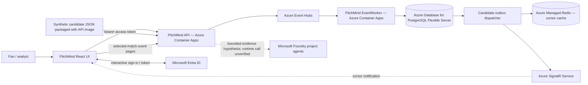
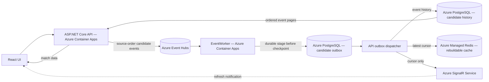
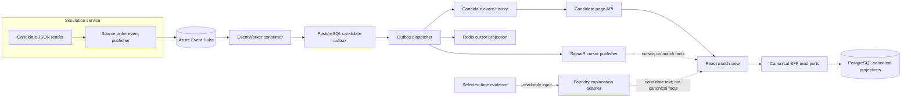
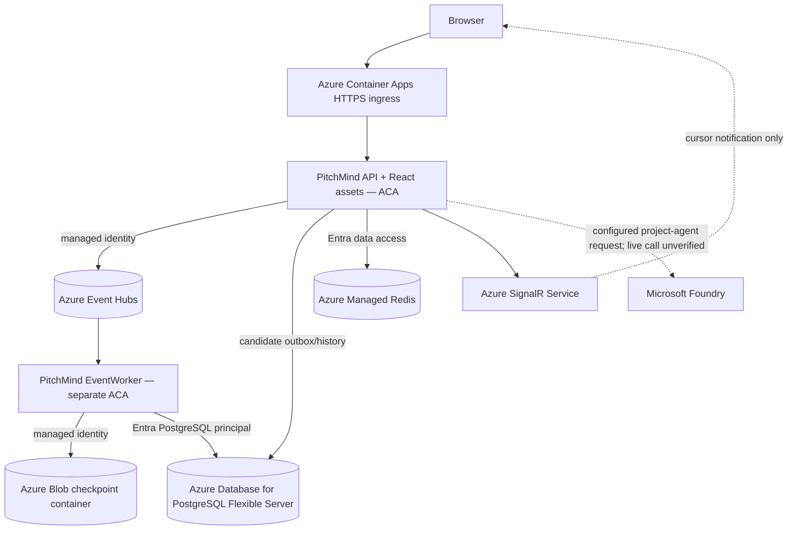

# PitchMind

Evidence-first football intelligence for match exploration and analysis. The application includes a DEV candidate-live path for visualizing source events; it does not treat the unvalidated feed as canonical football facts.

## Architecture at a glance

The C4 views below describe the **Azure DEV application path implemented in the repository**. They use Azure services only. The release template declares these resources, identities and settings, but the diagrams do not prove that every resource, network route, identity grant or runtime connection is healthy. Owner-supplied DEV screenshots show the candidate UI rendering source events and positions; see the [DEV integration status](docs/engineering/AZURE-DEV-LIVE-INTEGRATION-STATUS.md) for the evidence limits. LOCAL Docker topology is documented in the [local development guide](docs/engineering/M02-LOCAL-DEVELOPMENT.md).

### C4 Level 1 — System context



### C4 Level 2 — Azure DEV containers and data stores



### C4 Level 3 — Azure DEV application components



### C4 Level 4 — Azure DEV deployment boundary



### High-level application flow

1. The API-hosted Simulation Service reads the candidate JSON packaged in its image and publishes source-order events to Azure Event Hubs.
2. The separate EventWorker consumes Event Hubs, durably stages each raw envelope or poison record in the PostgreSQL candidate outbox, then advances the Blob checkpoint.
3. The API dispatcher writes candidate event history to PostgreSQL and updates the rebuildable Redis cursor; it publishes a cursor-only Azure SignalR notification after durable processing.
4. The UI reads ordered event pages and player-position fields from the API. SignalR prompts refresh; it does not carry match facts. PostgreSQL remains authoritative for persisted candidate records, which remain non-canonical.
5. The AI Analyst API can send bounded, selected-match source evidence to an allowlisted Foundry project agent and return a labeled hypothesis. Automatic per-event report generation, successful live Foundry calls, and a canonical multi-agent workflow are not established by available evidence.

The DEV release template declares Azure runtime settings, services, identities and roles. The supplied screenshots show the deployed UI rendering candidate events and positions, but do not prove each data-plane connection. Candidate source clock semantics, coordinate units and orientation, player metric definitions, event mappings, and football realism remain unverified; see the [DEV integration status](docs/engineering/AZURE-DEV-LIVE-INTEGRATION-STATUS.md).

## Run locally

Follow the [local infrastructure guide](docker/README.md) for the full setup and candidate-live walkthrough. Run each application process in its own terminal:

```bash
# Terminal 1: Docker dependencies and schema (LOCAL only)
./scripts/dev-up.sh
./scripts/dev-migrate.py
# Terminal 2
./scripts/start-local-api.sh
# Terminal 3
./scripts/start-local-eventworker.sh
# Terminal 4
npm --prefix frontend run dev -- --host 127.0.0.1
```

Open the Vite URL printed by the frontend command. LOCAL infrastructure uses Docker PostgreSQL, Redis and Kafka; Azure credentials are not required. DEV, STAGE and PRODUCTION use Azure services only.

## Project references

- [Architecture source documents and C4 details](docs/architecture/README.md)
- [API contract](docs/api/API.md)
- [Local development guide](docs/engineering/M02-LOCAL-DEVELOPMENT.md)
- [Simulation source profile and data-quality limits](docs/data/MANU-LIV-SOURCE-PROFILE.md)
- [Story execution register](docs/backlog/STORY-EXECUTION.md)
- [CI/CD pipelines](pipelines/README.md)
