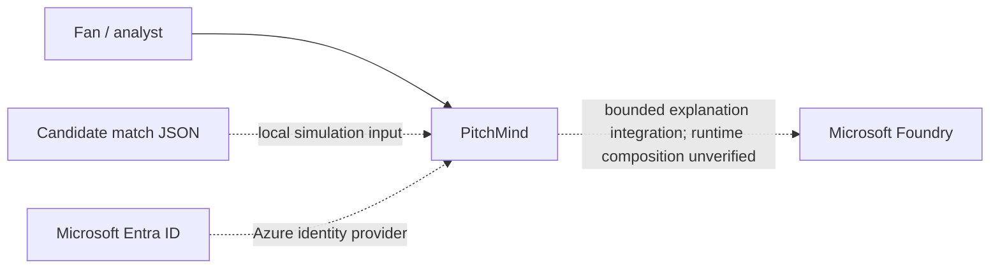
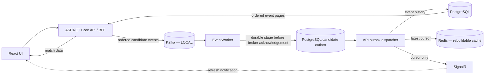
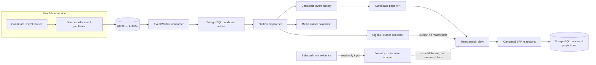
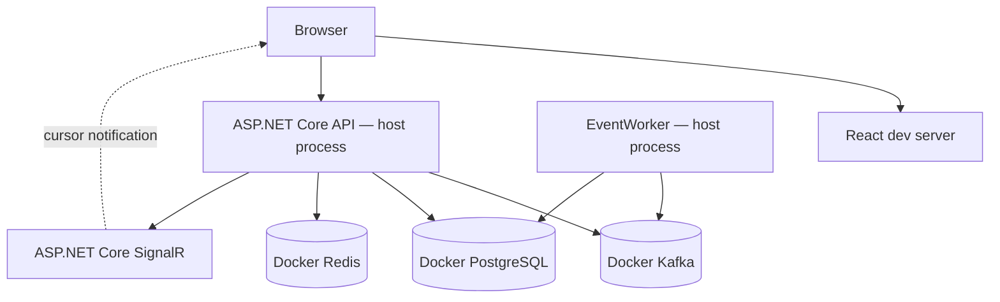

# PitchMind

Evidence-first football intelligence for match exploration and analysis. The local candidate-live path streams source events for visualization; it does not treat the unvalidated feed as canonical football facts.

## Architecture at a glance

The diagrams below summarize the implemented application boundaries. **LOCAL** is the runnable Docker-backed path. Azure adapters exist in code, but their end-to-end cloud configuration is not verified by these diagrams.

### C4 Level 1 — System context



### C4 Level 2 — Containers



### C4 Level 3 — Application components



### C4 Level 4 — Local deployment



### High-level application flow

1. The local Simulation Service reads the candidate JSON and publishes each source-ordered event to Kafka.
2. EventWorker stores the raw envelope in the PostgreSQL outbox before acknowledging it to Kafka.
3. The API dispatcher writes event history to PostgreSQL and updates the Redis cursor. It then sends a cursor-only SignalR notification.
4. The UI loads ordered event pages from the API/PostgreSQL path. SignalR prompts refresh; it does not carry match facts. Redis is a rebuildable projection, not the source of truth.
5. The candidate AI Analyst can request a source-bounded hypothesis from a configured Foundry project agent; its output is not canonical match truth. The local request path is implemented, while a successful live Azure Foundry call and a canonical multi-agent explanation workflow are not verified.

The Azure profile has adapters for Event Hubs, PostgreSQL identity, Redis and Azure SignalR. Provisioning, identity configuration, and end-to-end Azure verification are separate from this local flow. Candidate source clock semantics, coordinate units and orientation, player metric definitions, event mappings, and football realism remain unverified.

## Run locally

Follow the [local infrastructure guide](docker/README.md) for the full setup and candidate-live walkthrough. Run each application process in its own terminal:

```bash
# Terminal 1: Docker dependencies and schema
./scripts/dev-up.sh
./scripts/dev-migrate.py
# Terminal 2
./scripts/start-local-api.sh
# Terminal 3
./scripts/start-local-eventworker.sh
# Terminal 4
npm --prefix frontend run dev -- --host 127.0.0.1
```

Open the Vite URL printed by the frontend command. Local infrastructure uses Docker PostgreSQL, Redis and Kafka; Azure credentials are not required. Do not use local adapters in DEV, STAGE or PRODUCTION.

## Project references

- [Architecture source documents and C4 details](docs/architecture/README.md)
- [API contract](docs/api/API.md)
- [Local development guide](docs/engineering/M02-LOCAL-DEVELOPMENT.md)
- [Simulation source profile and data-quality limits](docs/data/MANU-LIV-SOURCE-PROFILE.md)
- [Story execution register](docs/backlog/STORY-EXECUTION.md)
- [CI/CD pipelines](pipelines/README.md)
