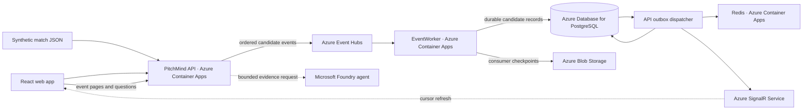

# PitchMind

**Football intelligence grounded in match evidence.** PitchMind is a hackathon demo that replays a synthetic Premier League-style match feed and makes its events easier to explore through a live timeline, player-position view, and match-scoped AI analysis.

## What the demo shows

- Follow a simulated Manchester United–Liverpool match, its score, event timeline, and player positions.
- Pause, resume, or reset the synthetic feed.
- Ask the AI Analyst about persisted events available at a selected source time.
- Explore a guest-accessible DEV demo; signed-in access is separate from the guest demo.

**Evidence boundary:** The supplied feed is synthetic and has not been validated as canonical football data. Event meanings, clock semantics, coordinate units, player metrics, and football realism are unverified. AI output is a source-bounded hypothesis, not a verified match fact. The UI's local tactical discussion helper is illustrative and is not generated by a Foundry agent.

## Azure architecture



PostgreSQL stores the candidate event history; Redis holds a rebuildable cursor; SignalR sends refresh hints while the browser fetches event data from the API. Candidate records remain separate from canonical match data. The API sends bounded evidence to a selected Foundry agent and validates the response and cited event IDs.

The project also uses Microsoft Entra ID for signed-in access and workload identity, Azure Container Registry for images, and Azure DevOps for CI/CD. The current DEV inventory, service responsibilities, and cost caveats are in the [DEV integration status](docs/engineering/AZURE-DEV-LIVE-INTEGRATION-STATUS.md). Resource presence and code implementation do not establish runtime health.

## Run locally

LOCAL uses Docker PostgreSQL, Redis, and Kafka, with the API, EventWorker, and frontend started separately. From the repository root:

```bash
./scripts/dev-up.sh
./scripts/dev-migrate.py
./scripts/start-local-api.sh
./scripts/start-local-eventworker.sh
npm --prefix frontend run dev -- --host 127.0.0.1
```

Run each long-lived command in its own terminal, then open the Vite URL printed by the frontend. See [local development setup](docs/engineering/M02-LOCAL-DEVELOPMENT.md) for prerequisites and troubleshooting.

## Project documentation

- [Architecture guide](docs/architecture/README.md) — C4 views, Azure deployment, and football domain design
- [Azure and Microsoft Foundry technology guide](docs/architecture/AZURE-AND-FOUNDRY-TECHNOLOGIES.md)
- [AI agent instructions and football knowledge](docs/ai/FOUNDRY-TACTICAL-AGENT-PACK.md) — prompt pack, agent roles, and grounding constraints
- [API contract](docs/api/API.md)
- [Candidate feed and data boundaries](docs/data/SIMULATION-FEED-CONTRACT.md)
- [DEV runtime status and release verification](docs/engineering/AZURE-DEV-LIVE-INTEGRATION-STATUS.md)
- [Azure DevOps pipeline](pipelines/README.md)
- [Infrastructure](infra/README.md)
- [Cost assumptions](docs/cost/COST-ASSUMPTIONS.md)

## Delivery status

Azure DevOps is configured for validation and guarded DEV delivery using a self-hosted Mac agent. The agent is currently stopped, so pipeline jobs need the agent started before they can run. `enableDevDelivery` defaults to `true`; review the pipeline parameters and release gates before queueing. A successful validation run alone does not mean the application was deployed. See the [pipeline guide](pipelines/README.md).
