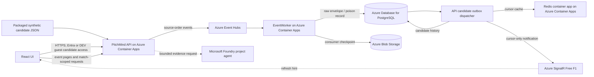

# PitchMind

PitchMind is an evidence-first football match demo. It replays a synthetic Manchester United–Liverpool event feed, shows source events and player positions, and provides a match-scoped AI analyst interface. The feed is a candidate source: its clock, event meanings, coordinates, and football realism have not been validated as canonical match facts.

## Demo experience

- **Home and Match:** select the demo match, follow its score and event timeline, pause/resume replay, and inspect source player positions on the pitch.
- **Teams and Players:** browse match-related team and player views exposed by the API. Values derived from the candidate feed inherit its unverified status.
- **Insights:** inspect evidence-backed data when the selected match has canonical records; unavailable canonical data is not replaced with a synthetic canonical fixture.
- **AI Analyst:** ask a match-scoped question using persisted source events and choose one of the project's configured agents. Responses, when available, are hypotheses and not verified match facts. Recent DEV analyst requests have returned `503 ANALYST_UNAVAILABLE`; a successful live response is not currently claimed.

The UI's locally computed tactical discussion helpers are illustrative client-side analysis, not responses from Azure AI agents. The server-side candidate analyst endpoint is the Foundry integration boundary.

## Azure DEV architecture

The current DEV candidate-feed path is distinct from the proposed canonical football-ingestion target.



The UI reads event pages from the API; SignalR carries a refresh cursor rather than match facts. PostgreSQL candidate tables hold persisted source records. Redis is a rebuildable cursor cache. Candidate records are separate from canonical match tables. Service Bus is provisioned in DEV but is not part of this candidate live-feed path. Azure Managed Redis is an optional infrastructure parameter, not the Redis service currently reported by the deployed DEV inventory.

The full deployed event path is not currently verified end to end. Recent owner-supplied DEV calls reported dependency failures for clear-data/replay and `503 ANALYST_UNAVAILABLE` for Foundry analysis; see the dated [integration status](docs/engineering/AZURE-DEV-LIVE-INTEGRATION-STATUS.md). The code path describes the intended behavior, not proof that the current DEV revision completed it.

### DEV services and cost notes

DEV currently includes Azure Container Apps, Azure Event Hubs Standard, Azure Database for PostgreSQL Flexible Server, Blob Storage, a Redis container app, Azure SignalR Free F1, Microsoft Foundry, Azure AI Search Serverless, Azure Container Registry Basic, Key Vault, Log Analytics, Service Bus Standard, VNet/private DNS, and managed identities. Free allowances are limited and shared or usage-dependent; PostgreSQL, Event Hubs, registry, storage, AI inference/search, private endpoints, and other metered services can incur charges. See [DEV runtime and current inventory](docs/engineering/AZURE-DEV-LIVE-INTEGRATION-STATUS.md) and [cost assumptions](docs/cost/COST-ASSUMPTIONS.md). Inventory is not a bill or a guarantee that every integration is healthy.

## Local development

LOCAL uses Docker PostgreSQL, Redis, and Kafka plus local API, EventWorker, and frontend processes. DEV, STAGE, and PROD use Azure profiles. See [local setup](docs/engineering/M02-LOCAL-DEVELOPMENT.md).

```bash
./scripts/dev-up.sh
./scripts/dev-migrate.py
./scripts/start-local-api.sh
./scripts/start-local-eventworker.sh
npm --prefix frontend run dev -- --host 127.0.0.1
```

Run each long-lived command in a separate terminal. Open the Vite URL it prints.

## Technical documentation

- [C4 architecture and Azure HLD/LLD](docs/architecture/README.md)
- [Current Azure DEV inventory and integration status](docs/engineering/AZURE-DEV-LIVE-INTEGRATION-STATUS.md)
- [API contract](docs/api/API.md)
- [Candidate feed contract and source profile](docs/data/SIMULATION-FEED-CONTRACT.md)
- [Azure DevOps pipeline](pipelines/README.md)
- [Infrastructure](infra/README.md)
- [Cost assumptions](docs/cost/COST-ASSUMPTIONS.md)

## CI/CD

Azure DevOps is the configured CI/CD orchestrator and uses a self-hosted agent in the `Default` pool. `enableDevDelivery` currently defaults to `true` in YAML, but delivery remains subject to service-connection availability, the reviewed infrastructure plan, and Azure DevOps environment approvals. A successful validation run alone does not prove a deployment occurred. See [pipeline setup and gates](pipelines/README.md).
