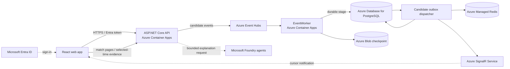

# PitchMind

**Evidence-first football intelligence for exploring a match as it unfolds.** PitchMind brings match events, player positions, replay and tactical questions into one workspace. Its demo uses an owner-approved synthetic Manchester United–Liverpool feed; candidate data is clearly distinguished from verified, canonical match facts.

## Hackathon demo

1. Open the match workspace and select the available candidate match.
2. Follow the event timeline and player positions on the pitch as the feed advances.
3. Pause live playback or move the replay control to inspect an earlier source time.
4. Ask the Match Analyst a question about the selected match evidence. Responses are intended to be bounded hypotheses, not authoritative facts.

**What to look for:** source event sequence and clock, changing player positions, selected-time replay, and the distinction between observed source data and verified analysis. The synthetic feed's clock semantics, coordinate orientation/units, metric definitions and event mappings are still being validated. Do not interpret it as real match data.

## Azure architecture

The DEV target runs on Azure services. Local development has a separate Docker-based topology.



**Flow:** the API-hosted simulation publishes source-order events to Event Hubs. The EventWorker stages raw candidate records in PostgreSQL before advancing its Blob checkpoint. The API dispatcher persists candidate history, refreshes the Redis cursor and sends cursor-only SignalR notifications. The UI obtains match facts and event pages from the API; SignalR prompts a refresh and does not carry facts. PostgreSQL is the canonical store for admitted football data; this demo's candidate records remain separate and non-canonical.

The diagram describes the intended Azure DEV service path in the repository. It is not evidence that the deployed Azure resources, identities, network routes or end-to-end runtime are healthy. The latest recorded cloud inventory is historical; see [DEV integration status](docs/engineering/AZURE-DEV-LIVE-INTEGRATION-STATUS.md) for the dated evidence and outstanding checks.

## AI and data boundaries

- Microsoft Foundry agents can explain bounded match evidence. They must not create or alter canonical football facts.
- The project contains tactical and specialist agents, including `TacticalAnalyst`, `HighPressAnalyst`, `DefensiveStructureAnalyst`, `TransitionStrategist`, `SetPieceStrategist`, `MatchStateStrategist`, `GoalkeeperAnalyst`, `ChanceCreationAnalyst` and `CoachFrameworkAnalyst`.
- A successful live Foundry response and automatic AI reports for every hot event have **not** been verified. The demo should not be described as providing those capabilities until a cloud end-to-end run proves them.
- Candidate feed provenance and redistribution permission are owner-confirmed. Football semantics and realism checks remain open; the feed is not canonical truth.

## Current status at a glance

| Area | Status |
| --- | --- |
| Match UI, candidate timeline, replay and pitch positions | Rendered in owner-supplied DEV screenshots (builds 68/69, 20 Oct 2026) |
| Azure Event Hubs → worker → PostgreSQL → Redis → SignalR path | Declared in code/release topology; complete cloud runtime path not verified |
| DEV authentication | A supplied browser capture showed `401` with an invalid/null token audience; authenticated service access needs validation |
| Match-scoped AI answer | UI/API flow exists; successful live Foundry generation not evidenced |
| Canonical match facts from candidate feed | Not available; feed remains non-canonical |

## Run locally

See the [local infrastructure guide](docker/README.md) for setup and troubleshooting. Start the processes in separate terminals:

```bash
# Terminal 1: Docker dependencies and schema (LOCAL only)
./scripts/dev-up.sh
./scripts/dev-migrate.py

# Terminal 2
./scripts/start-local-api.sh

# Terminal 3
./scripts/start-local-eventworker.sh

# Terminal 4
npm --prefix frontend run dev -- --host 127.0.0.1
```

Open the URL printed by Vite. LOCAL uses Docker PostgreSQL, Redis and Kafka. DEV, STAGE and PRODUCTION are Azure-only.

## CI/CD and deployment safety

Azure DevOps builds and tests the application, produces an immutable image and validates Bicep. DEV delivery is gated by a reviewed what-if plan and protected approvals. Pipeline configuration does not mean a release has completed. Do not apply infrastructure or deploy a DEV revision without approval for the exact reviewed changes.

## Project guide

- [Azure architecture and C4 views](docs/architecture/README.md)
- [Azure DEV implementation and evidence](docs/engineering/AZURE-DEV-LIVE-INTEGRATION-STATUS.md)
- [API contract](docs/api/API.md)
- [Candidate feed profile and validation limits](docs/data/MANU-LIV-SOURCE-PROFILE.md)
- [Local development guide](docs/engineering/M02-LOCAL-DEVELOPMENT.md)
- [CI/CD pipeline guide](pipelines/README.md)
- [Hackathon MVP stories](docs/backlog/HACKATHON-MVP-EPICS.md)
