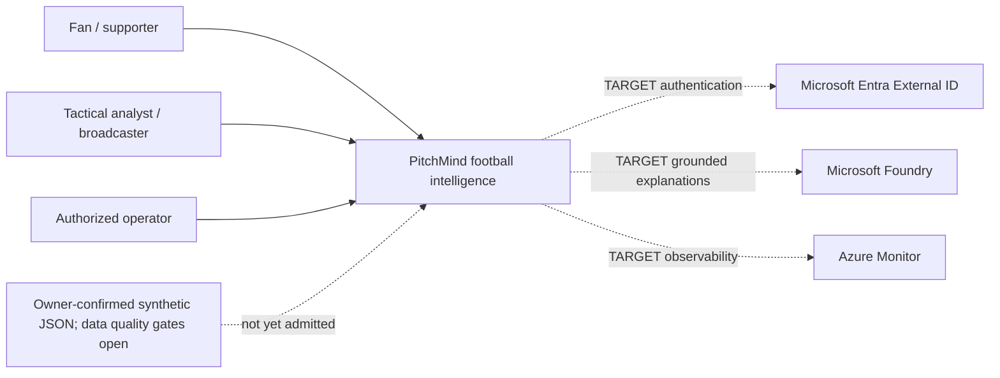
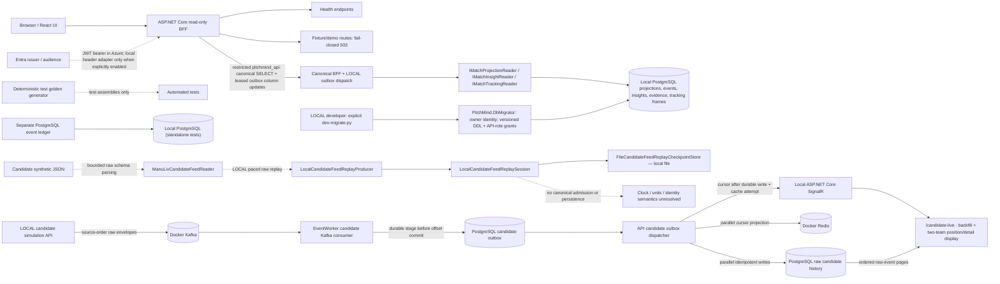
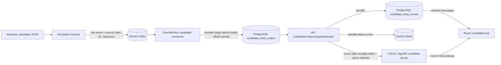
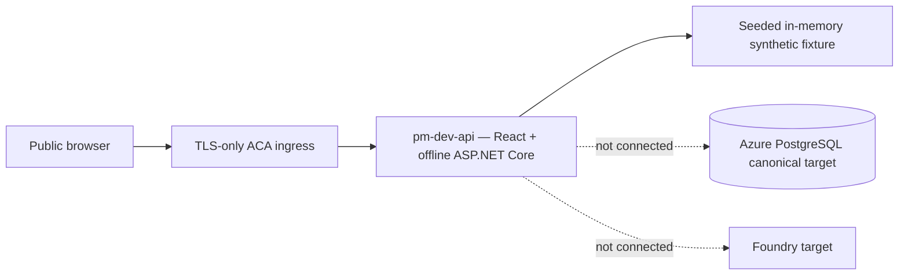

# PitchMind

Azure-native football intelligence, rebuilt from an evidence-first architecture.

**Status:** The local workstation stack is available; match reads remain unavailable until validated source admission and canonical PostgreSQL read composition are implemented. Azure ingestion, Foundry and production certification remain incomplete. See [story execution evidence](docs/backlog/STORY-EXECUTION.md) for verified scope and outstanding gates.

## Start here
- [28 Engineering Council skills and G0–G9 operating model](docs/operating-model/README.md)
- [All 59 stories — routed dependencies and skill owners](docs/operating-model/ALL-STORIES-EXECUTION-ROADMAP.md)
- [Source JSON structural audit and unresolved rights/unit gates](docs/operating-model/SIMULATION-DATA-ADMISSION.md)
- [Engineering Council: all 59 stories execution programme](docs/engineering/COUNCIL-EXECUTION-PLAN.md)
- [59 story HLD/LLD work packets](docs/backlog/STORY-WORKPACK-INDEX.md)
- [Azure target HLD](docs/architecture/06-target-azure-hld.md)
- [Football analytics detailed LLD](docs/architecture/07-football-analytics-detailed-lld.md)
- [Simulation JSON onboarding — source present, not yet certified](docs/data/SIMULATION-FEED-CONTRACT.md)
- [Frontend seven-screen requirements](docs/engineering/FRONTEND-SCREEN-CONTRACTS.md)
- [Five frontend design skills — Taste, Impeccable, Emil, Vercel & Awesome](docs/design/FRONTEND-DESIGN-DELIVERY.md)
- [Quality/release gates](docs/engineering/QA-RELEASE-GATES.md)
- [Architecture and C4](docs/architecture/README.md)
- [Architecture decision records](docs/adr/README.md)
- [MVP backlog and gates](docs/backlog/MVP-BACKLOG.md)
- [Infrastructure](infra/README.md)
- [Azure Pipelines](pipelines/README.md)
- [Story execution register](docs/backlog/STORY-EXECUTION.md)
- [Football low-level design](docs/architecture/05-football-lld.md)
- [Consolidated API contract](docs/api/API.md)

## Run the local workstation

Requires .NET 10 and Node 22+. No Azure credentials are required for local development. For PostgreSQL/Redis local services, Docker Desktop with Compose v2, and first-run/teardown instructions, see [local workstation guide](docs/engineering/M02-LOCAL-DEVELOPMENT.md).

The local API requires `DOTNET_ENVIRONMENT=Development`, `ASPNETCORE_ENVIRONMENT=Development`, and `Runtime__Profile=local`. Match data currently reports unavailable because validated feed admission and canonical PostgreSQL read composition are not implemented. The application does not serve the earlier synthetic match or deterministic explanation.

```bash
./scripts/dev-up.sh
./scripts/dev-health.sh
Runtime__Profile=local DOTNET_ENVIRONMENT=Development ASPNETCORE_ENVIRONMENT=Development dotnet run --project src/PitchMind.Api --urls http://127.0.0.1:5080
# In a second terminal
cd frontend
npm ci
npm run dev
```

From the repository root, `./scripts/dev-health.sh http://127.0.0.1:5080` verifies API readiness with the Docker services. `./scripts/dev-api-health.sh` checks API readiness by itself.

Stop services while preserving local data with `./scripts/dev-down.sh`. To delete the local PostgreSQL and Redis data volumes, use `./scripts/dev-reset.sh` and confirm by typing `RESET`.

Open the Vite URL. The current application reports match data unavailable because validated feed admission and canonical PostgreSQL read composition are not implemented. It does not serve the earlier synthetic match or deterministic explanation.

The combined frontend/API image uses the repository root as its build context:

```bash
docker build -f docker/Dockerfile -t pitchmind:dev .
docker run --rm -p 127.0.0.1:5081:8080 -e DOTNET_ENVIRONMENT=Development -e ASPNETCORE_ENVIRONMENT=Development -e Runtime__Profile=local pitchmind:dev
python3 scripts/api-smoke.py http://127.0.0.1:5081
```

Open `http://127.0.0.1:5081` for the same-origin application. PostgreSQL integration verification is described in [event ledger](docs/data/CANONICAL-EVENT-LEDGER.md); the offline fixture UI does not read that ledger yet.

## Engineering constraints
- Local: Docker Compose and local emulators/adapters; no required Azure account to run domain tests.
- DEV/STAGE/PROD: Azure services only; no Ollama, local Redis or local PostgreSQL.
- GitHub hosts source; Azure DevOps Pipelines owns CI/CD.
- PostgreSQL is canonical; Redis, AI Search and Data Explorer are projections or ephemeral state.
- AI-generated claims require evidence validation.
- `PitchMind_Old` is read-only reference material; do not bulk-copy code.

## Engineering Council delivery hold
The 59 stories have **work packets and a dependency-driven plan**, but are **not all implemented**. The owner-supplied `data/simulations/manu-liv-match-dataset.json` arrived on `main` after the initial review (commit `b978254`). It has 2,199 ordered events and event-attached player positions; see the [source profile](docs/data/MANU-LIV-SOURCE-PROFILE.md). The owner confirmed synthetic provenance and redistribution permission. Source clock/period semantics, coordinate units/orientation, player metric meanings, canonical event mappings and football realism remain unresolved. The test-only golden generator is not part of production C#; match reads remain fail-closed until canonical PostgreSQL admission and a revisioned read port are implemented. The generated candidate dictionary and quality audit describe observed values only; neither certifies football correctness or field meaning. **Do not deploy to Azure DEV without asking and obtaining explicit approval for the exact proposed changes.**

### Source and release truth (Council update)
The file `data/simulations/manu-liv-match-dataset.json` is committed and structurally profiled (2,199 records). The owner confirmed synthetic provenance and redistribution permission, while independent rights/privacy review remains pending. The candidate is **not** imported into the match API. Clock and coordinate semantics, player metrics, identity mapping and football realism remain unresolved. Production C# and React do not serve fixture facts; deterministic golden fixtures are test-only. See the role skill index and Story Execution Routing for implementation owners. **Always ask the repository owner to approve the exact DEV change before deploying; PR merge or pipeline resume is not consent.**

## AI-assisted engineering and CodeGraph

For concurrent story implementation and safe integration, see the [59-story execution directive](docs/operating-model/AI-EXECUTION-DIRECTIVE.md) and [optional CodeGraph MCP integration](docs/engineering/CODEGRAPH-INTEGRATION.md). The repository includes `.vscode/mcp.json` and a read-only `bash scripts/codegraph-pr-context.sh` helper; install the CodeGraph engine locally before use. Azure DevOps remains the sole CI/CD orchestrator, and no Azure resource changes are authorized by this tooling.

## Current C4 architecture

These diagrams summarize the currently implemented and observed architecture in C4 order. Solid paths show code or recorded deployment evidence; dashed paths and labels identify unavailable or target capabilities. The detailed, maintained sources are [C4 Level 1](docs/architecture/01-system-context.md), [Level 2](docs/architecture/02-container.md), [Level 3](docs/architecture/03-components.md), and [Level 4](docs/architecture/04-deployment.md).

### C4 Level 1 — System context



### C4 Level 2 — Containers and data flow



### C4 Level 3 — Candidate stream components



### C4 Level 4 — Observed DEV deployment



The Level 4 diagram records the limited previously observed DEV prototype; it is not evidence that the target Azure data plane is connected. See [deployment boundaries and evidence](docs/architecture/04-deployment.md) for the full distinction.
