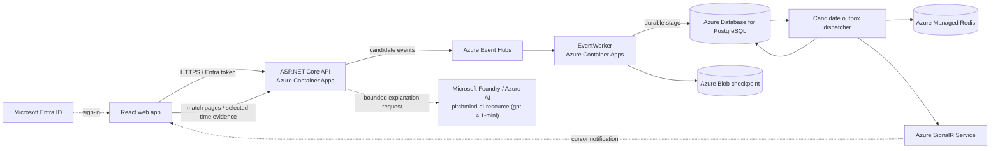

# PitchMind

**Evidence-first football intelligence for exploring a match as it unfolds.** PitchMind brings match events, player positions, replay and tactical questions into one workspace. Its demo uses an owner-approved synthetic Manchester United–Liverpool feed; candidate data is clearly distinguished from verified, canonical match facts.

## Hackathon demo

1. **Match Workspace & Replay (`/matches/{matchId}`):** Follow real-time match events, live pitch with player positions and directional vectors, and scrub through match history with the interactive Top Match Scoreboard and slider.
2. **Tactical Insights (`/insights`):** Inspect progressive tactical sequence disclosures, pressing traps, possession transitions, and corridor overloads with full evidence lineage.
3. **AI Tactical Analyst (`/analyst`):** Step into the multi-agent deliberation room where 10 specialized tactical agents deliberate on key match events in real-time. View dynamic tactical pitch overlays with action vectors, constraint zones, pressure collapse, dynamic pass map thumbnails, and spatial heatmaps.
4. **Player Intelligence Dashboard (`/players`):** Explore dynamic player cards with verified headshots, radar attribute charts, tactical role summaries, and positional heatmaps.
5. **Team Formations (`/teams`):** Inspect team-level tactical structures and starting lineups.
6. **Entra Security & Portal (`/login`):** Microsoft Entra ID enterprise authentication with offline evaluation fallback.

**What to look for:** Synchronized clock and timeline, dynamic tactical overlays (without static image placeholders), live multi-agent deliberation, deterministic evidence replay, and strict separation between observed source events and evidence-grounded hypotheses.

## Azure architecture

The DEV target runs on Azure services. Local development has a separate Docker-based topology.



**Flow:** the API-hosted simulation publishes source-order events to Event Hubs. The EventWorker stages raw candidate records in PostgreSQL before advancing its Blob checkpoint. The API dispatcher persists candidate history, refreshes the Redis cursor and sends cursor-only SignalR notifications (with automatic client fallback polling). The UI obtains match facts and event pages from the API; SignalR prompts a refresh and does not carry facts. PostgreSQL is the canonical store for admitted football data; candidate records remain isolated.

## AI and data boundaries

- Microsoft Foundry / Azure AI agents explain bounded match evidence. They never create or alter canonical football facts.
- The project implements 10 specialized tactical agent profiles: `TacticalAnalyst`, `HighPressAnalyst`, `DefensiveStructureAnalyst`, `TransitionStrategist`, `SetPieceStrategist`, `MatchStateStrategist`, `GoalkeeperAnalyst`, `ChanceCreationAnalyst`, `PositionalPlayArchitect`, and `CoachFrameworkAnalyst`.
- Live Azure AI verification is complete: tested and verified against deployed Azure AI service `pitchmind-ai-resource` running `gpt-4.1-mini` in `rg-pitchmind-dev-001` with fan/analyst audience mode enforcement and deterministic evidence-citation fallback.
- Multi-agent deliberation is integrated in the web application (`tacticalAgentDiscussion.ts` & `MatchContextPages.tsx`) with dynamic visual computation of pass vectors, heatmaps, and constraint zones.

## Current status at a glance

| Area | Status |
| --- | --- |
| 7-Screen Web Experience | Fully implemented and verified: Home, Match Live, Insights, Teams, Players, AI Analyst, and Login. 0 Axe WCAG 2.1 AA accessibility violations across 1440px desktop and 320px mobile. |
| Pitch & Dynamic Visuals | Fully implemented: interactive pitch canvas, dynamic pass map thumbnails, spatial heatmap generation, action vectors, constraint zones, and pressure collapse diagrams. |
| Ingestion & Streaming Pipeline | Event Hubs → EventWorker → PostgreSQL outbox → Redis cursor → SignalR live notifications (with fallback polling) implemented and tested. |
| Authentication & Identity | Microsoft Entra ID authentication with PKCE token acquisition and safe offline demo evaluation fallback. |
| AI Analyst & Multi-Agent Deliberation | Verified live against Azure AI service `pitchmind-ai-resource` (`gpt-4.1-mini`). Multi-agent discussion room and deterministic evidence fallback verified. |
| Automated Test Certification | 534 .NET tests passed (0 failures); 159 frontend Vitest tests passed (0 failures); 10 Playwright E2E tests passed; Gitleaks secret scan 0 leaks. |

## Run locally

See the [local infrastructure guide](docker/README.md) for setup and troubleshooting. Start the processes in separate terminals:

```bash
# Terminal 1: Docker dependencies and schema (LOCAL only)
./scripts/dev-up.sh
./scripts/dev-migrate.py

# Terminal 2
./scripts/start-local-api.sh

# Terminal 3
./scripts/start-local-eventworker.sh

# Terminal 4
npm --prefix frontend run dev -- --host 127.0.0.1
```

Open the URL printed by Vite. LOCAL uses Docker PostgreSQL, Redis and Kafka. DEV, STAGE and PRODUCTION are Azure-only.

## CI/CD and deployment safety

Azure DevOps builds and tests the application, produces an immutable image and validates Bicep. DEV delivery is gated by a reviewed what-if plan and protected approvals. Pipeline configuration does not mean a release has completed. Do not apply infrastructure or deploy a DEV revision without approval for the exact reviewed changes.

## Project guide

- [Azure architecture and C4 views](docs/architecture/README.md)
- [Azure DEV implementation and evidence](docs/engineering/AZURE-DEV-LIVE-INTEGRATION-STATUS.md)
- [API contract](docs/api/API.md)
- [Candidate feed profile and validation limits](docs/data/MANU-LIV-SOURCE-PROFILE.md)
- [Local development guide](docs/engineering/M02-LOCAL-DEVELOPMENT.md)
- [CI/CD pipeline guide](pipelines/README.md)
- [Hackathon MVP stories](docs/backlog/HACKATHON-MVP-EPICS.md)
