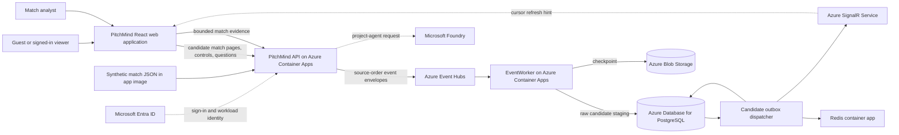

# C4 Level 1 — PitchMind system context

This view describes the current candidate-feed demo. The feed is synthetic and non-canonical. Arrows show the intended application path in source/configuration; current runtime health must be checked separately in the [DEV integration status](../engineering/AZURE-DEV-LIVE-INTEGRATION-STATUS.md).

## Product and data boundary

The candidate journey starts, pauses, and replays source records; reads persisted event pages; and displays source player-position fields. Those raw records are stored in candidate tables and are not admitted into canonical match tables. Their event semantics, clock, coordinates, and player metrics remain unvalidated. Canonical BFF routes read only already-admitted canonical records and fail closed when those records or dependencies are unavailable.

The candidate analyst API can pass a bounded, selected-time packet to an allowlisted Foundry project agent and validate the returned JSON and citation IDs. The result is a hypothesis, not a canonical insight. Recent DEV requests have returned `503 ANALYST_UNAVAILABLE`; the code path exists, but the current successful cloud invocation is not verified. The separate tactical discussion helper in the browser computes illustrative text locally and must not be described as an Azure-agent response.

## Service and evidence status

- The current Azure inventory reports a Redis **Container App** (`pm-dev-redis-cache`, image `redis:7-alpine`), not Azure Managed Redis. The private DEV Bicep template can optionally provision Azure Managed Redis, but `provisionRedis` defaults to false.
- Azure resources being present and adapters being implemented do not establish end-to-end health. Resource inventory, source configuration, and runtime probes are separate evidence.
- LOCAL uses Docker PostgreSQL, Kafka, and Redis; those adapters are not part of the Azure DEV context. See [local development](../engineering/M02-LOCAL-DEVELOPMENT.md).

See the [C4 Level 2](02-container.md), [components](03-components.md), [deployment view](04-deployment.md), [Azure HLD](06-target-azure-hld.md), and [API contract](../api/API.md).
