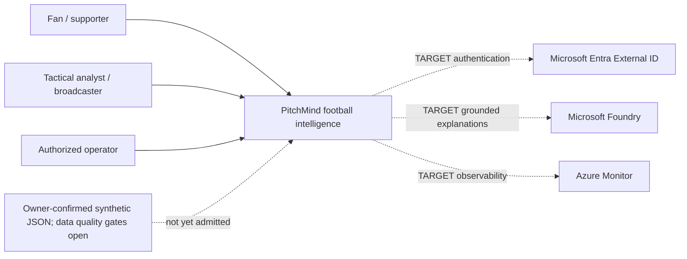

# C4 Level 1 — PitchMind system context

**Reality labels:** **OBSERVED** = executable offline source path and recorded previous Azure DEV demo. **TARGET** = capabilities to be implemented and certified. The [architecture review](../engineering/ARCHITECTURE-REVIEW-2026-10-08.md) and [source profile](../data/MANU-LIV-SOURCE-PROFILE.md) identify current blockers. This diagram is not deployment evidence.

## Product journey and scope
Discover simulated fixture → time-consistent score, match state and pitch → evidence-supported tactical key moment → **Show me why** → replay cited events/observed frames → grounded fan/analyst explanation with deterministic fallback.

## Trust and provenance boundaries
- The 28.6 MB `data/simulations/manu-liv-match-dataset.json` has owner-confirmed synthetic provenance and redistribution permission, but **has not passed semantic or football-quality validation and is not canonically imported**. It includes real club/player names and unverified performance/biometric-like attributes; label it synthetic and do not present those metrics as fact.
- Football truth comes only from validated input and deterministic, versioned derivation; the frontend and model cannot manufacture it.
- Current match API routes fail closed with `503 MATCH_DATA_UNAVAILABLE` until API route composition is replaced with a canonical, revisioned PostgreSQL-backed read port. No claim Entra or Foundry is currently active.
- Separate service roles for simulation import, event worker, BFF reads and evidence-only Foundry tools, with least privilege. A PR/diagram does not authorize DEV deployment.
