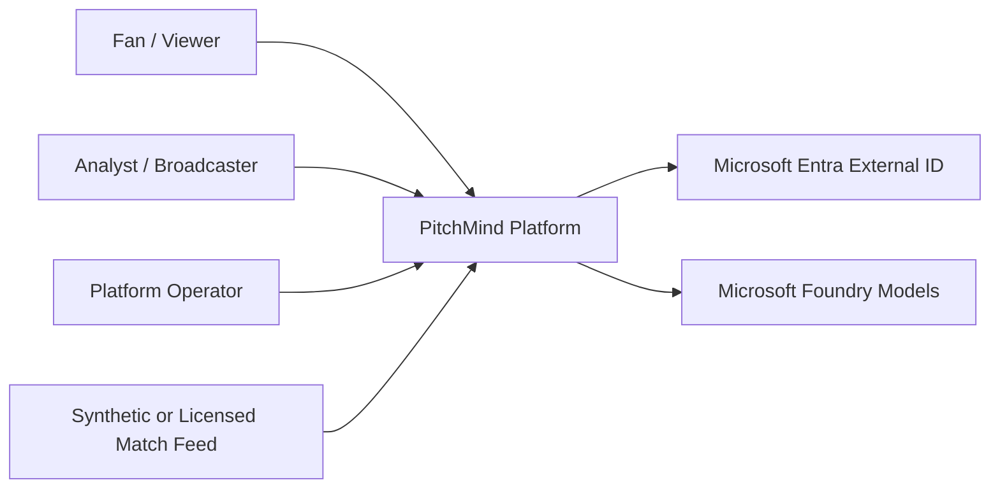

# C4 L1 — System Context

## External boundaries
- Feed content is untrusted, schema-versioned and provenance-tagged.
- Users authenticate via an external identity provider; application enforces authorization.
- Foundry supplies candidate language, not football truth.
- Only authorized roles can request exports, replay or administrative recovery.

## MVP journey
Synthetic match → ingestion → match state → press trigger / response / exploitation / outcome → evidence → live pitch and replay → grounded AI explanation with deterministic fallback.
