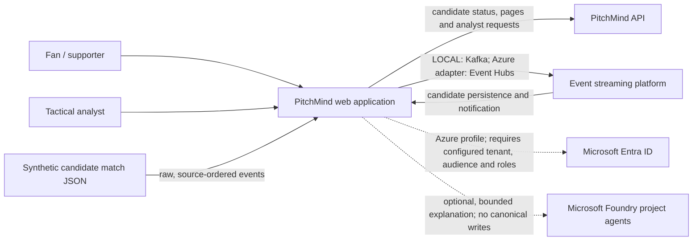

# C4 Level 1 — PitchMind system context

This view describes **CURRENT** product boundaries: solid lines show code paths present in the repository; dashed lines show optional integrations not yet cloud-verified. It does not depict the full **TARGET** canonical Azure ingestion/explanation design; see [Azure HLD](06-target-azure-hld.md). See [C4 Level 2](02-container.md), [component design](03-components.md), [deployment view](04-deployment.md), and the [source profile](../data/MANU-LIV-SOURCE-PROFILE.md).

## Product and data boundary

The implemented live demonstration is a **candidate-feed** journey: the UI starts or pauses a source replay, reads persisted raw candidate events and player-position fields, and uses SignalR cursor notifications to refresh its PostgreSQL-backed page. It labels this data non-canonical. It does not convert the candidate source clock or coordinates into verified football semantics.

The separate canonical BFF reads persisted match projections, events, insights, evidence and tracking frames. Canonical match routes do not substitute the candidate JSON or test fixtures; they return unavailable when the required canonical read adapter or data is not available. A candidate AI answer is a source-bounded hypothesis and is not a canonical insight.

## Trust and integration status

- The source JSON has owner-confirmed synthetic provenance and redistribution permission. Independent domain validation is still required for clock/period semantics, coordinate units and orientation, player-metric meanings, event mapping and football realism. See the [source admission record](../operating-model/SIMULATION-DATA-ADMISSION.md).
- Local simulation uses Docker Kafka, PostgreSQL and Redis with the API and EventWorker. Azure Event Hubs, PostgreSQL managed-identity access, Redis, and SignalR adapters are in code; current resource configuration and an end-to-end Azure run must be verified separately. See [DEV live integration status](../engineering/AZURE-DEV-LIVE-INTEGRATION-STATUS.md).
- The candidate analyst route can call an allowlisted Foundry project agent when configured. The API constrains input evidence and validates response shape and citation membership. This does not prove semantic entailment. The separate `AgentWorker` has no request/message consumer; canonical Foundry explanation orchestration is not a live product flow.
- Match truth comes from admitted canonical records and deterministic, versioned derivation. Neither the frontend nor a model can establish a score, event, player action or tactical cause.
