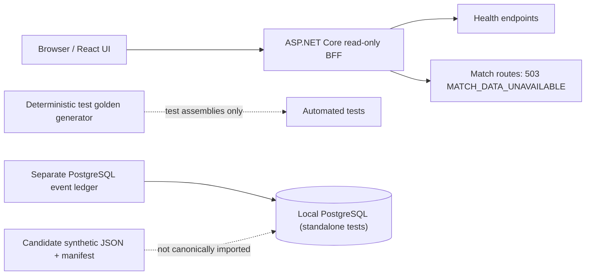
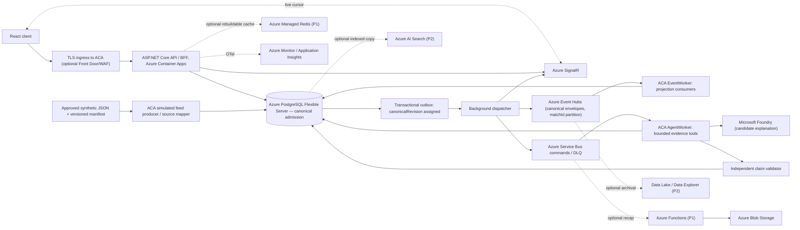

# C4 Level 2 — PitchMind containers and data-plane boundaries

**Legend:** Solid arrows under **CURRENT** are backed by existing implementation or recorded demo behavior. **TARGET** describes the desired Azure-only deployment and is **not verified as an integrated cloud path**. **OPTIONAL** is feature/cost gated. [Target HLD](06-target-azure-hld.md) | [Observed limitations](../engineering/ARCHITECTURE-REVIEW-2026-10-08.md) | [Azure deployment evidence](../engineering/evidence/2026-10-08-DEV-DEPLOYMENT.md).

## CURRENT — process health with match routes fail-closed (no canonical ingest)

The current PostgreSQL adapter persists `MatchEvent` but does **not** provide match frames, projections, evidence or a transactional outbox. Ordinary match reads return `503 MATCH_DATA_UNAVAILABLE`; the analyst endpoint may return `429` when rate-limited before its handler. Enabling match reads requires replacing API route composition with a canonical, revisioned read port backed by admitted PostgreSQL data. Registering `SyntheticMatchService` cannot enable these routes. The former generated scenario now exists only in test assemblies. The candidate JSON has owner-confirmed synthetic provenance and redistribution permission, but its time policy, coordinate units/orientation, player metrics, canonical event mappings and football realism remain unverified; it is not yet imported.

## TARGET — canonical Azure platform

**Non-negotiable contract:** Event Hubs is **at-least-once** telemetry; service-side `MatchId + EventId + Sequence + payload hash` and PostgreSQL transaction establish correctness. Service Bus is asynchronous command transport, not an event-ledger replacement. SignalR carries revision/cursor notifications, not canonical truth. Redis, Search and Data Explorer are rebuildable projections. Foundry may suggest words but cannot change score, event IDs or detector evidence. The BFF enforces selected-time and authorization on every read.

Only PostgreSQL-admitted records receive a positive per-match `canonicalRevision`; its transaction commits the canonical record and outbox intent together. The outbox publishes the canonical envelope with that revision. Raw source candidates have no canonical revision and do not use the canonical Event Hubs envelope.

**Environment mapping:** LOCAL Docker PostgreSQL + local event/AI adapters through ports; Azure DEV/STAGE/PROD managed services only. Source JSON units, rights and sparse frame quality require review before pressure/xT/xG or player performance claims.

## C# project responsibilities and dependency policy

`tests/PitchMind.Architecture.Tests` enforces this source-project reference map using evaluated MSBuild items, including imported properties and targets. It also captures the final compiler references after `CoreCompile` target hooks have run. A source project added without a documented policy, an unexpected reference, or a missing declared dependency fails the architecture test. Internal `PitchMind.*` assemblies must use mapped project references; aliases with `HintPath`, imported references, package compile/runtime assets, and late compiler inputs are checked as well. `PitchMind.Domain` must have no project, package, explicit framework, raw assembly, COM, or native references; the SDK's implicit `Microsoft.NETCore.App` reference is allowed.

| Project | Responsibility | Allowed project references |
|---|---|---|
| `PitchMind.Domain` | Football concepts and rules; no scenario data or fixture generation | None; SDK implicit framework baseline only |
| `PitchMind.Contracts` | Transport contracts | None |
| `PitchMind.Application` | Use cases and ports | `PitchMind.Domain` |
| `PitchMind.Infrastructure` | Persistence and external adapters | `PitchMind.Application` |
| `PitchMind.Api` | HTTP composition and endpoints | `PitchMind.Application`, `PitchMind.Infrastructure`, `PitchMind.Contracts` |
| `PitchMind.EventWorker` | Event-processing host composition | `PitchMind.Application` |
| `PitchMind.AgentWorker` | Explanation-worker host composition | `PitchMind.Application` |

**Release state:** The Azure integration arrows above are **proposed**. An existing hosted offline demo does not prove the connectivity represented here, and no new DEV deployment is authorized by this diagram.
