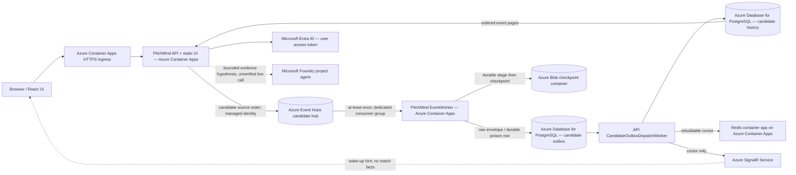
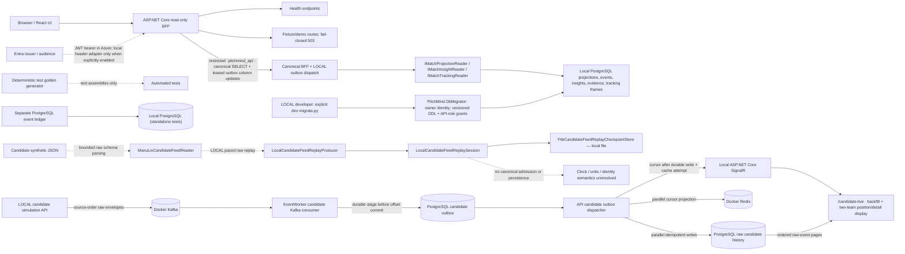
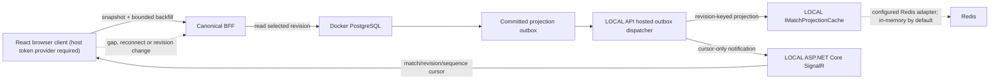
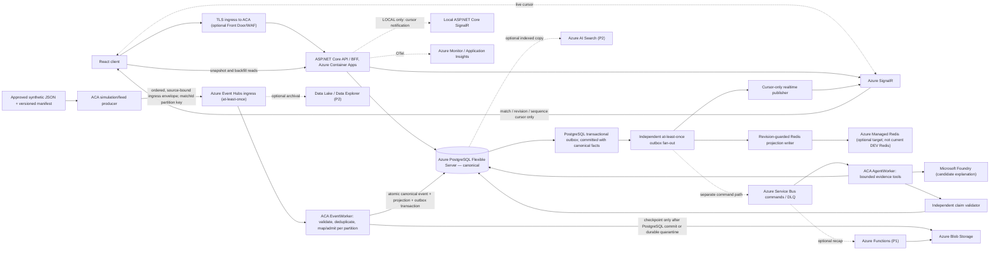

# C4 Level 2 — PitchMind containers and data-plane boundaries

**CURRENT code view:** solid lines are implemented under their stated settings. **Legend:** **IMPLEMENTED IN CODE** means a runtime adapter or route is composed under the stated settings. **OBSERVED** means dated deployment evidence exists. Neither implies current Azure connectivity. **TARGET** is a proposed end-to-end design. [Azure HLD](06-target-azure-hld.md) | [Deployment view](04-deployment.md) | [DEV live integration status](../engineering/AZURE-DEV-LIVE-INTEGRATION-STATUS.md).

## DEV — Azure candidate-feed containers and data stores

This is the Azure DEV implementation path represented by current source and the guarded release template. It persists unvalidated source records in separate candidate tables; it does not perform canonical match admission. User-supplied screenshots show candidate events and player positions in the DEV UI, but are not evidence that each Azure service link in this diagram succeeded. See the [DEV integration status](../engineering/AZURE-DEV-LIVE-INTEGRATION-STATUS.md).

## LOCAL — canonical reads and isolated candidate-feed path

The canonical BFF reads persisted projections, events, insights, evidence and selected-time tracking frames through PostgreSQL readers when `Runtime:Profile` and a connection string are configured. In LOCAL, `PitchMind.DbMigrator` is invoked explicitly by `scripts/dev-migrate.py`; it uses the owner connection for versioned schema changes and refreshes restricted runtime-role grants. API startup does not run DDL. Canonical routes are role-protected and fail closed when a read adapter or matching persisted data is unavailable. The Azure API composition uses the Entra-authenticated PostgreSQL data source and the same PostgreSQL readers when a connection string is supplied; without it, unavailable readers are registered. This is implementation in source, not proof of Azure database access. The source JSON is not admitted to canonical tables.

The LOCAL candidate path publishes source-order envelopes to Docker Kafka; EventWorker stages each envelope in `candidate_feed_outbox` before acknowledging its Kafka offset; the API dispatcher writes PostgreSQL candidate history and updates a Redis cursor, then sends a cursor-only SignalR notification and acknowledges the outbox item. The Azure profile composes the Event Hubs producer/processor, Blob checkpoint, managed-identity PostgreSQL and Redis access, and Azure SignalR provider when the required settings are present. Both paths keep raw candidate fields separate from canonical match facts. The UI reads event pages from the API and can start/pause replay. Adapter composition does not establish resource existence, network access, role grants, or a successful cloud run; use the dated integration-status report for the last recorded Azure observation.

## LOCAL — reconnect and catch-up slice (EP06-S03 candidate)

The canonical LOCAL dispatcher is enabled only for Development + `Runtime:Profile=local`, explicit `Realtime:Provider=local`, and an approved loopback PostgreSQL connection. It leases committed projection outbox messages and publishes revision-keyed cache updates and SignalR cursors; canonical data remains read from PostgreSQL. The separate candidate dispatcher writes raw candidate history and the latest cursor, with SignalR carrying only a wake-up cursor. These are distinct outbox/data paths. The React canonical realtime client uses a host token provider and bounded backfill; the candidate UI uses its candidate-feed negotiation and page routes. Cursor notifications never contain match facts. Azure SignalR is registered for the Azure candidate profile when its endpoint is configured, but the deployment and browser flow require cloud verification.

## TARGET — canonical Azure platform

**Non-negotiable contract:** Event Hubs is the first durable cloud ingress for source-bound simulation events, but ingress envelopes remain candidates until validated and admitted. The EventWorker validates ordering/idempotency and commits each canonical event, projection revision, and PostgreSQL outbox intent in one transaction; it checkpoints Event Hubs only after that commit (or durable quarantine). The outbox is downstream of canonical commit, not a pre-database write. Independent, idempotent outbox consumers update revision-guarded cache entries and publish SignalR cursors after commit; cache failure cannot block or replace canonical truth. SignalR carries only match/revision/sequence cursors, and the UI fetches canonical snapshots/backfill through the BFF. Service Bus is asynchronous command transport, not an event-ledger replacement. Redis, Search and Data Explorer are rebuildable projections. Foundry may suggest words but cannot change score, event IDs or detector evidence. The BFF enforces selected-time and authorization on every read.

**Current-state evidence:** source/configuration implements the Azure candidate path: API publishes ordered raw envelopes to Event Hubs; EventWorker stages an envelope or poison record in PostgreSQL before advancing its Blob checkpoint; the API dispatcher writes candidate history and updates the cursor cache before sending cursor-only SignalR notifications. This path does not admit canonical football facts. Azure resource inventory observed on 2026-10-28 includes the Event Hubs namespace, PostgreSQL server, checkpoint storage, SignalR F1 resource, and Redis Container App. The Redis app uses `redis:7-alpine` and has `minReplicas: 1`; it is not Azure Managed Redis. These inventory facts do not prove that every connection, identity grant, migration, or event-processing step is healthy. The candidate analyst API is implemented, but recent DEV requests returned `503 ANALYST_UNAVAILABLE`. The UI's local tactical discussion helper is computed client-side and is not a Foundry agent response. The canonical source-envelope admission/mapping path remains target work pending feed semantics and domain validation.

**Environment mapping:** LOCAL Docker PostgreSQL + local event/AI adapters through ports; Azure DEV/STAGE/PROD managed services only. Source JSON units, rights and sparse frame quality require review before pressure/xT/xG or player performance claims.

## C# project responsibilities and dependency policy

`tests/PitchMind.Architecture.Tests` enforces this source-project reference map using evaluated MSBuild items, including imported properties and targets. It also captures the final compiler references after `CoreCompile` target hooks have run. A source project added without a documented policy, an unexpected reference, or a missing declared dependency fails the architecture test. Internal `PitchMind.*` assemblies must use mapped project references; aliases with `HintPath`, imported references, package compile/runtime assets, and late compiler inputs are checked as well. `PitchMind.Domain` must have no project, package, explicit framework, raw assembly, COM, or native references; the SDK's implicit `Microsoft.NETCore.App` reference is allowed. Production projects must not embed files from test support or simulation/fixture/scenario/golden data; those resources belong in `tests/PitchMind.TestFixtures` and are checked from evaluated `EmbeddedResource` items.

| Project | Responsibility | Allowed project references |
|---|---|---|
| `PitchMind.Domain` | Football concepts and rules; no scenario data or fixture generation | None; SDK implicit framework baseline only |
| `PitchMind.Contracts` | Transport contracts | None |
| `PitchMind.Application` | Use cases and ports | `PitchMind.Domain` |
| `PitchMind.Infrastructure` | Persistence and external adapters | `PitchMind.Application` |
| `PitchMind.Api` | HTTP composition and endpoints | `PitchMind.Application`, `PitchMind.Infrastructure`, `PitchMind.Contracts` |
| `PitchMind.EventWorker` | Azure PostgreSQL outbox dispatcher and Event Hubs publisher host | `PitchMind.Application`, `PitchMind.Contracts`, `PitchMind.Infrastructure` |
| `PitchMind.AgentWorker` | Explanation-worker host composition | `PitchMind.Application` |
| `PitchMind.DbMigrator` | Explicit LOCAL versioned schema migration and restricted API-role provisioning | `PitchMind.Infrastructure` |

**Release state:** The Azure integration arrows above are **proposed**. An existing hosted offline demo does not prove the connectivity represented here, and no new DEV deployment is authorized by this diagram.
