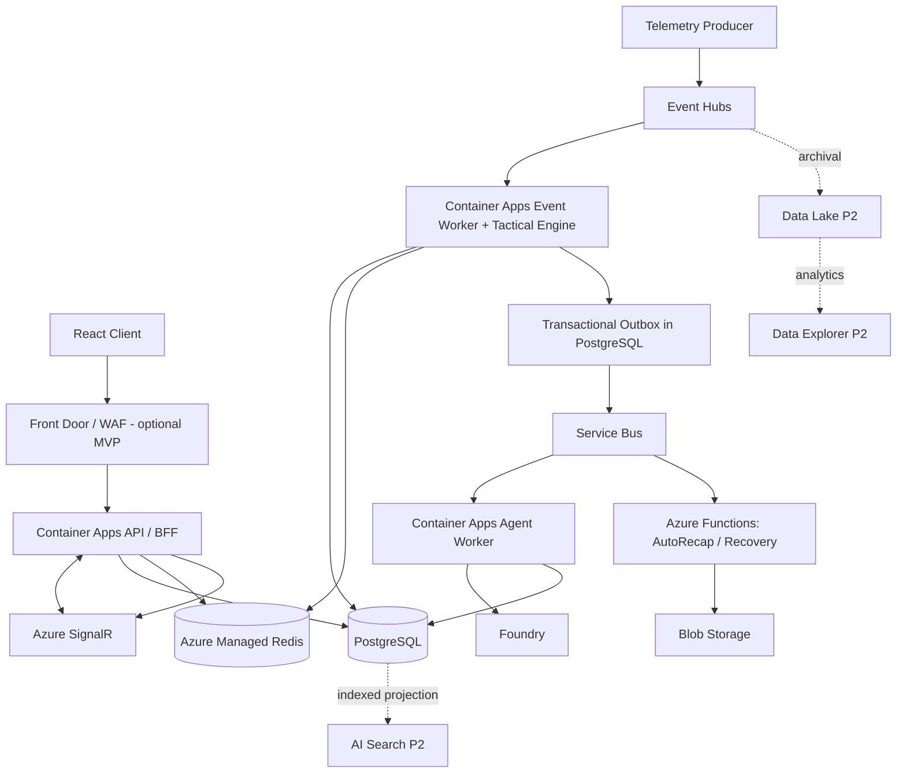

# C4 L2 — Containers

## Contracts
- Event Hubs: high-throughput match telemetry; partition key `matchId`.
- Service Bus: durable commands, retries and dead letters.
- PostgreSQL: canonical state, immutable evidence and outbox.
- Redis: rebuildable cache; never canonical truth.
- SignalR: fan-out, not a source of durable events.
- Foundry: only candidate narratives; deterministic fallback required.
- Functions: background jobs, not the core stream processor.

## Executable local slice (2026-10-08)

The implemented local path is browser → API `SyntheticMatchService` → seeded immutable fixture → deterministic projection/evidence/fallback. It does not traverse PostgreSQL, Event Hubs, SignalR or Foundry. The diagram above remains the Azure target; deployability gaps are tracked in [Azure delivery delta](../engineering/AZURE-DELIVERY-GAPS.md). Do not enable a cloud profile by renaming the in-memory adapter.
