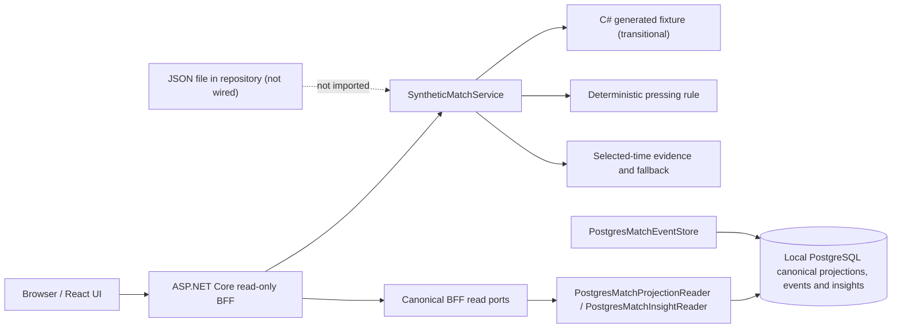
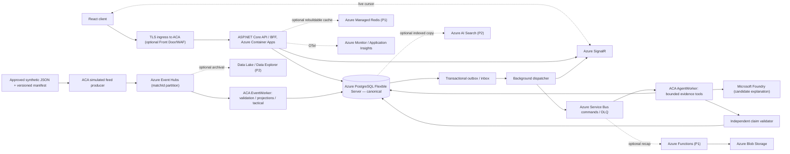

# C4 Level 2 — PitchMind containers and data-plane boundaries

**Legend:** Solid arrows under **CURRENT** are backed by existing implementation or recorded demo behavior. **TARGET** describes the desired Azure-only deployment and is **not verified as an integrated cloud path**. **OPTIONAL** is feature/cost gated. [Target HLD](06-target-azure-hld.md) | [Observed limitations](../engineering/ARCHITECTURE-REVIEW-2026-10-08.md) | [Azure deployment evidence](../engineering/evidence/2026-10-08-DEV-DEPLOYMENT.md).

## CURRENT — offline synthetic demonstration (not canonical Azure ingestion)

The existing unprefixed demo routes still use `SyntheticMatchService`; `/api/v1/canonical/*` reads only revisioned PostgreSQL projections, ledger events, and persisted insight evidence. If the PostgreSQL read adapter is absent, those routes return 503 and never fall back to demo data. The database schema has no canonical key-moment projection, so the canonical key-moments route returns an explicit unavailable response. Authentication for these canonical routes is still an EP06-S04 gate; they must not be exposed through a cloud ingress before that boundary is implemented or an approved public-synthetic boundary exists. The candidate JSON remains unimported and its coordinate/football semantics remain unapproved.

## TARGET — canonical Azure platform

**Non-negotiable contract:** Event Hubs is **at-least-once** telemetry; service-side `MatchId + EventId + Sequence + payload hash` and PostgreSQL transaction establish correctness. Service Bus is asynchronous command transport, not an event-ledger replacement. SignalR carries revision/cursor notifications, not canonical truth. Redis, Search and Data Explorer are rebuildable projections. Foundry may suggest words but cannot change score, event IDs or detector evidence. The BFF enforces selected-time and authorization on every read.

**Environment mapping:** LOCAL Docker PostgreSQL + local event/AI adapters through ports; Azure DEV/STAGE/PROD managed services only. Source JSON units, rights and sparse frame quality require review before pressure/xT/xG or player performance claims.

## C# project responsibilities and dependency policy

`tests/PitchMind.Architecture.Tests` enforces this source-project reference map. A source project added without a documented policy, an unexpected reference, or a missing declared dependency fails the architecture test. `PitchMind.Domain` must have no project, package, or framework references.

| Project | Responsibility | Allowed project references |
|---|---|---|
| `PitchMind.Domain` | Pure football concepts and rules | None |
| `PitchMind.Contracts` | Transport contracts | None |
| `PitchMind.Application` | Use cases and ports | `PitchMind.Domain` |
| `PitchMind.Infrastructure` | Persistence and external adapters | `PitchMind.Application` |
| `PitchMind.Api` | HTTP composition and endpoints | `PitchMind.Application`, `PitchMind.Infrastructure`, `PitchMind.Contracts` |
| `PitchMind.EventWorker` | Event-processing host composition | `PitchMind.Application` |
| `PitchMind.AgentWorker` | Explanation-worker host composition | `PitchMind.Application` |

**Release state:** The Azure integration arrows above are **proposed**. An existing hosted offline demo does not prove the connectivity represented here, and no new DEV deployment is authorized by this diagram.
