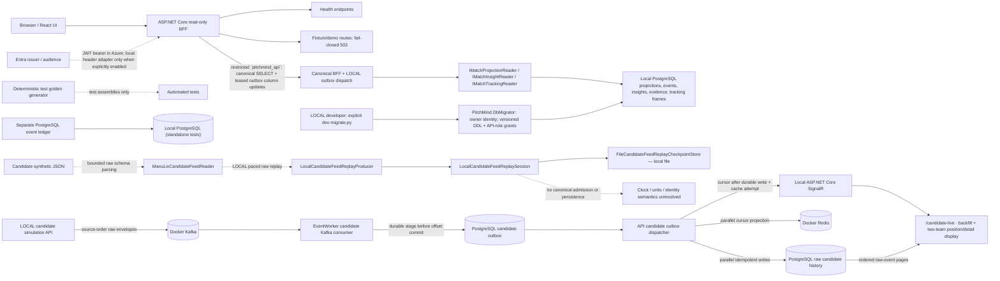
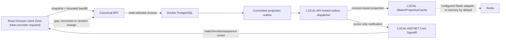
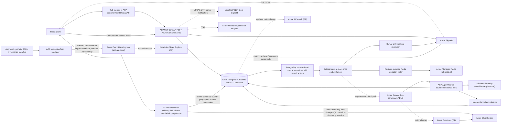

# C4 Level 2 — PitchMind containers and data-plane boundaries

**Legend:** Solid arrows under **CURRENT** are backed by existing implementation or recorded demo behavior. **TARGET** describes the desired Azure-only deployment and is **not verified as an integrated cloud path**. **OPTIONAL** is feature/cost gated. [Target HLD](06-target-azure-hld.md) | [Observed limitations](../engineering/ARCHITECTURE-REVIEW-2026-10-08.md) | [Azure deployment evidence](../engineering/evidence/2026-10-08-DEV-DEPLOYMENT.md).

## CURRENT — local canonical reads, no candidate-feed canonical ingest

The local canonical BFF reads persisted projections, ledger events, insights, evidence and selected-time tracking frames through `PostgresMatchProjectionReader`, `PostgresMatchInsightReader` and `PostgresMatchTrackingReader`; registration is conditional on `Runtime:Profile=local` and a PostgreSQL connection string. The local runtime uses the restricted `pitchmind_api` database role: SELECT on canonical read tables and the schema-version readiness probe, plus column-scoped updates for leasing/acknowledging outbox work, with no schema DDL, event/projection writes, or migration-history mutation. `PitchMind.DbMigrator` is a separate LOCAL-only command; a developer invokes it after `dev-up`, and it applies versioned schema migrations with the PostgreSQL owner before refreshing the API role grants. It refuses non-loopback connections and is not registered in API startup. The tracking-frame route is source-bound, pins both canonical and projection revisions, and pages at most 25 frames for the exact selected second. Without the adapter, canonical reads return sanitized `503 DEPENDENCY_UNAVAILABLE`. Canonical routes require the EP06-S04 role policies. Azure profiles require explicit Entra authority/audience configuration and map the protected routes with unavailable adapters until an Azure PostgreSQL read adapter is configured; no fixture fallback exists. Legacy match/demo routes remain fail-closed and protected; no synthetic demo is served by the runtime. No candidate-feed canonical admission path is implemented. `ManuLivCandidateFeedReader` parses raw candidate records and their source hash; `LocalCandidateFeedReplayProducer` emits those records in order at a bounded local rate; `LocalCandidateFeedReplaySession` owns start/pause/resume/cancel lifecycle and saves the source-bound cursor after the consumer acknowledges a record using `FileCandidateFeedReplayCheckpointStore`. The checkpoint is local operational state only, not a canonical offset or PostgreSQL state. These components do not map or persist canonical football facts and are not the target Event Hubs adapter. The candidate JSON has owner-confirmed synthetic provenance and redistribution permission, but its time policy, coordinate units/orientation, player metrics, canonical event mappings and football realism remain unverified; it is not yet imported.

The LOCAL candidate-live implementation adds a separate raw-data flow: the Simulation Service publishes source-order envelopes to Docker Kafka; EventWorker stages each envelope in `candidate_feed_outbox` before committing its Kafka offset; the API writes PostgreSQL candidate history and a Redis cursor concurrently, then sends a cursor-only SignalR notification after the durable write and cache attempt and acknowledges the outbox item. The Azure code profile adds the corresponding Event Hubs producer/processor, PostgreSQL Entra token authentication, managed-identity Redis cursor cache, Azure SignalR provider, and browser token integration through MSAL authorization code + PKCE. Both profiles preserve raw source fields and keep candidate data separate from canonical football facts. `/candidate-live` reads ordered pages from PostgreSQL and can pause/resume the simulation. Azure code is not the same as a provisioned deployment: DEV still needs a SignalR endpoint, a separate worker container, a Blob checkpoint path, runtime identities/data-plane grants, PostgreSQL principal/schema setup, and Entra SPA/API registration. Current DEV is still configured with the local runtime profile, so these adapters are not active there.

## LOCAL — reconnect and catch-up slice (EP06-S03 candidate)

The LOCAL dispatcher is registered only when the ASP.NET environment is Development, `Runtime:Profile=local`, `Realtime:Provider=local` is explicit, and PostgreSQL uses a single approved loopback host. It leases committed outbox messages through the existing bounded-retry dispatcher and publishes to the revision-keyed cache and local SignalR in parallel; an outbox row is acknowledged only after both handlers succeed, so retries may repeat an idempotent cache write or cursor notification. SignalR carries only revision/sequence cursors. The cache is a projection: canonical reads still fall back to PostgreSQL and event data is never read from cache. The canonical backfill endpoint returns one selected-time snapshot and a bounded ordered event page from PostgreSQL. A revision mismatch, a client sequence ahead of the durable head, or a nonnegative resume sequence without a projection revision forces replay from sequence -1. The React client obtains short-lived bearer credentials from a host-injected token provider, joins one match group, and refreshes canonical state after connect, reconnect and cursor notifications. A historical selection remains fixed while a polite status region reports new updates and offers a return-to-live action. The local browser bearer adapter is unsigned and opt-in for Development only. This candidate slice still lacks connected-browser verification, a production host identity provider, and the canonical event producer/feed adapter; story acceptance remains open.

## TARGET — canonical Azure platform

**Non-negotiable contract:** Event Hubs is the first durable cloud ingress for source-bound simulation events, but ingress envelopes remain candidates until validated and admitted. The EventWorker validates ordering/idempotency and commits each canonical event, projection revision, and PostgreSQL outbox intent in one transaction; it checkpoints Event Hubs only after that commit (or durable quarantine). The outbox is downstream of canonical commit, not a pre-database write. Independent, idempotent outbox consumers update revision-guarded cache entries and publish SignalR cursors after commit; cache failure cannot block or replace canonical truth. SignalR carries only match/revision/sequence cursors, and the UI fetches canonical snapshots/backfill through the BFF. Service Bus is asynchronous command transport, not an event-ledger replacement. Redis, Search and Data Explorer are rebuildable projections. Foundry may suggest words but cannot change score, event IDs or detector evidence. The BFF enforces selected-time and authorization on every read.

**Observed code versus target:** the Azure candidate path is implemented as an opt-in raw candidate feed: the API publishes source-order envelopes to Event Hubs, the EventWorker records them to candidate staging/history in PostgreSQL, and the API's outbox dispatcher updates Redis and sends cursor-only SignalR notifications. This candidate path does not admit canonical football facts. The Azure `EventWorker` also leases committed PostgreSQL outbox rows and publishes `ProjectionPublishedV1` to Event Hubs; its opt-in consumer persists an inbox/snapshot and advances a Blob checkpoint. Azure source-ingress, managed Redis, Entra PostgreSQL, and Azure SignalR adapters exist in code but are not configured or cloud-verified in DEV. `SimulationStreamerService` retains a separate in-process demo projection path; it is not proof of Event Hubs ingress. Canonical source-envelope admission and mapping remain blocked on candidate-feed semantics and domain validation.

**Environment mapping:** LOCAL Docker PostgreSQL + local event/AI adapters through ports; Azure DEV/STAGE/PROD managed services only. Source JSON units, rights and sparse frame quality require review before pressure/xT/xG or player performance claims.

## C# project responsibilities and dependency policy

`tests/PitchMind.Architecture.Tests` enforces this source-project reference map using evaluated MSBuild items, including imported properties and targets. It also captures the final compiler references after `CoreCompile` target hooks have run. A source project added without a documented policy, an unexpected reference, or a missing declared dependency fails the architecture test. Internal `PitchMind.*` assemblies must use mapped project references; aliases with `HintPath`, imported references, package compile/runtime assets, and late compiler inputs are checked as well. `PitchMind.Domain` must have no project, package, explicit framework, raw assembly, COM, or native references; the SDK's implicit `Microsoft.NETCore.App` reference is allowed. Production projects must not embed files from test support or simulation/fixture/scenario/golden data; those resources belong in `tests/PitchMind.TestFixtures` and are checked from evaluated `EmbeddedResource` items.

| Project | Responsibility | Allowed project references |
|---|---|---|
| `PitchMind.Domain` | Football concepts and rules; no scenario data or fixture generation | None; SDK implicit framework baseline only |
| `PitchMind.Contracts` | Transport contracts | None |
| `PitchMind.Application` | Use cases and ports | `PitchMind.Domain` |
| `PitchMind.Infrastructure` | Persistence and external adapters | `PitchMind.Application` |
| `PitchMind.Api` | HTTP composition and endpoints | `PitchMind.Application`, `PitchMind.Infrastructure`, `PitchMind.Contracts` |
| `PitchMind.EventWorker` | Azure PostgreSQL outbox dispatcher and Event Hubs publisher host | `PitchMind.Application`, `PitchMind.Contracts`, `PitchMind.Infrastructure` |
| `PitchMind.AgentWorker` | Explanation-worker host composition | `PitchMind.Application` |
| `PitchMind.DbMigrator` | Explicit LOCAL versioned schema migration and restricted API-role provisioning | `PitchMind.Infrastructure` |

**Release state:** The Azure integration arrows above are **proposed**. An existing hosted offline demo does not prove the connectivity represented here, and no new DEV deployment is authorized by this diagram.
