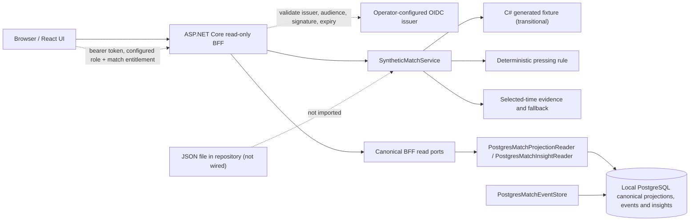
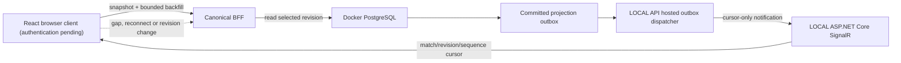
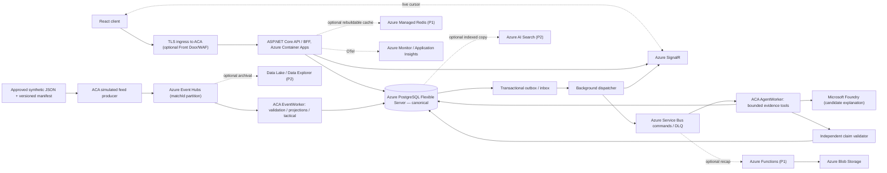

# C4 Level 2 — PitchMind containers and data-plane boundaries

**Legend:** Solid arrows under **CURRENT** are backed by existing implementation or recorded demo behavior. **TARGET** describes the desired Azure-only deployment and is **not verified as an integrated cloud path**. **OPTIONAL** is feature/cost gated. [Target HLD](06-target-azure-hld.md) | [Observed limitations](../engineering/ARCHITECTURE-REVIEW-2026-10-08.md) | [Azure deployment evidence](../engineering/evidence/2026-10-08-DEV-DEPLOYMENT.md).

## CURRENT — offline synthetic demonstration (not canonical Azure ingestion)

Fixture-backed `/api/v1/matches/*` demo routes still use `SyntheticMatchService`; they are anonymous only in Development + `Runtime:Profile=local`, return 404 elsewhere, and label responses `X-Data-Class: synthetic-demo`. `/api/v1/canonical/*` reads only revisioned PostgreSQL projections, ledger events, and persisted insight evidence. Canonical routes and local SignalR require JWT bearer validation, a configured read role, and a token entitlement matching the requested match ID; the fixture catalogue has a separate operator-configured catalog role. The issuer, audience, claim types, roles, catalog roles and CORS origins have no repository defaults and missing required authentication settings fail closed. Local contract tests use an explicit test authentication handler and do not prove production identity-provider integration. If the PostgreSQL adapter is absent, authorized canonical reads return 503 and never fall back to demo data. The database schema has no canonical key-moment projection, so the canonical key-moments route returns an explicit unavailable response. Cloud exposure remains blocked until operators provide and verify the actual identity and CORS configuration. The candidate JSON remains unimported and its coordinate/football semantics remain unapproved.

## LOCAL — reconnect and catch-up slice (EP06-S03 candidate)

The LOCAL dispatcher is inherited from EP06-S02 and is registered only when the ASP.NET environment is Development, `Runtime:Profile=local`, `Realtime:Provider=local` is explicit, and PostgreSQL uses a single approved loopback host. It leases committed outbox messages through the existing bounded-retry dispatcher; SignalR carries only revision/sequence cursors. The new canonical backfill endpoint returns one selected-time snapshot and a bounded ordered event page from PostgreSQL. A revision mismatch or a client sequence ahead of the durable head forces replay from sequence -1. This slice does not certify a connected browser journey: the current application has no production authentication scheme or integrated SignalR browser client, and the canonical event producer/feed adapter remains separately gated.

## TARGET — canonical Azure platform

**Non-negotiable contract:** Event Hubs is **at-least-once** telemetry; service-side `MatchId + EventId + Sequence + payload hash` and PostgreSQL transaction establish correctness. Service Bus is asynchronous command transport, not an event-ledger replacement. SignalR carries revision/cursor notifications, not canonical truth. Redis, Search and Data Explorer are rebuildable projections. Foundry may suggest words but cannot change score, event IDs or detector evidence. The BFF enforces selected-time and authorization on every read.

**Environment mapping:** LOCAL Docker PostgreSQL + local event/AI adapters through ports; Azure DEV/STAGE/PROD managed services only. Source JSON units, rights and sparse frame quality require review before pressure/xT/xG or player performance claims.

## C# project responsibilities and dependency policy

`tests/PitchMind.Architecture.Tests` enforces this source-project reference map. A source project added without a documented policy, an unexpected reference, or a missing declared dependency fails the architecture test. `PitchMind.Domain` must have no project, package, or framework references.

| Project | Responsibility | Allowed project references |
|---|---|---|
| `PitchMind.Domain` | Pure football concepts and rules | None |
| `PitchMind.Contracts` | Transport contracts | None |
| `PitchMind.Application` | Use cases and ports | `PitchMind.Domain` |
| `PitchMind.Infrastructure` | Persistence and external adapters | `PitchMind.Application` |
| `PitchMind.Api` | HTTP composition and endpoints | `PitchMind.Application`, `PitchMind.Infrastructure`, `PitchMind.Contracts` |
| `PitchMind.EventWorker` | Event-processing host composition | `PitchMind.Application` |
| `PitchMind.AgentWorker` | Explanation-worker host composition | `PitchMind.Application` |

**Release state:** The Azure integration arrows above are **proposed**. An existing hosted offline demo does not prove the connectivity represented here, and no new DEV deployment is authorized by this diagram.
