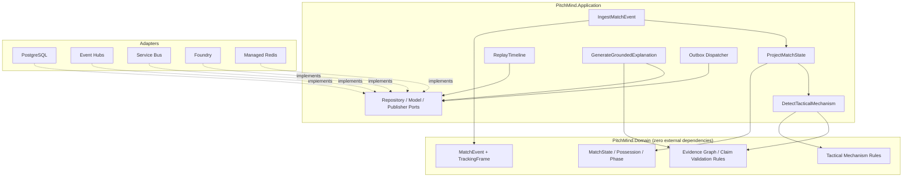

# C4 L3 — Application components

## Required invariants
- `Domain` references neither Application nor Infrastructure.
- Input event IDs are stable; sequence violations quarantine, not silently reorder truth.
- Observed ≠ Derived ≠ Supported Interpretation ≠ Hypothesis.
- No unsupported AI claim can be published.
- Replay with identical input and algorithm version yields identical outputs.
- Agent tools are read-only and budgeted.
