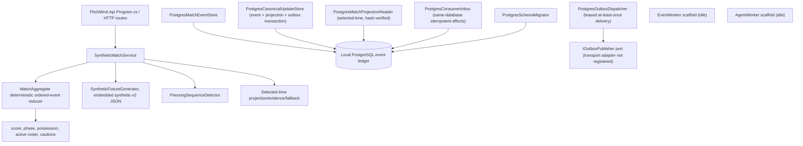
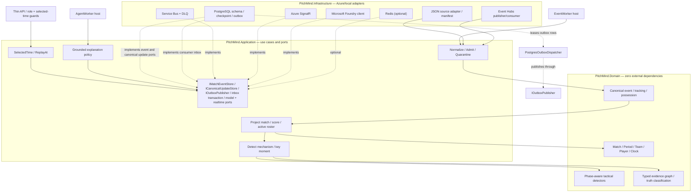

# C4 Level 3 — Components, domain purity and realization map

**CURRENT** sections document the source-verified local implementation; **TARGET** sections describe proposed ports and adapters, not an integrated runtime.

**Authority:** [Football LLD](07-football-analytics-detailed-lld.md), [API](../api/API.md), [Architecture review](../engineering/ARCHITECTURE-REVIEW-2026-10-08.md). Current runtime and target ports are intentionally separated to avoid asserting unavailable integrations.

## Realized application components (source verified, not new test evidence)

The fixture generator reads the fictional `data/simulations/synthetic-fixture-v2.json` definition as an embedded versioned resource; team/player/scenario facts are not literals in production C#. `SyntheticMatchService` folds the selected-time event prefix through the pure `MatchAggregate`, which enforces ordered sequence, 11-per-team initial roster, participant, period, score, card, substitution and terminal-state rules. The PostgreSQL v3 schema adds lease/retry/dead-letter state, a projection FK for outbox records, and a consumer inbox. `PostgresCanonicalUpdateStore` commits event, revisioned state and outbox intent atomically; `PostgresOutboxDispatcher` uses stable IDs, leases and bounded retries, and emits local .NET metrics; `PostgresConsumerInbox` couples a same-database effect to its dedupe receipt. `PostgresMatchProjectionReader` selects a persisted revision at or before the requested clock, verifies state hash/metadata, and bounds event windows by both selected time and projection sequence. These infrastructure primitives are not yet registered in the API/EventWorker runtime, and there is no Azure broker publisher, metrics exporter/alert, or projection API read path. Competition linkage, source import and persisted correction workflows remain unimplemented. `EventWorker`, `AgentWorker` and Azure adapters must not be described as production-enabled. The candidate `data/simulations/manu-liv-match-dataset.json` still does not drive the C# service.

## Target Ports and Adapters

## Runtime, data and code invariants
- Pure Domain may not depend on Application, Infrastructure, Azure SDK, Npgsql or React. Infrastructure handles JSON source vocabulary, clock/units conversion, source record pointers, nullable coordinates and bad input quarantine.
- `EventEnvelope` and `TrackingFrame` carry source/fixture hash, 1-based original sequence and explicit canonical index, period/elapsed time, pitch units/orientation, observed-vs-interpolated coverage.
- PostgreSQL commits validated event, tracking reference, projection, evidence and outbox atomically; checkpoint follows durable commit; repeated delivery is safe.
- `MatchTimeContext` fixes match, selected timestamp, revision and period across API, pitch, scoreboard, events, claims and AI.
- Foundry receives read-only evidence scoped to selected time; separate deterministic validator checks every published claim; malformed model output falls back.
- React gets data via BFF; no clubs, players, scores, tactical observations or event-specific narrative hardcoded in `*.cs` or `*.tsx` after feed integration.
- **Every actual change** to an aggregate, port, trust boundary or deployment needs an updated diagram/ADR/API and contract tests in the same PR. Docs do not imply feature acceptance or authorize Azure DEV mutation.
