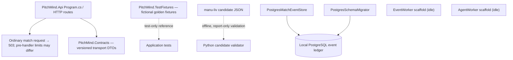
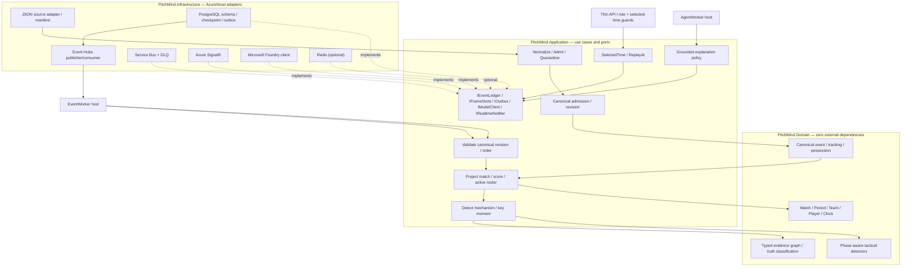

# C4 Level 3 — Components, domain purity and realization map

**CURRENT** sections document the source-verified local implementation; **TARGET** sections describe proposed ports and adapters, not an integrated runtime.

**Authority:** [Football LLD](07-football-analytics-detailed-lld.md), [API](../api/API.md), [Architecture review](../engineering/ARCHITECTURE-REVIEW-2026-10-08.md). Current runtime and target ports are intentionally separated to avoid asserting unavailable integrations.

## Realized application components (source verified, not new test evidence)

The event store is a separately exercised adapter; current API paths do **not** consume it. Ordinary match reads fail closed with `503 MATCH_DATA_UNAVAILABLE` (the analyst endpoint can return `429` when rate-limited before its handler). Enabling match reads requires replacing API route composition with a canonical, revisioned read port backed by admitted PostgreSQL data. Registering `SyntheticMatchService` cannot enable the routes. `SyntheticFixtureGenerator` lives in the test-only `PitchMind.TestFixtures` project; it is not reachable from production projects. `EventWorker`, `AgentWorker` and Azure adapters must not be described as production-enabled. `data/simulations/manu-liv-match-dataset.json` has an offline manifest-pinned structural validator that emits an aggregate report only; it is not a runtime source adapter and the source is not canonically ingested or served.

## Target Ports and Adapters

## Runtime, data and code invariants
- Pure Domain may not depend on Application, Infrastructure, Azure SDK, Npgsql or React. Infrastructure handles JSON source vocabulary, clock/units conversion, source record pointers, nullable coordinates and bad input quarantine.
- `EventEnvelope` and `TrackingFrame` carry source/fixture hash, 1-based original sequence and explicit canonical index, period/elapsed time, pitch units/orientation, observed-vs-interpolated coverage.
- PostgreSQL commits validated event, tracking reference, projection, evidence and outbox atomically; checkpoint follows durable commit; repeated delivery is safe.
- PostgreSQL canonical admission assigns the positive per-match `canonicalRevision`; only its outbox publishes `EventEnvelopeV1`/`TrackingFrameV1`. Raw source candidates have no canonical revision and cannot validate as these canonical DTOs.
- `MatchTimeContext` fixes match, selected timestamp, revision and period across API, pitch, scoreboard, events, claims and AI.
- Foundry receives read-only evidence scoped to selected time; separate deterministic validator checks every published claim; malformed model output falls back.
- React gets data via BFF; no clubs, players, scores, tactical observations or event-specific narrative hardcoded in `*.cs` or `*.tsx` after feed integration.
- **Every actual change** to an aggregate, port, trust boundary or deployment needs an updated diagram/ADR/API and contract tests in the same PR. Docs do not imply feature acceptance or authorize Azure DEV mutation.
