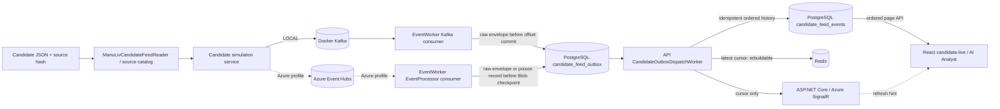
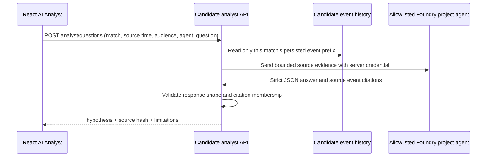

# C4 Level 3 — Implemented components and runtime boundaries

This document describes the **CURRENT** composition in `src/`, the routes in `PitchMind.Api`, and the separate React clients. It distinguishes the candidate demonstration path from canonical match processing. Adapter registration is source-level evidence; cloud connectivity and story acceptance require their own evidence. Full canonical Azure ingestion remains **TARGET** design in [the Azure HLD](06-target-azure-hld.md).

## Candidate-live path — raw source events, non-canonical

`CandidateFeedSourceCatalog` loads the repository-relative source file, rejects multi-match input for the current replay, and caches the parsed `ManuLivCandidateFeedReader` result and source SHA-256. `LocalCandidateSimulationService` owns start/resume/pause and uses the bounded replay session; the source cursor advances only after the publisher acknowledges an event. LOCAL publishes to Kafka, and the EventWorker consumer durably stages records in PostgreSQL before acknowledging Kafka. The Azure implementation publishes to Event Hubs; its consumer records the candidate envelope or a durable poison result before advancing the Blob checkpoint. Source IDs, sequence, raw clock/period values, raw payload and source hash are retained. These staging/history tables are not canonical match tables.

The API dispatcher writes candidate history and updates the latest Redis cursor. It publishes a cursor-only SignalR notification after the durable write and cache attempt, then acknowledges the candidate outbox record. Redis is rebuildable and is not the UI's event source; the UI reads ordered pages from PostgreSQL through `/api/v1/simulation/candidate/matches/{matchId}/events`. The candidate status/start/pause and SignalR negotiation endpoints are under `/api/v1/simulation/candidate`. The active UI shows source positions and player fields as unverified observations and labels the feed as non-canonical.

## Candidate analyst — direct API-to-project-agent request

The API validates the request and limits its context to at most 12 persisted source events and 32 KiB. It restricts agent names to the ten-agent allowlist and defaults to `TacticalAnalyst`. The response's claims must cite event IDs present in the supplied packet; the answer is labeled `hypothesis` and is not persisted as a canonical insight. Citation membership does not prove semantic entailment, event meaning, intent or causality. The AI Analyst UI can poll the candidate cursor and request reports for newly observed notable event types; user questions use the same selected match and source-clock boundary. Foundry calls require endpoint configuration and a usable server-side credential. No successful call is implied by the route or Bicep declaration.

## Canonical BFF and PostgreSQL readers

`CanonicalMatchEndpoints` exposes fixture, summary, event, frame, insight, evidence, replay and timeline-backfill reads. Application ports separate the route contracts from `PostgresMatchProjectionReader`, `PostgresMatchInsightReader` and `PostgresMatchTrackingReader`. LOCAL registration requires `Runtime:Profile=local` plus a PostgreSQL connection. Azure registration uses `AzurePostgresDataSourceFactory` and managed identity when the Azure profile has a connection string; otherwise it binds unavailable adapters. Persisted canonical reads are revision/time bounded and protected by `MatchRead` or the more restrictive `MatchReplay` policy. Legacy `/api/v1/matches` routes intentionally return `503 MATCH_DATA_UNAVAILABLE`; they do not fall back to candidate data or test fixtures.

Canonical aggregate, event-ingestion, evidence-graph and explanation-orchestration code exists in Domain/Application projects. It is not equivalent to a complete candidate-source-to-canonical admission pipeline. The candidate JSON is not mapped into canonical event semantics. The current canonical Foundry context builder/orchestrator is not composed into an API route or a consuming AgentWorker flow.

## Realtime and operational services

The API hosts `/hubs/matches` for enabled local realtime or Azure candidate-feed profiles. Candidate notifications carry source match/hash/sequence cursors; canonical notifications carry revision/sequence cursors. Both are hints; clients fetch facts from their corresponding page/read API. Local canonical outbox dispatch is enabled only with Development, the local profile, explicit local realtime and loopback PostgreSQL. Azure SignalR uses the managed-identity provider when the Azure candidate profile is configured.

`ApiSecurity` validates explicit runtime profiles, Entra issuer/audience and roles in Azure, and permits the unsigned development-header adapter only in local Development when explicitly enabled. Candidate and canonical actions use role policies and rate limits. Health endpoints distinguish liveness from readiness; readiness performs a bounded PostgreSQL/schema probe. Request and outbox instruments are low-cardinality; OTLP metrics export is opt-in and requires an explicit endpoint.

## AgentWorker boundary

`PitchMind.AgentWorker` contains the Foundry explanation adapter, the bounded tactical knowledge retrieval code, profile/agent catalogs and explanation orchestration components. Its current hosted `Worker` is a scaffold that logs startup and waits; it does not consume a queue or invoke a model. The candidate AI Analyst request path is instead composed in the API and calls a selected project agent directly. These are separate integration paths and must not be presented as one deployed multi-agent workflow.

## Canonical versus candidate persistence

| Data path | Durable objects | Meaning |
| --- | --- | --- |
| Candidate replay | `candidate_feed_outbox`, `candidate_feed_events`, candidate poison records | Raw source records, source hash and operational cursor; not canonical facts |
| Canonical match | match ledger, projections, insights, evidence and transactional outbox | Admitted, revisioned football state and derived evidence |
| Realtime/cache | Redis projection/cursor and SignalR notifications | Rebuildable state or wake-up cursor; never authoritative match facts |

PostgreSQL is authoritative for both persisted candidate records and canonical records, but their schemas and trust status are separate. Candidate persistence does not certify the candidate feed or satisfy canonical ingestion. See [canonical ledger](../data/CANONICAL-EVENT-LEDGER.md), [candidate feed contract](../data/SIMULATION-FEED-CONTRACT.md), and [API contract](../api/API.md).
