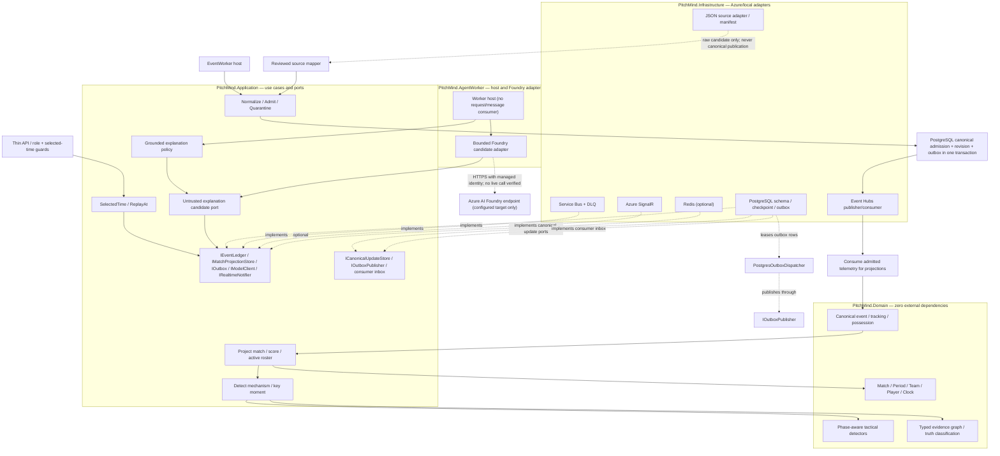

# C4 Level 3 — Components, domain purity and realization map

**CURRENT** sections document the source-verified local implementation; **TARGET** sections describe proposed ports and adapters, not an integrated runtime.

**Authority:** [Football LLD](07-football-analytics-detailed-lld.md), [API](../api/API.md), [Architecture review](../engineering/ARCHITECTURE-REVIEW-2026-10-08.md). Current runtime and target ports are intentionally separated to avoid asserting unavailable integrations.

## Realized application components (source verified, not new test evidence)

```mermaid
flowchart TB
  API["PitchMind.Api Program.cs / HTTP routes"] --> Profile["RuntimeProfileGuard: local in Development; azure in supported hosts"]
  API --> Security["ApiSecurity: Entra JWT / role policies / rate limits / security headers"]
  API --> Guard["Fixture/demo routes fail closed; malformed requests → typed 4xx; body capped at 4 KiB including chunked input"]
  API --> BFF["Canonical BFF routes: protected in local and Azure profiles"]
  BFF --> ReadPorts["IMatchProjectionReader / IMatchInsightReader / IMatchTrackingReader"]
  ReadPorts --> PgReader["PostgresMatchProjectionReader / PostgresMatchInsightReader"] --> DB[("Local PostgreSQL canonical read models")]
  ReadPorts --> TrackingReader["PostgresMatchTrackingReader: selected-time tracking frames"] --> DB
  API --> LocalRealtime["Development/local ASP.NET Core SignalR: authenticated match groups + cursor-only negotiation"]
  LocalRealtime --> RealtimePublisher["Local IOutboxPublisher: ProjectionPublishedV1 → canonical revision/sequence cursor"]
  RealtimePublisher --> LocalHub["Local SignalR hub / match groups"]
  LocalHub --> Clients["Authorized local clients; canonical facts remain HTTP/PostgreSQL reads"]
  API --> Contracts["PitchMind.Contracts — versioned transport DTOs"]
  Test["PitchMind.TestFixtures — fictional golden fixtures"] -. "test-only reference" .-> AppTests["Application tests"]
  Ledger["PostgresMatchEventStore"] --> DB[("Local PostgreSQL event ledger")]
  ProjectionRead["PostgresMatchProjectionStore: source metadata + projection/provenance read"] --> DB
  CanonicalWrite["PostgresCanonicalUpdateStore: event + projection + outbox transaction"] --> DB
  DispatchWorker["OutboxDispatchWorker: Development/local + explicit local provider + loopback PostgreSQL only"] --> Dispatcher
  Dispatcher["PostgresOutboxDispatcher: leased at-least-once delivery"] --> RealtimePublisher
  PointInTime["Internal Application: GetMatchAtQueryService"] --> ReplayReader["PostgresMatchProjectionReader: projection + replay envelope + bounded frames"] --> DB
  BFF --> FrameRoute["GET /api/v1/canonical/matches/{matchId}/frames"] --> TrackingReader
  Migrator["PostgresSchemaMigrator"] --> DB
  Candidate["Candidate JSON"] -. "raw schema only" .-> RawReader["ManuLivCandidateFeedReader"]
  RawReader -. "not connected to canonical admission" .-> Boundary["Mapping blocked: source semantics unverified"]
  EventWorker["EventWorker scaffold (idle)"]
  AgentWorker["AgentWorker Foundry candidate adapter (no consumer; candidate remains untrusted)"]
  MatchContext["Application MatchIntelligenceContextBuilder (not host-composed)"]
  MatchContext -. "read-only ports" .-> ReadPorts
```

The Domain PressSequenceDetector is called by the offline SyntheticMatchService and the internal selected-time GetMatchAtQueryService; both paths use the same deterministic policy and emit simulated, unapproved, non-publishable insights with source/revision/time/evidence metadata. When the selected-time reducer state is available, the insight also carries versioned `tactical-context-v1`: scoreline, pressing-team role, active-player difference, reducer phase, and the event-supported possession transition. The detector builds a typed evidence graph with a pattern claim, source event/frame nodes and a reducer-derived context metric, links source events in observed order with `precedes` edges, and links the claim/context metric to source-prefix evidence with `derived_from` edges, including a source-hash-pinned active-roster node for reducer player counts. The graph validator rejects dangling references and does not allow publishing without approved policy and revisioned canonical evidence. Missing context state leaves context null. EP06-S01 adds a separate canonical BFF that reads PostgreSQL projections/events/insights/evidence through the projection and insight read ports. EP07-S05 adds a tracking read port and protected exact-selected-second frame route; it pins canonical revision, projection revision and source hash, and pages frames by stable sequence/frame identity. EP06-S04 protects canonical and legacy match routes with role policies and abuse controls; Azure runtime requires Entra authority/audience and uses unavailable adapters until cloud PostgreSQL composition exists. No fixture/demo route serves synthetic facts, and the detector is not wired to the candidate Manu–Liverpool feed or evidence that certifies its coordinate/event semantics.

The profile guard rejects selecting local-only adapters outside Development while allowing an explicit Azure profile in Development, Staging, or Production. The in-memory event store is registered only for the local profile; Azure startup does not fall back to it. EP06-S01 registers PostgreSQL projection and insight readers only for the local profile when a connection string is configured; EP07-S05 adds the PostgreSQL tracking-frame reader in the same local-only composition. Azure maps the protected read contracts against unavailable adapters until an Azure PostgreSQL reader is configured, returning typed 503 responses after authorization. The frame route requires the MatchReplay role, validates persisted telemetry and indexed frame identity/source/time, applies selected-time and as-of sequence/revision bounds, and returns sanitized `503 CANONICAL_DATA_INVALID` for corrupt canonical payloads. It does not certify candidate source coordinate/time semantics. EP06-S04 adds Entra JWT bearer configuration and role policies for Azure, plus a development-only header adapter that must be explicitly enabled. EP06-S02's current implementation candidate adds Development/local-only ASP.NET Core SignalR negotiation and a cursor-only outbox publisher; it uses the committed event's 64-bit canonical revision and sequence, strips persisted state, and leaves canonical reads on PostgreSQL-backed HTTP APIs. The local `OutboxDispatchWorker` is gated on Development, explicit local runtime/provider settings, and a single PostgreSQL loopback endpoint; it dispatches through the existing leased PostgreSQL outbox. This does not verify database-to-connected-client delivery or ordering/reconnect behavior. No Azure SignalR provider is registered, so non-local realtime negotiation returns 503. Azure managed identity and canonical database adapters are not configured. `EventWorker`, `AgentWorker` and Azure adapters must not be described as production-enabled. `ManuLivCandidateFeedReader` computes the exact source SHA-256 and parses source identity/order/time labels while retaining each original JSON record. It does not map event types, convert coordinates or clocks, persist data, or enable API reads; it is not wired into runtime composition. The candidate therefore still does not drive canonical match service behavior.

For EP05-S06, `MechanismReplayBuilder` exports only graph-referenced source events and sampled frames at the selected time, with stable participant identities, separate `eventIds` and `mechanismEventIds`, source metadata, the fixture coordinate convention and explicit limitations. The API contract carries the source hash and coordinate convention on the replay and each frame. It preserves original event identity/sequence/clock/period and does not interpolate movement. EP06-S01 composes the replay response from the canonical selected-time projection and event read port; the route is protected in local and Azure profiles and returns unavailable until an authorized canonical reader is configured. Key moments remain unavailable until a persisted projection exists.

EP08-S01 adds an Application-only `MatchIntelligenceContextBuilder` over the existing projection and insight read ports. Its packet pins both `canonicalRevision` and `projectionRevision`, selected time and as-of sequence, plus score, insight source lineage, evidence references, limits and explicit unknowns. The builder is not registered by the API or AgentWorker; no public route or model call exposes it yet. The dashed diagram edge describes a code dependency only, not runtime composition. The AgentWorker Foundry adapter and Azure-profile managed-identity composition exist as code, but the worker has no request/message consumer and no live Foundry call has been performed. Candidate output is untrusted and cannot be displayed or persisted as a validated explanation; EP08-S04 verification remains required.

## Target Ports and Adapters

## Runtime, data and code invariants
- Pure Domain may not depend on Application, Infrastructure, Azure SDK, Npgsql or React. Infrastructure handles JSON source vocabulary, clock/units conversion, source record pointers, nullable coordinates and bad input quarantine.
- Raw candidates carry source hash, original bytes/IDs/order and raw clock labels; they have no `canonicalRevision` and are not canonical envelopes. Only PostgreSQL assigns a positive per-match `canonicalRevision` atomically with an admitted record and its outbox intent. `EventEnvelope` and `TrackingFrame` then carry the source/fixture hash, original sequence and explicit canonical index, period/elapsed time, pitch units/orientation, and observed-vs-interpolated coverage.
- PostgreSQL commits validated event, tracking reference, projection, evidence and outbox atomically; checkpoint follows durable commit; repeated delivery is safe.
- `MatchTimeContext` fixes match, selected timestamp, revision and period across API, pitch, scoreboard, events, claims and AI.
- Foundry receives read-only evidence scoped to selected time; separate deterministic validator checks every published claim; malformed model output falls back.
- React gets data via BFF; no clubs, players, scores, tactical observations or event-specific narrative hardcoded in `*.cs` or `*.tsx` after feed integration.
- **Every actual change** to an aggregate, port, trust boundary or deployment needs an updated diagram/ADR/API and contract tests in the same PR. Docs do not imply feature acceptance or authorize Azure DEV mutation.
