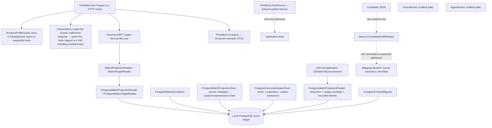
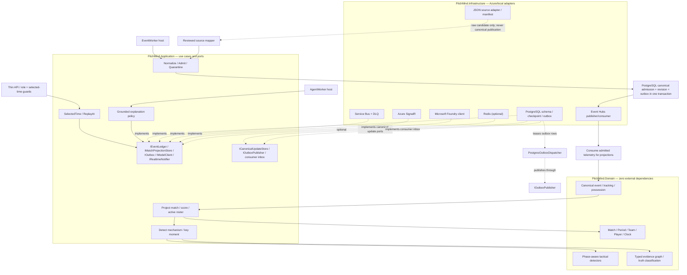

# C4 Level 3 — Components, domain purity and realization map

**CURRENT** sections document the source-verified local implementation; **TARGET** sections describe proposed ports and adapters, not an integrated runtime.

**Authority:** [Football LLD](07-football-analytics-detailed-lld.md), [API](../api/API.md), [Architecture review](../engineering/ARCHITECTURE-REVIEW-2026-10-08.md). Current runtime and target ports are intentionally separated to avoid asserting unavailable integrations.

## Realized application components (source verified, not new test evidence)

The Domain PressSequenceDetector is called by the offline SyntheticMatchService and the internal selected-time GetMatchAtQueryService; both paths use the same deterministic policy and emit simulated, unapproved, non-publishable insights with source/revision/time/evidence metadata. When the selected-time reducer state is available, the insight also carries versioned `tactical-context-v1`: scoreline, pressing-team role, active-player difference, reducer phase, and the event-supported possession transition. The detector builds a typed evidence graph with a pattern claim, source event/frame nodes and a reducer-derived context metric, links source events in observed order with `precedes` edges, and links the claim/context metric to source-prefix evidence with `derived_from` edges, including a source-hash-pinned active-roster node for reducer player counts. The graph validator rejects dangling references and does not allow publishing without approved policy and revisioned canonical evidence. Missing context state leaves context null. EP06-S01 adds a separate, local-profile-only canonical BFF that reads PostgreSQL projections/events/insights/evidence through the two read ports; fixture/demo routes remain fail-closed. Canonical routes are unauthenticated and cloud-unmapped, and the detector is not wired to the candidate Manu–Liverpool feed or evidence that certifies its coordinate/event semantics.

The profile guard rejects selecting local-only adapters outside Development while allowing an explicit Azure profile in Development, Staging, or Production. The in-memory event store is registered only for the local profile; Azure startup does not fall back to it. EP06-S01 registers PostgreSQL projection and insight readers only for the local profile when a connection string is configured; absent configuration uses unavailable adapters that return typed 503 responses. Azure authentication, managed identity and canonical service adapters are not configured. `EventWorker`, `AgentWorker` and Azure adapters must not be described as production-enabled. `ManuLivCandidateFeedReader` computes the exact source SHA-256 and parses source identity/order/time labels while retaining each original JSON record. It does not map event types, convert coordinates or clocks, persist data, or enable API reads; it is not wired into runtime composition. The candidate therefore still does not drive canonical match service behavior.

For EP05-S06, `MechanismReplayBuilder` exports only graph-referenced source events and sampled frames at the selected time, with stable participant identities, separate `eventIds` and `mechanismEventIds`, source metadata, the fixture coordinate convention and explicit limitations. The API contract carries the source hash and coordinate convention on the replay and each frame. It preserves original event identity/sequence/clock/period and does not interpolate movement. EP06-S01 composes the replay response from the canonical selected-time projection and event read port; the route remains local-only, and key moments remain unavailable until a persisted projection exists.

## Target Ports and Adapters

## Runtime, data and code invariants
- Pure Domain may not depend on Application, Infrastructure, Azure SDK, Npgsql or React. Infrastructure handles JSON source vocabulary, clock/units conversion, source record pointers, nullable coordinates and bad input quarantine.
- Raw candidates carry source hash, original bytes/IDs/order and raw clock labels; they have no `canonicalRevision` and are not canonical envelopes. Only PostgreSQL assigns a positive per-match `canonicalRevision` atomically with an admitted record and its outbox intent. `EventEnvelope` and `TrackingFrame` then carry the source/fixture hash, original sequence and explicit canonical index, period/elapsed time, pitch units/orientation, and observed-vs-interpolated coverage.
- PostgreSQL commits validated event, tracking reference, projection, evidence and outbox atomically; checkpoint follows durable commit; repeated delivery is safe.
- `MatchTimeContext` fixes match, selected timestamp, revision and period across API, pitch, scoreboard, events, claims and AI.
- Foundry receives read-only evidence scoped to selected time; separate deterministic validator checks every published claim; malformed model output falls back.
- React gets data via BFF; no clubs, players, scores, tactical observations or event-specific narrative hardcoded in `*.cs` or `*.tsx` after feed integration.
- **Every actual change** to an aggregate, port, trust boundary or deployment needs an updated diagram/ADR/API and contract tests in the same PR. Docs do not imply feature acceptance or authorize Azure DEV mutation.
