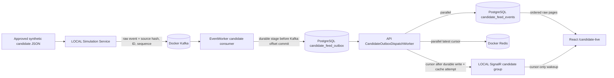
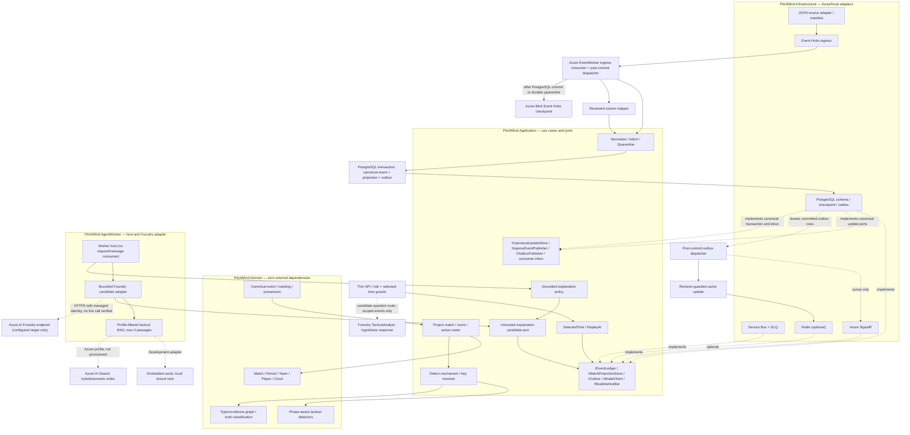

# C4 Level 3 — Components, domain purity and realization map

**CURRENT** sections document the source-verified local implementation; **TARGET** sections describe proposed ports and adapters, not an integrated runtime.

**Authority:** [Football LLD](07-football-analytics-detailed-lld.md), [API](../api/API.md), [Architecture review](../engineering/ARCHITECTURE-REVIEW-2026-10-08.md). Current runtime and target ports are intentionally separated to avoid asserting unavailable integrations.

## LOCAL candidate simulation stream (not canonical admission)

The candidate path preserves source event identity, sequence, raw clock/period values, raw event payload, provenance hash and original order. It intentionally uses separate candidate tables rather than `matches`, canonical event/projection tables or canonical BFF contracts. The UI renders raw candidate positions and player fields as unverified candidate observations; it scales only for visualization and does not infer a pitch coordinate system or interpret player metrics. Header Live starts/resumes or pauses the local replay; its indicator pulses only while the API reports active replay. SignalR is a latency hint, and PostgreSQL page reads are the UI's data source of truth.

The match-scoped candidate analyst route is composed in the API host: an authenticated analyst submits a question, selected specialist and source-clock value; the API reads only the selected match's persisted candidate events, bounds the packet, and calls the selected Foundry project agent with server-side Entra credentials. The allowlist matches the ten existing project agents, and TacticalAnalyst is the default. The AI Analyst UI polls the selected candidate cursor while visible and automatically requests a report for the newest notable event in each new page; users can still ask a manual question. Reports are transient page state rather than a durable analysis ledger. The response is schema-checked and all citations must resolve to the supplied source event IDs. It is returned only as an explicitly labeled hypothesis with source hash and limitations. Citation validation is not semantic entailment; the response is never admitted as canonical insight or persisted as football fact. DEV topology configuration targets the existing `pitchmind-ai-resource/pitchmind-ai` project and grants the API identity Foundry Agent Consumer at project scope. This grants endpoint invocation for agents in that project without project editing access. The grant/configuration is code only until the guarded what-if/deployment pipeline is approved and run; no live model request is verified.

The Azure candidate adapter code includes an Entra-authenticated Event Hubs publisher, a separate EventWorker consumer that persists an idempotent raw candidate outbox record (or a durable poison record) before updating its Blob checkpoint, managed-identity PostgreSQL token refresh, Entra-token refresh for Managed Redis, and Azure SignalR server endpoints using managed identity. The API outbox dispatcher writes PostgreSQL candidate history and the Redis cursor concurrently, then sends only the cursor through SignalR; PostgreSQL remains the UI backfill source. The private DEV Bicep template now declares the separate worker app, candidate hub/consumer group, Blob checkpoint container/private endpoint, SignalR service, scoped data-plane roles, and migration-time PostgreSQL worker principal. The release pipeline parameter `enableCandidateFeed` now defaults true; the protected what-if and approval gates still control application of infrastructure changes. The path has not been deployed or exercised against Azure. Candidate data remains explicitly non-canonical. Redis failures remain best-effort because the cache is rebuildable; they do not replace PostgreSQL.

## Realized application components (source verified, not new test evidence)

`ApiRequestTelemetry` records bounded HTTP request/error/duration instruments and trace tags without high-cardinality metric dimensions; unrecognized HTTP methods map to `_OTHER`. SignalR hub and negotiate requests are excluded from HTTP duration metrics because they can remain open for a connection lifetime. `PostgresOutboxDispatcher` measures durable message age and publication/retry/dead-letter counts; this is dispatch lag, not browser receipt lag or client reconnect state. An OTLP metrics exporter is registered only when an explicit standard OTLP endpoint variable is present; non-local profiles require HTTPS. No collector/backend is configured here, and no measured SLO or operator dashboard is claimed. `/health/live` and the compatibility `/health` route report process liveness; `/health/ready` requires configured PostgreSQL and a bounded probe of the current canonical schema version. Local without PostgreSQL is unready.

```mermaid
flowchart TB
  API["PitchMind.Api Program.cs / HTTP routes"] --> Profile["RuntimeProfileGuard: local in Development; azure in supported hosts"]
  API --> Security["ApiSecurity: Entra JWT / role policies / rate limits / security headers"]
  API --> Telemetry["ApiRequestTelemetry: low-cardinality counters + duration histogram"]
  Telemetry --> OtlpExporter["Optional OTLP metrics exporter: explicit endpoint; HTTPS outside Development/local"]
  OtlpExporter -. "destination is deployment configuration; none provisioned" .-> MetricsBackend["Azure Monitor or Azure-hosted OpenTelemetry Collector"]
  API --> Health["Liveness + bounded LOCAL PostgreSQL readiness"]
  API --> Guard["Fixture/demo routes fail closed; malformed requests → typed 4xx; body capped at 4 KiB including chunked input"]
  API --> BFF["Canonical BFF routes: protected in local and Azure profiles"]
  BFF --> ReadPorts["IMatchProjectionReader / IMatchInsightReader / IMatchTrackingReader"]
  ReadPorts --> PgReader["PostgresMatchProjectionReader / PostgresMatchInsightReader"] --> DB[("Local PostgreSQL canonical read models")]
  ReadPorts --> TrackingReader["PostgresMatchTrackingReader: selected-time tracking frames"] --> DB
  API --> LocalRealtime["Development/local ASP.NET Core SignalR: authenticated match groups + cursor-only negotiation"]
  LocalRealtime --> RealtimePublisher["Local IOutboxPublisher: ProjectionPublishedV1 → canonical revision/sequence cursor"]
  RealtimePublisher --> LocalHub["Local SignalR hub / match groups"]
  LocalHub --> Clients["Authorized local clients; canonical facts remain HTTP/PostgreSQL reads"]
  API --> Contracts["PitchMind.Contracts — versioned transport DTOs"]
  Test["PitchMind.TestFixtures — fictional golden fixtures"] -. "test-only reference" .-> AppTests["Application tests"]
  Ledger["PostgresMatchEventStore"] --> DB[("Local PostgreSQL event ledger")]
  ProjectionRead["PostgresMatchProjectionStore: source metadata + projection/provenance read"] --> DB
  CanonicalWrite["PostgresCanonicalUpdateStore: event + projection + outbox transaction"] --> DB
  DispatchWorker["OutboxDispatchWorker: Development/local + explicit local provider + loopback PostgreSQL only"] --> Dispatcher
  Dispatcher["PostgresOutboxDispatcher: leased at-least-once delivery"] --> RealtimePublisher
  Dispatcher --> OutboxMetrics["Published/retried/dead-lettered counters + outbox message-age histogram"]
  OutboxMetrics --> OtlpExporter
  PointInTime["Internal Application: GetMatchAtQueryService"] --> ReplayReader["PostgresMatchProjectionReader: projection + replay envelope + bounded frames"] --> DB
  BFF --> FrameRoute["GET /api/v1/canonical/matches/{matchId}/frames"] --> TrackingReader
  Operator["LOCAL developer: explicit dev-migrate.py"] --> DbMigrator["PitchMind.DbMigrator: loopback-only; owner migration connection"]
  DbMigrator --> Migrator["PostgresSchemaMigrator + LocalApiRoleProvisioner"] --> DB
  API -. "restricted pitchmind_api role: canonical reads + outbox lease columns" .-> DB
  Candidate["Candidate JSON"] -. "raw schema only" .-> RawReader["ManuLivCandidateFeedReader"]
  RawReader -. "LOCAL paced replay" .-> ReplayProducer["LocalCandidateFeedReplayProducer"]
  ReplayProducer --> ReplaySession["LocalCandidateFeedReplaySession: lifecycle + post-ack cursor save"]
  ReplaySession --> Checkpoint["FileCandidateFeedReplayCheckpointStore: local operational state"]
  ReplaySession -. "not connected to canonical admission" .-> Boundary["Mapping blocked: source semantics unverified"]
  EventWorker["Azure-only EventWorker: managed-identity PostgreSQL outbox dispatch"] --> EventHubPublisher["EventHubOutboxPublisher: validated ProjectionPublishedV1; partition key = matchId"]
  EventHubPublisher --> EH[("Azure Event Hubs")]
  EH --> ProjectionConsumer["EventWorker projection consumer"]
  ProjectionConsumer --> ConsumerInbox["PostgreSQL inbox + rebuildable snapshot"]
  ProjectionConsumer --> BrokerCheckpoint["Azure Blob Event Hubs checkpoint"]
  AgentWorker["AgentWorker: Foundry adapter + bounded tactical knowledge retrieval (no consumer; candidate remains untrusted)"]
  KnowledgeRetriever["ITacticalKnowledgeRetriever: profile topic allowlist; max 3 passages"]
  LocalKnowledge["LOCAL: embedded curated cards; lexical retrieval"]
  AzureKnowledge["Azure AI Search: hybrid/vector + semantic ranker; target index"]
  AgentWorker --> KnowledgeRetriever
  KnowledgeRetriever -. "Development/local adapter" .-> LocalKnowledge
  KnowledgeRetriever -. "Azure profile adapter; no service/index verified" .-> AzureKnowledge
  Orchestrator["ExplanationAgentOrchestrator: bounded curator → narrator → deterministic verifier (library code; not host-composed)"]
  MatchContext["Application MatchIntelligenceContextBuilder (not host-composed)"]
  MatchContext -. "read-only ports" .-> ReadPorts
  Orchestrator -. "read-only selected-time context tool" .-> MatchContext
  Orchestrator -. "candidate generation port" .-> AgentWorker
```

The Domain PressSequenceDetector is called by the offline SyntheticMatchService and the internal selected-time GetMatchAtQueryService; both paths use the same deterministic policy and emit simulated, unapproved, non-publishable insights with source/revision/time/evidence metadata. When the selected-time reducer state is available, the insight also carries versioned `tactical-context-v1`: scoreline, pressing-team role, active-player difference, reducer phase, and the event-supported possession transition. The detector builds a typed evidence graph with a pattern claim, source event/frame nodes and a reducer-derived context metric, links source events in observed order with `precedes` edges, and links the claim/context metric to source-prefix evidence with `derived_from` edges, including a source-hash-pinned active-roster node for reducer player counts. The graph validator rejects dangling references and does not allow publishing without approved policy and revisioned canonical evidence. Missing context state leaves context null. EP06-S01 adds a separate canonical BFF that reads PostgreSQL projections/events/insights/evidence through the projection and insight read ports. EP07-S05 adds a tracking read port and protected exact-selected-second frame route; it pins canonical revision, projection revision and source hash, and pages frames by stable sequence/frame identity. EP06-S04 protects canonical and legacy match routes with role policies and abuse controls; Azure runtime requires Entra authority/audience and uses unavailable adapters until cloud PostgreSQL composition exists. No fixture/demo route serves synthetic facts, and the detector is not wired to the candidate Manu–Liverpool feed or evidence that certifies its coordinate/event semantics.

The profile guard rejects selecting local-only adapters outside Development while allowing an explicit Azure profile in Development, Staging, or Production. The in-memory event store is registered only for the local profile; Azure startup does not fall back to it. EP06-S01 registers PostgreSQL projection and insight readers only for the local profile when a connection string is configured; EP07-S05 adds the PostgreSQL tracking-frame reader in the same local-only composition. Those reads and the local outbox dispatcher use the restricted `pitchmind_api` PostgreSQL role; it has no DDL, migration-history, quarantine, or canonical event/projection mutation privileges. `PitchMind.DbMigrator` is invoked explicitly by `scripts/dev-migrate.py` in LOCAL after Docker startup. It uses a host-loopback owner connection for versioned migrations and refreshes the API role grants; API startup does not run DDL. Azure migration/identity remains a separate target concern and is not implemented by this LOCAL tool. Azure maps the protected read contracts against unavailable adapters until an Azure PostgreSQL reader is configured, returning typed 503 responses after authorization. The frame route requires the MatchReplay role, validates persisted telemetry and indexed frame identity/source/time, applies selected-time and as-of sequence/revision bounds, and returns sanitized `503 CANONICAL_DATA_INVALID` for corrupt canonical payloads. It does not certify candidate source coordinate/time semantics. EP06-S04 adds Entra JWT bearer configuration and role policies for Azure, plus a development-only header adapter that must be explicitly enabled. EP06-S02's local implementation adds Development/local-only ASP.NET Core SignalR negotiation and a cursor-only outbox publisher; it uses the committed event's 64-bit canonical revision and sequence, strips persisted state, and leaves canonical reads on PostgreSQL-backed HTTP APIs. The local `OutboxDispatchWorker` is gated on Development, explicit local runtime/provider settings, and a single PostgreSQL loopback endpoint; it dispatches through the existing leased PostgreSQL outbox. This does not verify database-to-connected-client delivery or ordering/reconnect behavior. No Azure SignalR provider is registered, so non-local realtime negotiation returns 503. **EP04-S03 includes an Azure-only EventWorker outbox dispatcher and `EventHubOutboxPublisher`, plus an opt-in EventProcessorClient projection consumer. The consumer validates broker metadata and payload, commits a payload-bound inbox receipt plus a rebuildable PostgreSQL snapshot, advances the database partition cursor, and only then advances the Azure Blob checkpoint. No Azure host, resource, live connection, or cloud checkpoint has been verified; these are local code and test results, not production-enabled evidence.** `AgentWorker` remains an unconsuming host. Its Foundry candidate adapter now has an explicit bounded tactical-knowledge retrieval port: local code uses a profile-filtered lexical adapter over embedded cards; the Azure profile requires managed-identity access to an Azure AI Search index queried with text-vector plus semantic retrieval. Retrieved passages are advisory only, limited to three, and never count as match evidence or citations. No Azure search service/index, vectorizer, index role assignment, live query, Foundry call or host consumer is verified. `ManuLivCandidateFeedReader` computes the exact source SHA-256 and parses source identity/order/time labels while retaining each original JSON record. The LOCAL-only replay producer yields those raw records in order; its session owns pause/resume/cancel behavior and saves a source-bound cursor after each successful consumer acknowledgement through the file checkpoint store. The store is bounded, atomically replaced, and protected by exclusive session lease and reparse-point checks across existing path components. It is local operational state only: it does not map event types, convert coordinates or clocks, persist canonical facts, or enable API reads. The replay path is not wired into canonical runtime composition, so the candidate still does not drive canonical match service behavior.

For EP05-S06, `MechanismReplayBuilder` exports only graph-referenced source events and sampled frames at the selected time, with stable participant identities, separate `eventIds` and `mechanismEventIds`, source metadata, the fixture coordinate convention and explicit limitations. The API contract carries the source hash and coordinate convention on the replay and each frame. It preserves original event identity/sequence/clock/period and does not interpolate movement. EP06-S01 composes the replay response from the canonical selected-time projection and event read port; the route is protected in local and Azure profiles and returns unavailable until an authorized canonical reader is configured. Key moments remain unavailable until a persisted projection exists.

EP08-S01 adds an Application-only `MatchIntelligenceContextBuilder` over the existing projection and insight read ports. Its packet pins both `canonicalRevision` and `projectionRevision`, selected time and as-of sequence, plus score, insight source lineage, evidence references, limits and explicit unknowns. The builder is not registered by the API or AgentWorker; no public route or model call exposes it yet. The dashed diagram edge describes a code dependency only, not runtime composition. The AgentWorker Foundry adapter and Azure-profile managed-identity composition exist as code, but the worker has no request/message consumer and no live Foundry call has been performed. EP08-S03 adds a bounded in-process orchestration library with three typed handoff stages: it validates the host-authorized read-only context packet, calls one audience-aware candidate generator, then returns only deterministic verifier output. The generator accepts one ID from a versioned tactical profile catalog (nine specialist lenses plus an evidence-first default) and injects only that profile's referenced cards from an embedded football knowledge base. The profiles cover positional play and matchup hypotheses, pressing/escape routes, defensive phases, transitions, restarts, substitutions/game state, goalkeeper integration, chance creation, and source-backed coach frameworks. Profile and knowledge content is bounded and read-only; it does not create autonomous model handoffs, tools or canonical writes. The adapter supports either model-deployment chat completions or a configured project-agent Responses endpoint (`Foundry:Mode=ProjectAgent`, project endpoint, agent name); this mode does not create/update remote agents and has not been verified against the supplied project. The worker still does not compose authenticated host identity or consume a request/message. Rejected context and unverified candidate citation IDs are excluded from trace payloads; only verifier-approved evidence IDs appear as successful output. The orchestrator remains unregistered code. Candidate output is untrusted and cannot be displayed or persisted as a validated explanation; semantic support and live runtime composition remain unverified.

## Target Ports and Adapters

This is the requested **target ingress flow**, not the currently implemented EventWorker flow. Event Hubs is the first durable cloud ingress. A consumer validates and admits each record; PostgreSQL commits the canonical event/projection and an outbound outbox intent atomically. After commit, idempotent outbox deliveries may update Redis and publish SignalR cursors independently. SignalR never carries canonical facts; the browser reads those from the BFF/PostgreSQL path. Do not place an outgoing transactional outbox before its canonical database transaction; if an additional inbound staging store is needed, model it as an inbox/staging ledger and make Event Hubs checkpointing conditional on durable processing.

## Runtime, data and code invariants
- Pure Domain may not depend on Application, Infrastructure, Azure SDK, Npgsql or React. Infrastructure handles JSON source vocabulary, clock/units conversion, source record pointers, nullable coordinates and bad input quarantine.
- Raw candidates carry source hash, original bytes/IDs/order and raw clock labels; they have no `canonicalRevision` and are not canonical envelopes. Only PostgreSQL assigns a positive per-match `canonicalRevision` atomically with an admitted record and its outbox intent. `EventEnvelope` and `TrackingFrame` then carry the source/fixture hash, original sequence and explicit canonical index, period/elapsed time, pitch units/orientation, and observed-vs-interpolated coverage.
- PostgreSQL commits validated event, tracking reference, projection, evidence and outbox atomically; checkpoint follows durable commit; repeated delivery is safe.
- `MatchTimeContext` fixes match, selected timestamp, revision and period across API, pitch, scoreboard, events, claims and AI.
- Foundry receives read-only evidence scoped to selected time; separate deterministic validator checks every published claim; malformed model output falls back.
- React gets data via BFF; no clubs, players, scores, tactical observations or event-specific narrative hardcoded in `*.cs` or `*.tsx` after feed integration.
- **Every actual change** to an aggregate, port, trust boundary or deployment needs an updated diagram/ADR/API and contract tests in the same PR. Docs do not imply feature acceptance or authorize Azure DEV mutation.
