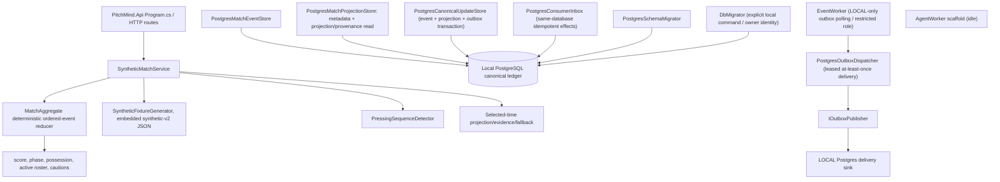
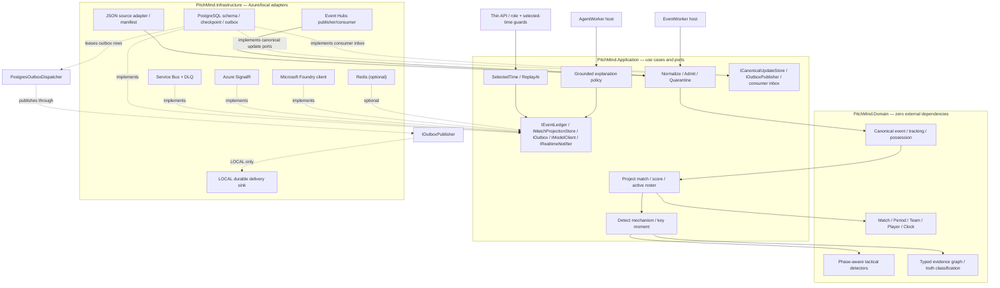

# C4 Level 3 — Components, domain purity and realization map

**CURRENT** sections document the source-verified local implementation; **TARGET** sections describe proposed Azure ports and adapters, not an integrated cloud runtime.

**Authority:** [Football LLD](07-football-analytics-detailed-lld.md), [API](../api/API.md), [Architecture review](../engineering/ARCHITECTURE-REVIEW-2026-10-08.md). Current runtime and target ports are intentionally separated to avoid asserting unavailable integrations.

## Realized application components (source verified, not new test evidence)

The fixture generator reads the fictional `data/simulations/synthetic-fixture-v2.json` definition as an embedded versioned resource; team/player/scenario facts are not literals in production C#. `SyntheticMatchService` folds the selected-time event prefix through the pure `MatchAggregate`, which enforces ordered sequence, 11-per-team initial roster, participant, period, score, card, substitution and terminal-state rules. The PostgreSQL v4 migration adds outbox lease/retry/dead-letter state and a consumer inbox while preserving v3 canonical admission revisions. `PostgresMatchProjectionStore` records immutable source metadata and reads persisted projection state and insight provenance, checking hashes and selected-sequence bounds. `PostgresCanonicalUpdateStore` commits event, canonical/projection revisioned state and outbox intent atomically; `PostgresOutboxDispatcher` provides leased at-least-once publication with bounded retries; `PostgresConsumerInbox` couples same-database effects to dedupe receipts. The LOCAL EventWorker polls the dispatcher under a restricted runtime role and writes each message to a separate durable PostgreSQL delivery sink; repeated IDs with different payloads fail. A distinct loopback-only DbMigrator command uses the database owner identity and must be run explicitly before the worker on a fresh database; the worker never migrates schema. This is a development transport adapter, not a broker. Azure profiles fail closed because no cloud publisher is registered. Metrics exporter/alert and projection API read path remain absent. Competition linkage, source import and persisted correction workflows remain unimplemented. The candidate `data/simulations/manu-liv-match-dataset.json` still does not drive the C# service.

## Target Ports and Adapters

## Runtime, data and code invariants
- Pure Domain may not depend on Application, Infrastructure, Azure SDK, Npgsql or React. Infrastructure handles JSON source vocabulary, clock/units conversion, source record pointers, nullable coordinates and bad input quarantine.
- `EventEnvelope` and `TrackingFrame` carry source/fixture hash, 1-based original sequence and explicit canonical index, period/elapsed time, pitch units/orientation, observed-vs-interpolated coverage.
- PostgreSQL commits validated event, tracking reference, projection, evidence and outbox atomically; checkpoint follows durable commit; repeated delivery is safe.
- `MatchTimeContext` fixes match, selected timestamp, revision and period across API, pitch, scoreboard, events, claims and AI.
- Foundry receives read-only evidence scoped to selected time; separate deterministic validator checks every published claim; malformed model output falls back.
- React gets data via BFF; no clubs, players, scores, tactical observations or event-specific narrative hardcoded in `*.cs` or `*.tsx` after feed integration.
- **Every actual change** to an aggregate, port, trust boundary or deployment needs an updated diagram/ADR/API and contract tests in the same PR. Docs do not imply feature acceptance or authorize Azure DEV mutation.
