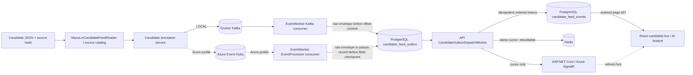
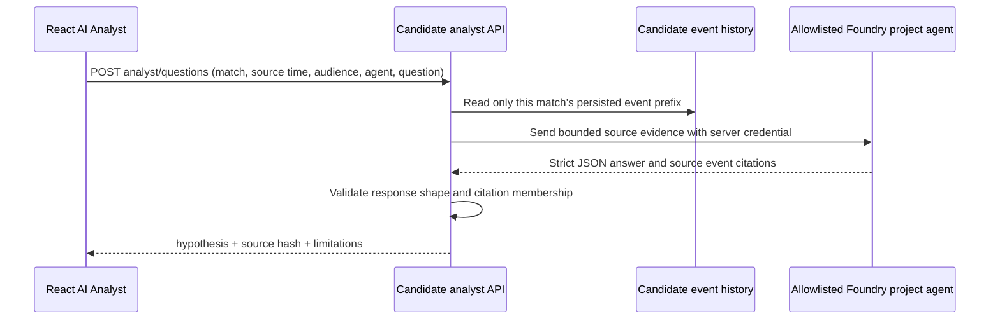

# C4 Level 3 — Implemented components and runtime boundaries

This document describes the **CURRENT** Azure DEV composition in `src/`, the routes in `PitchMind.Api`, and the React client. It distinguishes the candidate-feed path from canonical match processing. Adapter registration is source-level evidence; cloud connectivity and story acceptance require their own evidence. Full canonical Azure ingestion remains **TARGET** design in [the Azure HLD](06-target-azure-hld.md).

## DEV Azure component topology

```mermaid
flowchart LR
  JSON["Candidate JSON + SHA-256"] --> Reader["CandidateFeedSourceCatalog / reader"]
  Reader --> Simulation["API-hosted candidate simulation service"]
  Simulation -->|"ordered source envelopes"| EH[("Azure Event Hubs")]
  EH --> Worker["EventWorker on Azure Container Apps"]
  Worker -->|"durable before checkpoint"| CandidateOutbox[("Azure PostgreSQL candidate_feed_outbox")]
  Worker -->|"checkpoint state"| Blob[("Azure Blob Storage")]
  CandidateOutbox --> Dispatch["API CandidateOutboxDispatchWorker"]
  Dispatch -->|"event history"| CandidateHistory[("Azure PostgreSQL candidate_feed_events")]
  Dispatch -->|"latest cursor"| Redis["Redis container app on Azure Container Apps"]
  Dispatch -->|"cursor only"| SignalR["Azure SignalR Service"]
  CandidateHistory --> API["Candidate page API"]
  API --> UI["React Match / AI Analyst views"]
  SignalR -. "refresh hint; no facts" .-> UI
  UI -->|"bounded match-scoped request"| Analyst["Candidate analyst API"]
  Analyst -->|"selected persisted evidence"| CandidateHistory
  Analyst -->|"bounded project-agent request"| Foundry["Microsoft Foundry project agent"]
  API --> PlayerIntel["PlayerIntelligenceEndpoints / Service"]
  API --> HackOps["HackathonOperationsEndpoints (Recap, Export, Search)"]
```

The Candidate Simulation Service, outbox dispatcher, Player Intelligence Service, and Hackathon Operations Endpoints are application components hosted by the API container; EventWorker is a separate Container App. The candidate analyst's recent 503 was traced to a 30,076-byte Foundry Responses envelope exceeding the former 16,384-byte API limit. Main commit `dbd04f1f` raises the bound to 65,536 bytes, resolving the reported issue. See [DEV integration status](../engineering/AZURE-DEV-LIVE-INTEGRATION-STATUS.md).

## Candidate-live adapters — raw source events, non-canonical

The Azure-only DEV topology is shown above. The following source-level view compares the separately configured LOCAL adapter with the Azure adapter; it is not a DEV deployment diagram.

`CandidateFeedSourceCatalog` loads the repository-relative source file, rejects multi-match input for the current replay, and caches the parsed `ManuLivCandidateFeedReader` result and source SHA-256. `LocalCandidateSimulationService` owns start/resume/pause and uses the bounded replay session; the source cursor advances only after the publisher acknowledges an event. LOCAL publishes to Kafka, and the EventWorker consumer durably stages records in PostgreSQL before acknowledging Kafka. The Azure implementation publishes to Event Hubs; its consumer records the candidate envelope or a durable poison result before advancing the Blob checkpoint. Source IDs, sequence, raw clock/period values, raw payload and source hash are retained. These staging/history tables are not canonical match tables.

The API dispatcher writes candidate history and updates the latest Redis cursor. It publishes a cursor-only SignalR notification after the durable write and cache attempt, then acknowledges the candidate outbox record. Redis is rebuildable and is not the UI's event source; the UI reads ordered pages from PostgreSQL through `/api/v1/simulation/candidate/matches/{matchId}/events`. The candidate status/start/pause and SignalR negotiation endpoints are under `/api/v1/simulation/candidate`. The active UI shows source positions and player fields as unverified observations and labels the feed as non-canonical.

## Candidate analyst — direct API-to-project-agent request

The API validates the request and supplies at most eight persisted source events (bounded by a 32 KiB context) at or before the selected source-clock value. It restricts agent names to the ten-agent allowlist and defaults to `TacticalAnalyst`. The response must cite event IDs in the supplied packet; it is labeled `hypothesis` and is not persisted as a canonical insight. The AI Analyst UI can request a report for a newly observed notable event and accept user questions. Such reports are held in page state, not a durable report ledger. `tacticalAgentDiscussion.ts` computes illustrative discussion text in the browser; it is not multi-agent deliberation and is not an Azure AI response. The server-side project-agent call uses managed identity in the Azure profile. Its former response-size cap was too small for the full Foundry envelope; main commit `dbd04f1f` raises the limit and resolves the reported 503. The API does not substitute deterministic text for a future unavailable candidate analyst response.

## Player intelligence and dynamic visual services

`PlayerIntelligenceEndpoints` exposes roster and player-intelligence API routes. The service contains computed match-derived fields as well as explicit fallback/default values; these endpoints should not be described as exclusively live-feed-derived. The frontend's pitch and visual components render returned match context, while any local tactical discussion helper remains illustrative. See the API contract and current source before treating a displayed metric as validated football analysis.

## Canonical BFF and PostgreSQL readers

`CanonicalMatchEndpoints` exposes fixture, summary, event, frame, insight, evidence, replay and timeline-backfill reads. Application ports separate the route contracts from `PostgresMatchProjectionReader`, `PostgresMatchInsightReader` and `PostgresMatchTrackingReader`. LOCAL registration requires `Runtime:Profile=local` plus a PostgreSQL connection. Azure registration uses `AzurePostgresDataSourceFactory` and managed identity when the Azure profile has a connection string; otherwise it binds unavailable adapters. Persisted canonical reads are revision/time bounded and protected by `MatchRead` or the more restrictive `MatchReplay` policy. Legacy `/api/v1/matches` routes intentionally return `503 MATCH_DATA_UNAVAILABLE`; they do not fall back to candidate data or test fixtures.

Canonical aggregate, event-ingestion, evidence-graph and explanation-orchestration code exists in Domain/Application projects.

## Realtime and operational services

The API hosts `/hubs/matches` for enabled local realtime or Azure candidate-feed profiles. Candidate notifications carry source match/hash/sequence cursors; canonical notifications carry revision/sequence cursors. Both are hints; clients fetch facts from their corresponding page/read API. Local canonical outbox dispatch is enabled with Development, the local profile, explicit local realtime and loopback PostgreSQL. Azure SignalR uses the managed-identity provider when the Azure candidate profile is configured; the client includes automatic polling fallback.

`HackathonOperationsEndpoints` exposes operational services for the hackathon:
- `/api/v1/simulation/matches/{matchId}/recap`: Deterministic AutoRecap generation from verified key moments.
- `/api/v1/simulation/matches/{matchId}/export`: Permissioned evidence export with audit checks and SHA-256 fingerprinting.
- `/api/v1/simulation/matches/search`: Historical evidence retrieval.
- `/api/v1/simulation/matches/{matchId}/spatial-summary`: Spatial analysis.

`ApiSecurity` validates explicit runtime profiles, Entra issuer/audience and roles in Azure. Candidate and canonical actions use role policies and rate limits (120 req/min for general API, 30 req/min for analyst). Health endpoints distinguish liveness (`/health`, `/health/live`) from readiness (`/health/ready`), which probes PostgreSQL and schema version.

## AgentWorker and tactical intelligence

`PitchMind.AgentWorker` contains Foundry-related explanation and knowledge-retrieval components and the specialist profiles in `tactical-agents.v1.json`. The candidate analyst HTTP path is currently hosted by the API and calls a selected allowlisted project agent. `PitchMind.AgentWorker` is not a live multi-agent deliberation service for the current UI. Project configuration, agent invocation, and successful response are separate checks.

## Canonical versus candidate persistence

| Data path | Durable objects | Meaning |
| --- | --- | --- |
| Candidate replay | `candidate_feed_outbox`, `candidate_feed_events`, candidate poison records | Raw source records, source hash and operational cursor; not canonical facts |
| Canonical match | match ledger, projections, insights, evidence and transactional outbox | Admitted, revisioned football state and derived evidence |
| Realtime/cache | Redis projection/cursor and SignalR notifications | Rebuildable state or wake-up cursor; never authoritative match facts |

PostgreSQL is authoritative for both persisted candidate records and canonical records, but their schemas and trust status are separate. Candidate persistence does not certify the candidate feed or satisfy canonical ingestion. See [canonical ledger](../data/CANONICAL-EVENT-LEDGER.md), [candidate feed contract](../data/SIMULATION-FEED-CONTRACT.md), and [API contract](../api/API.md).
