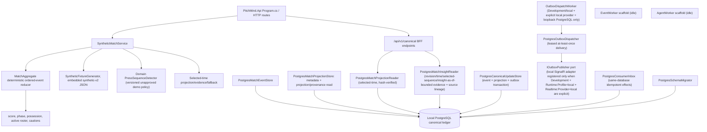
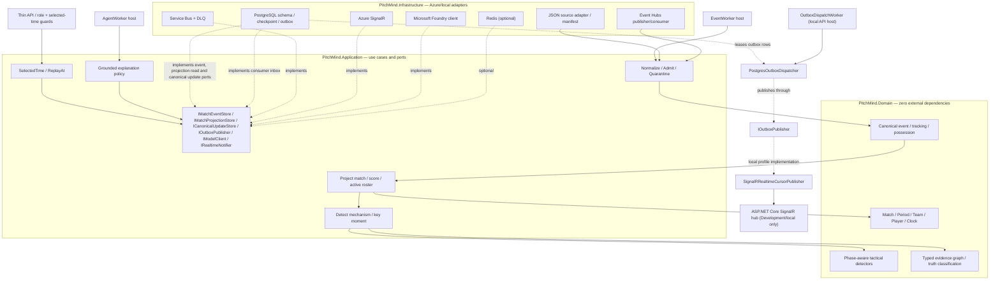

# C4 Level 3 — Components, domain purity and realization map

**CURRENT** sections document the source-verified local implementation; **TARGET** sections describe proposed ports and adapters, not an integrated runtime.

**Authority:** [Football LLD](07-football-analytics-detailed-lld.md), [API](../api/API.md), [Architecture review](../engineering/ARCHITECTURE-REVIEW-2026-10-08.md). Current runtime and target ports are intentionally separated to avoid asserting unavailable integrations.

## Realized application components (source verified, not new test evidence)

The fixture generator reads the fictional `data/simulations/synthetic-fixture-v2.json` definition as an embedded versioned resource; team/player/scenario facts are not literals in production C#. `SyntheticMatchService` folds the selected-time event prefix through the pure `MatchAggregate`, which enforces ordered sequence, 11-per-team initial roster, participant, period, score, card, substitution and terminal-state rules. The version 3 schema supports immutable match/source metadata and projection/insight provenance reads; `PostgresMatchProjectionStore` verifies source/state hashes and rejects event/frame evidence later than an insight sequence. Its bounded insight path calls the Domain `PressSequenceDetector` with the same event prefix, selected time/through-sequence, fixture version, pitch dimensions, projected selected-time score/roster/phase context, and available frames. The response context states scoreline, home/away role, active-player difference, match phase and the observed opponent possession transition; it does not infer a playing style, intent or superiority. The detector builds a typed evidence graph with a pattern claim, source event/frame nodes and a reducer-derived context metric, links source events in observed order with `precedes` edges, and links the claim/context metric to source-prefix evidence with `derived_from` edges. The graph validator rejects dangling evidence references and blocks publishable status unless canonical revision and an approved policy are present. The only executable policy is `press-sequence-v2` with status `unapproved-demo`; its output is `simulated` and `publishable=false`. This fixture path is not wired to the PostgreSQL projection reader and is not a PO-approved or canonical detector. `PostgresCanonicalUpdateStore` requires the registered source hash and commits event, revisioned state and outbox intent atomically; `PostgresOutboxDispatcher` uses stable IDs, leases and bounded retries, and emits local .NET metrics; `PostgresConsumerInbox` couples a same-database effect to its dedupe receipt. For canonical reads, `CanonicalMatchEndpoints` composes `IMatchProjectionReader` and `IMatchInsightReader`; PostgreSQL adapters verify projection hashes and bound snapshots/event pages by match, selected time and revision sequence; insight references and stored event/frame evidence payloads are additionally bounded by each insight's own as-of sequence. Canonical insight responses include source version, provenance and the SHA-256 for the insight revision's source projection. The API returns typed unavailable errors rather than falling back to `SyntheticMatchService`. These routes remain unauthenticated and must not be exposed at cloud ingress before EP06-S04 or an explicitly approved synthetic public-read boundary. There is no Azure broker publisher or metrics exporter/alert. In Development/local SignalR mode with PostgreSQL configured to an approved loopback host, `OutboxDispatchWorker` in the API host invokes the existing dispatcher and local cursor publisher; database-to-connected-client delivery and ordering/reconnect remain unverified. Competition linkage and source import remain unimplemented. `EventWorker`, `AgentWorker` and Azure adapters must not be described as production-enabled. The candidate `data/simulations/manu-liv-match-dataset.json` still does not drive the C# service.

For EP05-S06, `MechanismReplayBuilder` exports only graph-referenced source events and sampled frames at the selected time, with stable participant identities, separate `eventIds` and `mechanismEventIds`, source metadata, the fixture coordinate convention and explicit limitations. The API mapping carries that convention on the replay and each frame. It preserves original event identity/sequence/clock/period and does not interpolate movement. The replay route remains synthetic-only and non-publishable.

## Target Ports and Adapters

## Runtime, data and code invariants
- Pure Domain may not depend on Application, Infrastructure, Azure SDK, Npgsql or React. Infrastructure handles JSON source vocabulary, clock/units conversion, source record pointers, nullable coordinates and bad input quarantine.
- `EventEnvelope` and `TrackingFrame` carry source/fixture hash, 1-based original sequence and explicit canonical index, period/elapsed time, pitch units/orientation, observed-vs-interpolated coverage.
- PostgreSQL commits validated event, tracking reference, projection, evidence and outbox atomically; checkpoint follows durable commit; repeated delivery is safe.
- `MatchTimeContext` fixes match, selected timestamp, revision and period across API, pitch, scoreboard, events, claims and AI.
- Foundry receives read-only evidence scoped to selected time; separate deterministic validator checks every published claim; malformed model output falls back.
- React gets data via BFF; no clubs, players, scores, tactical observations or event-specific narrative hardcoded in `*.cs` or `*.tsx` after feed integration.
- **Every actual change** to an aggregate, port, trust boundary or deployment needs an updated diagram/ADR/API and contract tests in the same PR. Docs do not imply feature acceptance or authorize Azure DEV mutation.
