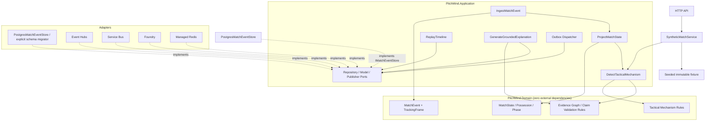

# C4 L3 — Application components

## Verified versus target paths (2026-10-08)

`PitchMind.Api` currently composes `SyntheticMatchService`, which reads the generated immutable fixture directly and provides selected-time state, events, insight, evidence and deterministic explanation. `SyntheticFixtureGenerator` uses seed/version-derived IDs and stable timestamps. `PressingSequenceDetector` is a bounded demonstration rule with metre coordinates and a same-period ordered event chain. This endpoint path does not call the event store.

Separately, `PostgresMatchEventStore` implements `IMatchEventStore` and `PostgresSchemaMigrator` applies an explicit schema operation using a migration connection. Infrastructure integration tests exercise durable event ledger behavior and runtime-role restrictions against local PostgreSQL. The ledger persists `MatchEvent`; it does not yet persist the simulation wrapper metadata, tracking frames, projections, evidence, or outbox. Event Hubs, Service Bus, Foundry and Redis remain target adapters. EP04 and complete cloud paths are therefore still open.

## Required invariants
- `Domain` references neither Application nor Infrastructure.
- Input event IDs are stable; sequence violations quarantine, not silently reorder truth.
- Observed ≠ Derived ≠ Supported Interpretation ≠ Hypothesis.
- No unsupported AI claim can be published.
- Replay with identical input and algorithm version yields identical outputs.
- Agent tools are read-only and budgeted.
