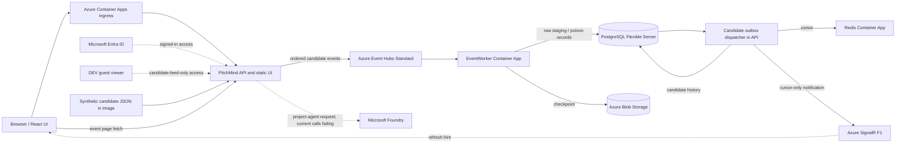

# C4 Level 4 — Azure DEV deployment and runtime evidence

**CURRENT:** This document combines the Azure DEV resource inventory with the repository's deployment topology. It distinguishes a resource being present from the app successfully using it. Inventory was read on **2026-10-28** in `rg-pitchmind-dev-001`; incident notes reflect the owner-reported resolution state as of **2026-10-29**. See [the integration status](../engineering/AZURE-DEV-LIVE-INTEGRATION-STATUS.md) for detail and evidence limits.

**TARGET:** the planned Azure topology and release shape are described in the [target Azure HLD](06-target-azure-hld.md); the resource table and diagram below document current DEV only and do not imply target completeness.

## Current DEV candidate-feed path

The candidate flow is distinct from canonical match ingestion. PostgreSQL stores candidate outbox/history separately; Redis holds a rebuildable cursor; SignalR sends a cursor hint, not event facts. The UI fetches event pages through the API. The Azure Managed Redis resource declared as an optional Bicep path is not the Redis deployment observed in the current inventory.

## Azure resources observed

| Resource | Current observed configuration | Notes |
| --- | --- | --- |
| `pm-dev-api-vnet`, `pm-dev-api-vnet-eventworker` | Azure Container Apps in `pm-dev-private-cae` (Consumption) | API and worker workloads; resource presence does not prove ready revisions or healthy event processing. |
| `pm-dev-redis-cache` | Container App; image `redis:7-alpine`; min/max replicas 1 | This is the current Redis runtime, not Azure Managed Redis. The always-on replica may incur Consumption usage. |
| `pm-dev-eh` | Event Hubs Standard | Candidate event transport. |
| `pitchmind-postgresql-dev` | Flexible Server, Burstable `Standard_B1ms` | Durable DB; canonical and candidate records have different trust boundaries. |
| `pmdev4iwntkatliy6sst` | Standard LRS Storage | Blob checkpoint storage. |
| `pm-dev-signalr` | Free F1, capacity 1 | Realtime cursor notifications subject to F1 limits. |
| `pitchmind-ai-resource` / project `pitchmind-ai` | Azure AI / Foundry resource | Configured project-agent path; reported API 503 was resolved by raising the bounded response envelope size. |
| `pitchmind-ai-srch-s3d9` | Azure AI Search Serverless | Resource exists; current analyst request does not prove this index is configured or used. |
| `pmdev4iwntkatliy6sacr` | Azure Container Registry Basic | Image registry. |
| `pmdev4iwntkatliy6skv` | Azure Key Vault | Exists; exact secret reads and workload identity access require separate verification. |
| `pm-dev-logs` | Log Analytics workspace | ACA diagnostic destination. |
| `pm-dev-4iwntkatliy6-sbus` | Service Bus Standard | Present in the resource group; not part of the current candidate-feed flow. |
| `pm-dev-vnet`, private DNS zones/links, `pm-dev-blob-pe` | Network resources | Actual connectivity still depends on DNS, routing, policy, and access configuration. |

Managed identities are also present for API runtime, EventWorker, image pull, and demo/migration tasks. Resource inventory does not verify effective role assignments or PostgreSQL grants. No Azure Managed Redis resource was identified in this DEV inventory.

## Current code and limitations

- `infra/private-dev-topology.bicep` configures a Redis container app when `provisionRedis=false` (the default); when true, it can declare Azure Managed Redis and a private endpoint. The deployed `pm-dev-redis-cache` is the container-app option.
- The pipeline YAML currently defaults `enableDevDelivery=true` and `enableCandidateFeed=true`. Exact-plan review and Azure DevOps environment/service-connection controls remain necessary; repository YAML alone does not prove external approvals or a completed release.
- The candidate analyst API sends bounded persisted source evidence to an allowlisted Foundry project agent and validates response shape and evidence-ID membership. The reported `503 ANALYST_UNAVAILABLE` was fixed in main commit `dbd04f1f` by raising the Foundry response bound from 16,384 to 65,536 bytes. The browser's tactical discussion helper is computed text, not an agent response.
- Candidate data remains synthetic and non-canonical. The UI must not treat source sequence, clock, coordinate units, or raw event labels as validated football semantics.
- The provisioned Service Bus, optional managed Redis, AI Search, AgentWorker code, and canonical-ingestion design are not automatically part of the live candidate-feed path.

## Release and verification controls

Azure DevOps builds/tests, publishes an immutable image, validates Bicep, generates a what-if plan, and passes through the configured approval/deployment gates. A green CI run does not prove deployment. After a release, verify the active image digest/revision, readiness, migration status, managed-identity roles, an Event Hubs event through PostgreSQL and Blob checkpointing, Redis cursor update, SignalR negotiation, and UI refresh. For AI, verify a real project-agent request and response separately. See [pipeline guide](../../pipelines/README.md) and [Azure DEV status](../engineering/AZURE-DEV-LIVE-INTEGRATION-STATUS.md).
