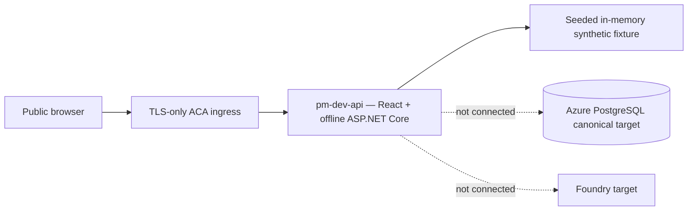
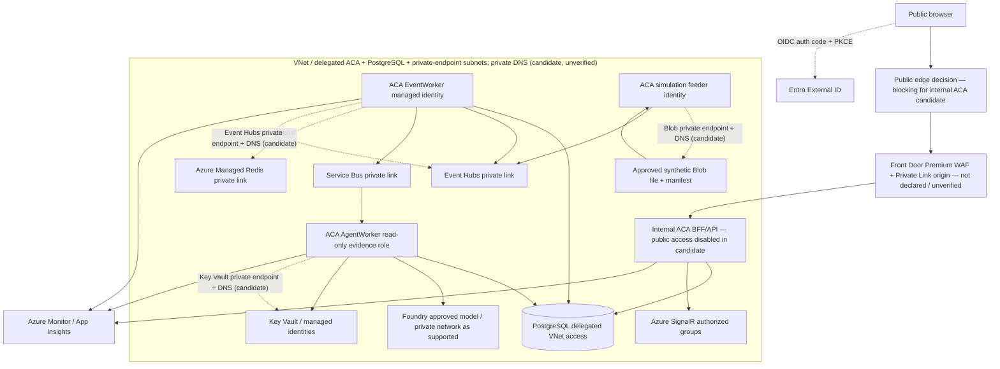
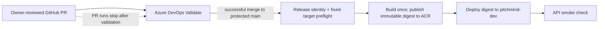

# C4 Level 4 — Deployment and trust boundaries

**Two separate realities:** Previous DEV evidence proves only one read-only synthetic ACA demonstration. The target below is **not** evidence that service connections/private network are implemented. [Azure HLD](06-target-azure-hld.md) | [DEV evidence](../engineering/evidence/2026-10-08-DEV-DEPLOYMENT.md) | [Operating model](../operating-model/ENGINEERING-OPERATING-MODEL.md).

For the resource-by-resource current/deferred/blocking reconciliation, see [EP02-S01 IaC reconciliation](../engineering/EP02-S01-IAC-RECONCILIATION.md). Its observed state comes from the dated DEV evidence; private connectivity and the canonical PostgreSQL path remain unverified blockers.

The isolated [`infra/canonical-dev-topology.bicep`](../../infra/canonical-dev-topology.bicep) root is an executable candidate for internal ACA, private PostgreSQL, and conditional Blob/Key Vault/Event Hubs private endpoints. Its endpoint targets use caller-supplied subscription/resource-group/name inputs bound to fixed-type existing-resource declarations; those declarations do not establish resource existence or private-only service policy. The root is disabled by default and not referenced by the normal deployment pipeline. Because its ACA environment is internal and public network access is disabled, this candidate has no direct public-browser path. A public edge design is a blocking decision; Front Door Premium with a Private Link origin or a reviewed ACA topology change are options, neither implemented or verified here. Compilation is not deployment evidence; subnet overlap, target-service policy/DNS ownership, SKU/region capacity, identity, app workloads, and end-to-end connectivity still require review and separately approved verification. On local candidate commit `a481094bb8476f07bfffefe38f1d5d1db37781d`, Bicep CLI 0.48.1 compiled the canonical, main and demo roots plus DEV/STAGE/PROD and example parameter files, and linted the canonical root; generated ARM confirmed the opt-in default is false and all 19 emitted resources are conditional. This remains local syntax/template evidence only.

## CURRENT — observed DEV prototype (limited)

Previous deployment evidence cites image digest, revision and HTTP smoke. It **does not** prove source-file-driven live ingestion, persistent tracking/projections, Azure managed identity database authentication, Event Hubs, SignalR or Foundry.

## Azure-only TARGET topology and trust zones

**Actual SKU/network feasibility must be validated:** the diagram is conceptual. ACA environment/subnet delegation, PostgreSQL Flexible Server networking mode, Azure SignalR and Foundry private DNS/region availability, user-assigned identity scopes, Functions network capability and outbound routing require product-specific validation and actual connectivity tests. Do not bypass access restrictions to force an unapproved demo.

The public edge shown above is a target option, not a configured route. The current candidate declares neither Front Door nor a public ACA ingress path. The existing offline demo's observed public ACA ingress does not prove reachability to the private canonical candidate.

## Automatic application delivery to DEV

- **LOCAL:** Docker Compose PostgreSQL and Redis with explicit local adapters; no live Azure token required for domain tests.
- **DEV application release:** each successful commit merged by an owner-reviewed PR into protected `main` triggers Azure DevOps validation, release identity preflight, one immutable image build/push, Container App deployment by digest, and API smoke checks. PR validation is release-ineligible. Failed stages stop downstream delivery. This pipeline policy is implemented in source but does not prove external branch protection, Azure DevOps registration, service connections, role assignments, Environment configuration, or a successful cloud run.
- **DEV infrastructure changes:** provisioning, Bicep application, role assignments, database/schema migration and other Azure resource mutations remain separate changes with scoped owner approval and reviewed what-if/cost/rollback evidence. Application auto-release does not authorize infrastructure mutation.
- **STAGE/PROD:** separate Azure resources/data/identity, protected approvals, replay/correction golden tests, restore/recovery evidence and budgets.
- Azure DevOps is CI/CD authority, GitHub hosts source. Configure GitHub `main` branch protection to require PR review and all relevant Azure Pipeline checks; restrict direct pushes and bypass. The `pitchmind-dev` Environment must have no manual approval check if DEV application deployment is to be automatic. This repository cannot prove those external controls are configured.
- Image publication and DEV deployment use distinct workload-federated Azure DevOps service connections: `pitchmind-acr-publisher-wif` scoped to the exact ACR (`AcrPush`) and `pitchmind-dev-deployer-wif` scoped to the named Container App with minimum reviewed update permission. The release preflight checks that the distinct expected connection names and exact DEV target are supplied; actual existence, federation and RBAC remain externally verified setup steps.
- Retain immutable artifacts, minimum necessary access, separate migration and runtime identities, no local PostgreSQL/Ollama/Redis in cloud, and no claims that unavailable proof was executed.
