# C4 Level 4 — Azure DEV deployment

This view describes the Azure-only DEV design implemented by `infra/private-dev-topology.bicep`, the Azure API/EventWorker composition, and the guarded Azure DevOps release template. It separates what the repository declares from what has been observed in the deployed app. A Bicep resource, environment setting, or successful compile is not proof of an existing resource or a working data-plane connection. See the [DEV integration status](../engineering/AZURE-DEV-LIVE-INTEGRATION-STATUS.md) for dated evidence.

## TARGET architecture (declared Azure DEV topology)

The flow below is the target topology declared in source/configuration. It does not claim that every Azure resource or data-plane connection has been deployed or observed.

```mermaid
flowchart LR
  Browser["Browser"] --> Ingress["Azure Container Apps HTTPS ingress"]
  Ingress --> API["PitchMind API + React assets — Azure Container Apps"]
  Browser <-->|"interactive sign-in / access token"| Entra["Microsoft Entra ID"]
  Browser -->|"bearer access token"| API
  Source["Candidate JSON packaged in API image"] --> Simulation["API-hosted candidate Simulation Service"]
  Simulation -->|"source-order events; managed identity"| EH[("Azure Event Hubs candidate hub")]
  EH -->|"consumer group; at-least-once"| Worker["PitchMind EventWorker — separate Azure Container App"]
  Worker -->|"durable raw event / poison record"| Outbox[("Azure Database for PostgreSQL — candidate outbox")]
  Worker -->|"checkpoint after durable stage; managed identity"| Blob[("Azure Blob checkpoint container")]
  Outbox --> Dispatch["API CandidateOutboxDispatchWorker"]
  Dispatch -->|"idempotent event history"| History[("Azure Database for PostgreSQL — candidate history")]
  Dispatch -->|"latest cursor; rebuildable"| Redis[("Azure Managed Redis")]
  Dispatch -->|"after durable history; cursor only"| SignalR["Azure SignalR Service"]
  History -->|"selected match event pages"| API
  SignalR -. "refresh hint; no football facts" .-> Browser
  API -. "bounded source evidence; hypothesis only" .-> Foundry["Microsoft Foundry project agents"]
```

The API simulation service publishes records to Event Hubs; it does not send the UI a local fixture or bypass the broker. EventWorker persists the source envelope or a durable poison record in the candidate outbox before committing the Blob checkpoint. The API dispatcher writes persisted candidate history and the Redis cursor, then sends SignalR a cursor-only hint. The UI retrieves event pages from the API. PostgreSQL is the durable store; Redis is a rebuildable cursor cache. These candidate tables are isolated from canonical match tables, and replayed source records do not establish canonical football facts.

The analyst route is a separate API request: it reads a bounded prefix of persisted candidate events and can call an allowlisted Microsoft Foundry project agent. Its response is an evidence-bounded hypothesis. The repository does not implement a durable, automatic per-event Foundry report pipeline or a hosted multi-agent orchestration worker.

## CURRENT implementation and deployment evidence

- **Implemented in source/configuration:** API and EventWorker Azure profiles; Event Hubs candidate producer/consumer; PostgreSQL Entra data-source and candidate outbox/history persistence; Redis Entra access; Azure SignalR provider with client polling fallback; Blob checkpoints; 10 tactical agent profiles; Player Intelligence endpoints; Hackathon Operations endpoints; and separate EventWorker Container App.
- **Verified Azure Cloud Services (`rg-pitchmind-dev-001`):**
  - **Azure AI Services (`pitchmind-ai-resource`):** Live model deployment `gpt-4.1-mini` verified with authenticated 200 OK responses, bounded fan/analyst audience modes, and deterministic citation fallback (see [EP08-S02 evidence](../engineering/evidence/EP08-S02-AZURE-AI-LIVE-VERIFICATION-2026-10-17.md)).
  - **Azure Container Apps:** Live ACA API responding with HTTP 200 on `/health` and `/api/health`.
  - **Azure Database for PostgreSQL Flexible Server:** Schema migrations 1-10 verified.
- **Authentication & Security:** Microsoft Entra ID authentication implemented with PKCE flow; rate limiting (120 req/min general, 30 req/min analyst) and request payload bounds (4096 bytes); fail-closed demo fallback for offline evaluation.
- **Verified Test Suites:** 534 .NET tests passed (0 failures); 159 frontend Vitest tests passed (0 failures); 10 Playwright E2E tests passed; 0 Axe WCAG 2.1 AA accessibility violations.

## Environment and release controls

- DEV, STAGE and PRODUCTION use Azure services only. LOCAL uses its separate Docker adapters, documented in the [local development guide](../engineering/M02-LOCAL-DEVELOPMENT.md); it is not part of this deployment diagram.
- `enableDevDelivery` is default-off. Within the guarded path `enableCandidateFeed` defaults on; the Bicep module itself defaults candidate provisioning off unless the pipeline passes the flag.
- The release requires reviewed what-if output, immutable image digest, exact-change owner approval, and the protected Azure DevOps environment. A successful validation pipeline does not deploy by itself.
- No Azure resource was provisioned or changed for this documentation update.
