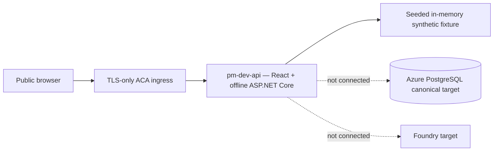
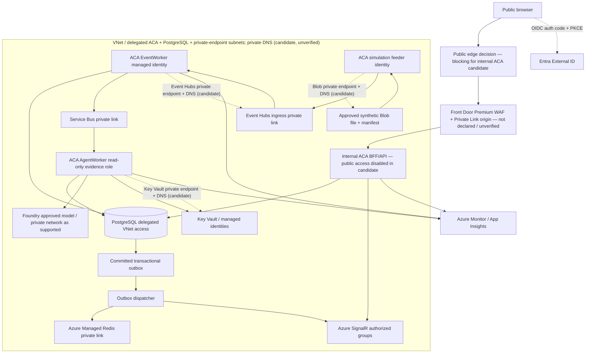
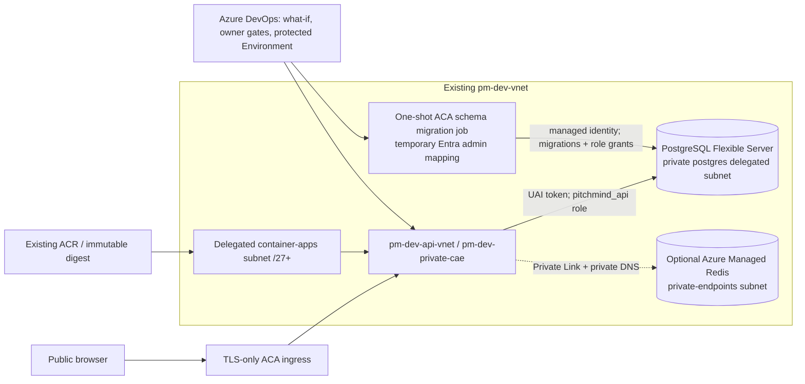

# C4 Level 4 — Deployment and trust boundaries

**Two separate realities:** Previous DEV evidence proves only one read-only synthetic ACA demonstration. The target below is **not** evidence that service connections/private network are implemented. [Azure HLD](06-target-azure-hld.md) | [DEV evidence](../engineering/evidence/2026-10-08-DEV-DEPLOYMENT.md) | [Operating model](../operating-model/ENGINEERING-OPERATING-MODEL.md).

For the resource-by-resource current/deferred/blocking reconciliation, see [EP02-S01 IaC reconciliation](../engineering/EP02-S01-IAC-RECONCILIATION.md). Its observed state comes from the dated DEV evidence; private connectivity and the canonical PostgreSQL path remain unverified blockers.

The isolated [`infra/canonical-dev-topology.bicep`](../../infra/canonical-dev-topology.bicep) root is an executable candidate for internal ACA, private PostgreSQL, and conditional Blob/Key Vault/Event Hubs private endpoints. Its endpoint targets use caller-supplied subscription/resource-group/name inputs bound to fixed-type existing-resource declarations; those declarations do not establish resource existence or private-only service policy. The root is disabled by default and not referenced by the normal deployment pipeline. Because its ACA environment is internal and public network access is disabled, this candidate has no direct public-browser path. A public edge design is a blocking decision; Front Door Premium with a Private Link origin or a reviewed ACA topology change are options, neither implemented or verified here. Compilation is not deployment evidence; subnet overlap, target-service policy/DNS ownership, SKU/region capacity, identity, app workloads, and end-to-end connectivity still require review and separately approved verification. On local candidate commit `a481094bb8476f07bfffefe38f1d5d1db37781d`, Bicep CLI 0.48.1 compiled the canonical, main and demo roots plus DEV/STAGE/PROD and example parameter files, and linted the canonical root; generated ARM confirmed the opt-in default is false and all 19 emitted resources are conditional. This remains local syntax/template evidence only.

## CURRENT — observed DEV prototype (limited)

Previous deployment evidence cites image digest, revision and HTTP smoke. It **does not** prove source-file-driven live ingestion, persistent tracking/projections, Azure managed identity database authentication, Event Hubs, SignalR or Foundry.

## Azure-only TARGET topology and trust zones

**Actual SKU/network feasibility must be validated:** the diagram is conceptual. ACA environment/subnet delegation, PostgreSQL Flexible Server networking mode, Azure SignalR and Foundry private DNS/region availability, user-assigned identity scopes, Functions network capability and outbound routing require product-specific validation and actual connectivity tests. Do not bypass access restrictions to force an unapproved demo.

The public edge shown above is a target option, not a configured route. The current candidate declares neither Front Door nor a public ACA ingress path. The existing offline demo's observed public ACA ingress does not prove reachability to the private canonical candidate.

## Separation and approval
- **LOCAL:** Docker Compose PostgreSQL and Redis with explicit local adapters; no live Azure token required for domain tests.
- **DEV:** Azure-only integrated workload when the owner explicitly approves **each** change set, with a recorded subscription/region/resource diff, exact git SHA/digest, cost, migration, rollback and verification plan.
- **STAGE/PROD:** separate Azure resources/data/identity, protected approvals, replay/correction golden tests, restore/recovery evidence and budgets.
- Azure DevOps is CI/CD authority, GitHub hosts source. A passing PR, Bicep compile/what-if, a diagram or `enableDevDelivery=true` is **not** owner approval. DEV pipeline must require independent manual/protected gate before any Azure registry/service mutation.
- If release delivery is explicitly configured, image publication and DEV deployment use distinct workload-federated Azure DevOps service connections. The publisher is scoped to the exact ACR (`AcrPush`); the deployer is scoped to the named Container App with the minimum reviewed update permission. The opt-in gate rejects missing or identically named connections. These are configuration requirements, not evidence that either connection exists or that its RBAC has been verified.
- `ManualValidation@0` is a pause, not owner identity enforcement: users with pipeline Queue builds permission can resume or reject it ([Microsoft task documentation](https://learn.microsoft.com/en-us/azure/devops/pipelines/tasks/reference/manual-validation-v0?view=azure-pipelines)). Configure and verify owner-only queue permissions and protected Environment approvers before any DEV release; this repository has no evidence those controls are configured.
- Retain immutable artifacts, minimum necessary access, separate migration and runtime identities, no local PostgreSQL/Ollama/Redis in cloud, and no claims that unavailable proof was executed.

## Guarded DEV topology candidate (not deployed)

`infra/private-dev-topology.bicep` is an opt-in alternative for the existing `pm-dev-vnet`. It creates a separate ACA environment on a newly delegated `container-apps` subnet while preserving public browser ingress through ACA; PostgreSQL remains private on the `postgres` delegated subnet. An optional Azure Managed Redis instance uses a Private Link endpoint in the existing `private-endpoints` subnet, `privatelink.redis.azure.net` DNS, TLS, and disabled public network access. PostgreSQL and Redis provisioning are separate default-off options. The shared private-endpoints subnet itself is not changed.

The guarded release candidate now sets the API to `Runtime:Profile=azure`, gives it a dedicated user-assigned identity, creates the `pitchmind` database when reusing the existing PostgreSQL server, and runs a one-shot ACA migration job before the deployment script completes. The job applies the current schema and maps the API identity to the restricted `pitchmind_api` database role. Its separate migration identity is temporarily mapped as a PostgreSQL Entra administrator; the deployment script removes that administrator mapping only after the job succeeds. `/health/ready` verifies authenticated PostgreSQL connectivity and the current schema version. This is source and pipeline behavior only until an owner-approved release runs and passes the health smoke.

The API candidate keeps `CandidateFeed:Enabled=false`; this readiness fix does not claim the live simulation, Event Hubs ingress, Redis projection, or SignalR flow is operational in DEV. Redis's initial low-cost configuration has HA disabled and remains cache-only. Subnet CIDR/overlap, SKU/region capacity, RBAC, private DNS resolution, database role creation, and connectivity still require guarded pipeline execution and smoke evidence.
