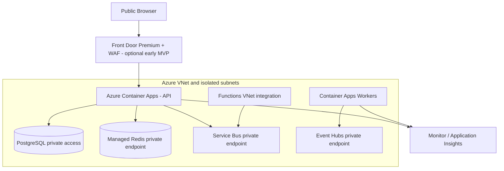

# Deployment, environments and trust boundaries

The drawing is logical: subnet delegation, private endpoints, private DNS, egress, Function plan compatibility and regional support must be validated per resource. No claim that this topology has been deployed.

## Environment strategy
- Local: Docker PostgreSQL/Redis and explicit local event/AI adapters.
- DEV: Azure-only integration environment; smallest viable SKUs.
- STAGE: production-like security, test fixtures, deployment and rollback exercises.
- PROD: approved identity, network, backup, SLO, alerts and release gates.
- Separate environment parameter files; secrets and credentials never committed.
- Advanced ADX, ML, AI Search, APIM and Data Lake disabled until a feature gate justifies them.

## Observed DEV prototype (2026-10-08)

The existing centralindia ACA environment now hosts `pm-dev-api` from a recorded immutable linux/amd64 digest, with managed-identity ACR pull and TLS ingress. This explicitly tagged offline synthetic demonstration serves the React client and read-only selected-time fixture API from one container. [Deployment and actual HTTP smoke evidence](../engineering/evidence/2026-10-08-DEV-DEPLOYMENT.md) records the revision/digest. It has no canonical cloud database/feed/model path; the target trust-boundary diagram above is still unproved for those components.
