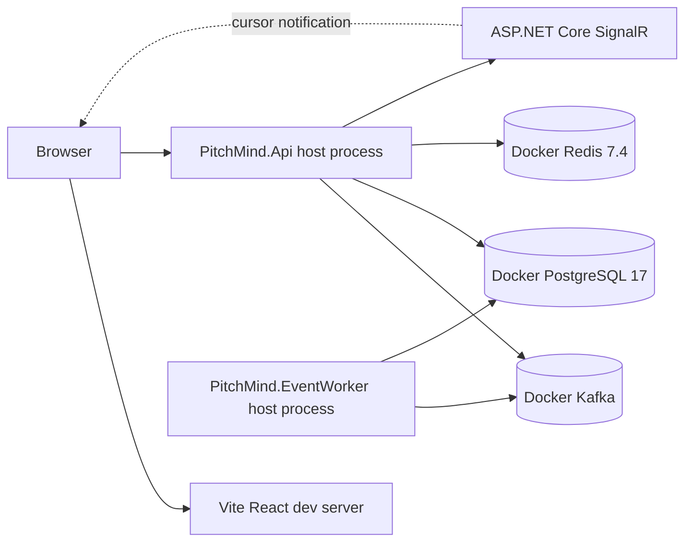
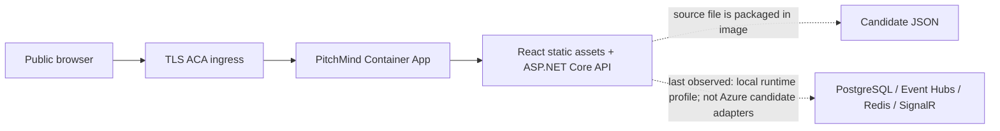
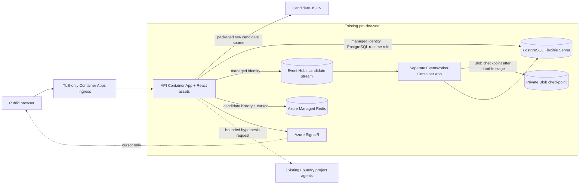

# C4 Level 4 — Deployment and trust boundaries

This diagram separates the **CURRENT** local runtime, the last dated DEV observation, and the Azure **TARGET** topology declared in code. Bicep compilation or adapter registration is not deployment evidence. The [DEV integration status](../engineering/AZURE-DEV-LIVE-INTEGRATION-STATUS.md) holds detailed configuration and dated observations.

## LOCAL — runnable development topology

PostgreSQL, Redis and Kafka are defined in `docker/compose.yml`; the frontend, API and EventWorker run as host processes. The candidate simulation starts from the API and publishes to Kafka. EventWorker stages raw events in PostgreSQL, and the API dispatches persisted candidate events/cursors to PostgreSQL, Redis and SignalR. The local API performs PostgreSQL schema checks at readiness. Startup commands and limitations are in the [local development guide](../engineering/M02-LOCAL-DEVELOPMENT.md) and [Docker guide](../../docker/README.md).

## DEV — last dated observation

The latest dated read-only inventory in the repository is 2026-10-19. It records an API-only DEV revision with local runtime configuration, no EventWorker app, and no runtime endpoint settings for candidate Event Hubs, PostgreSQL, Redis or Blob checkpointing; SignalR was also absent at that observation. This is a historical snapshot, not a fresh inspection of Azure. The previously recorded Azure demo proves external HTTPS ingress and health checks only; it does not prove live candidate streaming or Foundry analysis.

## Azure candidate topology — declared in code, not deployment proof

`infra/private-dev-topology.bicep` and the Azure DevOps templates declare this opt-in integration against the existing `pm-dev-vnet`, PostgreSQL server, Redis and Foundry project. The pipeline parameter `enableCandidateFeed` defaults to `true`; the separate deployment parameter `enableDevDelivery` defaults to `false`. A release still requires owner approval for the exact plan and protected environment gates. The API can compose Azure PostgreSQL, Event Hubs, managed-identity Redis, SignalR and candidate Foundry adapters only when the required settings and identities exist. The EventWorker is a separate image process/app in the topology. No arrow here claims that resources, role assignments, private DNS or the full end-to-end route are currently connected.

The candidate stream writes to separate candidate staging/history records and does not admit canonical facts. Canonical Event Hubs-to-match-ledger admission, a public edge for any internal-only topology, and a consuming AgentWorker explanation workflow remain distinct design/release decisions. See [target Azure HLD](06-target-azure-hld.md), [IaC reconciliation](../engineering/EP02-S01-IAC-RECONCILIATION.md), and the [live integration status](../engineering/AZURE-DEV-LIVE-INTEGRATION-STATUS.md).

## Environment and release controls

- LOCAL uses Docker PostgreSQL, Redis and Kafka plus explicit local adapters.
- DEV/STAGE/PRODUCTION use Azure services; local adapters are rejected outside Development.
- Azure DevOps owns CI/CD. Image publishing and app/infrastructure deployment use separate workload identities and immutable image digests.
- What-if, static compilation, or a green CI pipeline does not authorize Azure mutation. DEV requires change-specific owner approval and protected gates; this repository cannot assert external Azure DevOps permission configuration.
