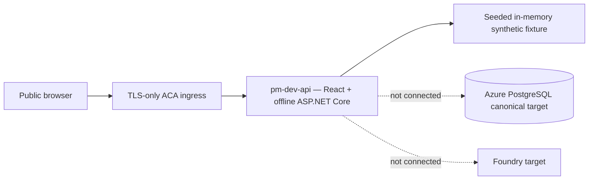
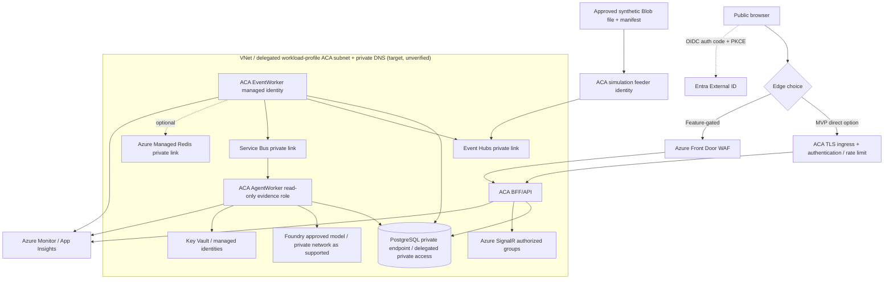

# C4 Level 4 — Deployment and trust boundaries

**Two separate realities:** Previous DEV evidence proves only one read-only synthetic ACA demonstration. The target below is **not** evidence that service connections/private network are implemented. [Azure HLD](06-target-azure-hld.md) | [DEV evidence](../engineering/evidence/2026-10-08-DEV-DEPLOYMENT.md) | [Operating model](../operating-model/ENGINEERING-OPERATING-MODEL.md).

For the resource-by-resource current/deferred/blocking reconciliation, see [EP02-S01 IaC reconciliation](../engineering/EP02-S01-IAC-RECONCILIATION.md). Its observed state comes from the dated DEV evidence; private connectivity and the canonical PostgreSQL path remain unverified blockers.

The isolated [`infra/canonical-dev-topology.bicep`](../../infra/canonical-dev-topology.bicep) root is an executable candidate for internal ACA + private PostgreSQL networking. It is disabled by default and is not referenced by the normal deployment pipeline. Compilation is not deployment evidence; subnet overlap, SKU/region capacity, identity, app workloads, private dependency paths, and end-to-end connectivity still require review and separately approved verification.

## CURRENT — observed DEV prototype (limited)

Previous deployment evidence cites image digest, revision and HTTP smoke. It **does not** prove source-file-driven live ingestion, persistent tracking/projections, Azure managed identity database authentication, Event Hubs, SignalR or Foundry.

## Azure-only TARGET topology and trust zones

**Actual SKU/network feasibility must be validated:** the diagram is conceptual. ACA environment/subnet delegation, PostgreSQL Flexible Server networking mode, Azure SignalR and Foundry private DNS/region availability, user-assigned identity scopes, Functions network capability and outbound routing require product-specific validation and actual connectivity tests. Do not bypass access restrictions to force an unapproved demo.

## Separation and approval
- **LOCAL:** Docker Compose PostgreSQL and Redis with explicit local adapters; no live Azure token required for domain tests.
- **DEV:** Azure-only integrated workload when the owner explicitly approves **each** change set, with a recorded subscription/region/resource diff, exact git SHA/digest, cost, migration, rollback and verification plan.
- **STAGE/PROD:** separate Azure resources/data/identity, protected approvals, replay/correction golden tests, restore/recovery evidence and budgets.
- Azure DevOps is CI/CD authority, GitHub hosts source. A passing PR, Bicep compile/what-if, a diagram or `enableDevDelivery=true` is **not** owner approval. DEV pipeline must require independent manual/protected gate before any Azure registry/service mutation.
- Retain immutable artifacts, minimum necessary access, separate migration and runtime identities, no local PostgreSQL/Ollama/Redis in cloud, and no claims that unavailable proof was executed.
