# Azure DEV High-Level Design

**Scope:** Azure-only DEV application architecture, as represented by the current API/EventWorker code and guarded Bicep release path. This document distinguishes the implemented candidate-feed path from the future canonical football ingestion design. A configured template or compiled Bicep is not proof of current resource state or healthy connections. See [DEV integration status](../engineering/AZURE-DEV-LIVE-INTEGRATION-STATUS.md) for observed evidence and limits.

## Design principles

- DEV, STAGE and PRODUCTION use Azure services only. LOCAL Docker adapters are documented separately in M02 and are not part of these diagrams.
- PostgreSQL Flexible Server is the durable store. Redis is a rebuildable cursor/cache projection. SignalR is a cursor notification channel, not a match-facts transport.
- Candidate source records remain explicitly non-canonical until domain/data admission is approved. Preserve event ID, source order, provenance, raw payload, and original clock/period values.
- Microsoft Foundry can explain only bounded persisted evidence. Its output is a hypothesis; it cannot create canonical facts, score changes, tactical events or causal claims.
- Azure resources are accessed by managed identity and scoped data-plane roles. Schema migration identity and runtime identity are separate.

## Azure DEV — current candidate-feed implementation

```mermaid
flowchart LR
  Browser["React browser"] -->|"HTTPS"| ACAIngress["Azure Container Apps ingress"]
  ACAIngress --> API["PitchMind API + static UI — Azure Container Apps"]
  Entra["Microsoft Entra ID"] -->|"user JWT validation"| API
  JSON["Candidate JSON packaged in API image"] --> Simulation["API-hosted Candidate Simulation Service"]
  Simulation -->|"ordered source envelopes; managed identity"| EH[("Azure Event Hubs candidate hub")]
  EH -->|"dedicated consumer group"| Worker["PitchMind EventWorker — Azure Container Apps"]
  Worker -->|"raw candidate or durable poison record"| Outbox[("Azure PostgreSQL — candidate outbox")]
  Worker -->|"checkpoint after durable stage"| Blob[("Azure Blob checkpoint container")]
  Outbox --> Dispatch["API CandidateOutboxDispatchWorker"]
  Dispatch -->|"persist event history"| History[("Azure PostgreSQL — candidate history")]
  Dispatch -->|"rebuildable cursor projection"| Redis["Redis container app on Azure Container Apps"]
  Dispatch -->|"after durable processing; cursor only"| SignalR["Azure SignalR Service"]
  History -->|"match event pages / source positions"| API
  SignalR -. "refresh hint only" .-> Browser
  API -->|"bounded selected-match evidence"| Foundry["Microsoft Foundry project agent"]
  Foundry -. "labeled hypothesis; no canonical write" .-> API
```

### Runtime sequence

1. An authorized UI action starts or pauses the candidate simulation. The API-hosted service reads the versioned source asset and publishes original events in source order to Event Hubs.
2. EventWorker consumes the dedicated candidate hub. It stores the raw event or a durable poison record in the PostgreSQL candidate outbox before advancing the Blob checkpoint. Delivery is at least once; the candidate persistence key preserves idempotency.
3. The API dispatcher processes the committed candidate outbox. It writes the ordered candidate event history to PostgreSQL and updates the latest Redis cursor as independent projections. SignalR sends a cursor notification after durable processing; it does not carry event facts.
4. The React UI fetches event pages and source player-position fields from the API. It can pause/resume the feed and update the pitch from returned data. Candidate data remains separate from canonical match/insight records.
5. The AI Analyst API reads a bounded selected-match event prefix and calls an allowlisted Microsoft Foundry project agent. The returned answer is a hypothesis. Recent DEV requests returned `503 ANALYST_UNAVAILABLE`; current live success is not verified. The browser's locally computed tactical discussion helper is illustrative and is not multi-agent deliberation.

### Service boundaries

| Azure component | Responsibility in DEV | Authority / limitation |
|---|---|---|
| Azure Container Apps | Hosts API/static React app, EventWorker, and current Redis container app | Consumption compute; inventory observed 2026-10-28. Runtime health is separate. |
| Azure Event Hubs | Ordered candidate event transport | Transport only; not canonical storage |
| Azure Database for PostgreSQL Flexible Server | Candidate outbox/history and canonical schema/read models | Durable database; candidate tables are not canonical truth. Current migration/readiness must be probed. |
| Azure Blob Storage | Event Hubs processor checkpoint container | Consumer progress only |
| Redis Container App (`pm-dev-redis-cache`) | Latest candidate cursor/cache projection | Current image `redis:7-alpine`, min/max replicas 1; rebuildable, no authoritative event pages. Azure Managed Redis is only an optional Bicep path. |
| Azure SignalR Service | Cursor-only realtime notification to browsers | Wake-up hint; clients refetch facts from API with fallback polling |
| Microsoft Entra ID | Signed-in user identity and managed-identity token authority | DEV candidate routes may also be anonymous when `CandidateFeed:GuestAccessEnabled=true`; clear-data remains protected. |
| Microsoft Foundry project `pitchmind-ai` | Bounded match-scoped hypotheses via selected agent | Recent DEV calls returned 503; no deterministic candidate-answer substitution. |

## Canonical football pipeline — target, not current candidate flow

Canonical ingestion remains separate from the raw candidate simulation. This target is the gate for interpreting a feed as match truth; do not label the candidate-feed path as canonical until its source semantics and mapping are approved.

```mermaid
flowchart LR
  Feed["Rights-cleared, validated source feed"] --> Producer["Azure simulation / ingestion workload"]
  Producer --> EH["Azure Event Hubs ingress"]
  EH --> Worker["Azure EventWorker: validate, map, deduplicate"]
  Worker -->|"single transaction: canonical event + revision + outbox"| PG[("Azure PostgreSQL canonical ledger")]
  Worker -->|"checkpoint only after commit or durable quarantine"| Blob["Azure Blob checkpoint"]
  PG --> Outbox["PostgreSQL transactional outbox"]
  Outbox --> Dispatcher["Independent idempotent fan-out"]
  Dispatcher --> Redis["Azure Managed Redis projection"]
  Dispatcher --> SignalR["Azure SignalR cursor notification"]
  SignalR -. "revision / sequence cursor only" .-> UI["React browser"]
  UI -->|"snapshot and bounded backfill"| API["Azure Container Apps API/BFF"]
  API --> PG
  API -. "read-only bounded evidence" .-> Agent["Azure-hosted explanation worker — future"]
  Agent --> Foundry["Microsoft Foundry"]
  Agent -. "validated explanation proposal" .-> PG
  API -. "Azure Monitor / OpenTelemetry" .-> Monitor["Azure Monitor and Application Insights"]
```

The canonical target commits the event/revision/outbox atomically, checkpoints after durable outcome, and fans out cache and notification work after commit. It is not what the candidate staging tables do today. Azure Service Bus, Azure Functions, Azure AI Search, Data Explorer, or a separate agent worker are optional future components and are not required to describe the current DEV candidate-feed path.

## Security, reliability and operations

- Signed-in API requests validate Entra issuer, audience, expiry and configured roles. In DEV only, the candidate feed may be guest-accessible via configuration; this is a public synthetic demo path, not proof of user authentication. Clear-data and other privileged actions remain role-protected.
- API and EventWorker use their assigned managed identities for PostgreSQL, Event Hubs, Blob, Redis and SignalR. Grant only required data-plane roles. Migration runs use a separate privileged identity; runtime roles do not own schema objects.
- Private endpoints, VNet routing, private DNS, subnet delegation, ACA ingress mode and service egress must match the reviewed DEV topology. Do not infer network reachability from Bicep declarations.
- Event Hubs delivery is at least once. PostgreSQL idempotency keys and durable staging protect against duplicate delivery. A failed durable write must not advance the checkpoint. Redis failure must not replace or corrupt PostgreSQL data; SignalR failure requires API polling/backfill.
- Health/readiness, authenticated candidate-status checks, event-page retrieval, worker checkpoints, migration result, SignalR negotiation, and one live Foundry request each need explicit runtime evidence before claiming the full path is operational.

## Delivery and verification

In `pipelines/azure-pipelines.yml`, `enableDevDelivery` and `enableCandidateFeed` currently default to `true`; the Bicep module's topology/feed defaults remain off unless pipeline parameters enable them. The Azure DevOps release path validates topology/what-if, records an image digest and cost estimate, and uses configured approval/deployment gates. YAML does not prove service connections or server-side approvals are present. CI success alone does not prove deployment.

The 2026-10-28 read-only inventory is summarized in [C4 deployment](04-deployment.md). Earlier screenshots show candidate event/position rendering but do not prove every service link. The latest owner-supplied AI API responses show `503 ANALYST_UNAVAILABLE`, so successful report generation remains unverified.

## Related designs

- [C4 system context](01-system-context.md)
- [C4 containers](02-container.md)
- [C4 components](03-components.md)
- [C4 Azure DEV deployment](04-deployment.md)
- [Football domain LLD](05-football-lld.md)
- [Football analytics target LLD](07-football-analytics-detailed-lld.md)
- [API contract and implementation registry](../api/API.md)
- [Azure DEV integration evidence](../engineering/AZURE-DEV-LIVE-INTEGRATION-STATUS.md)
