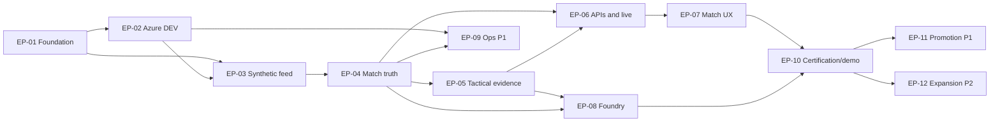

# PitchMind — Hackathon MVP Epics and Development Stories

**Owner:** PitchMind Product Owner / Coordinated Engineering Council  
**Baseline:** `prateekgangopadhyay/PitchMind`, `main` branch, `docs/backlog/MVP-BACKLOG.md`  
**Baseline revision reviewed:** `f670ea92e1703522efd26f033b4391e2c84226c9` (2026-10-08)  
**Target submission:** October 27, 2026  
**Status:** **PROPOSED backlog expansion — NOT evidence of implementation**  
**Intended placement:** `docs/backlog/HACKATHON-MVP-EPICS.md`

> This document expands the existing M01–M16 milestones into epics and implementation-ready development stories. The original backlog remains the authoritative source for milestone priority. All new story decomposition, proposed screens, agent roles, prioritization refinements, and delivery sequencing are Product Owner proposals, not capabilities asserted to exist in the repository.

## 1. Product mission and MVP outcome

**Product promise:** PitchMind transforms synthetic, football-realistic event and tracking telemetry into meaningful, evidence-grounded match understanding. A supporter can answer: **What is happening? Why does it matter? Show me why. What changed? What should I watch next?**

**North-star experience:** Open a synthetic match → see score, time, and developing story → notice a contextual tactical Key Moment → select **Why?** → inspect the event sequence and evidence on a synchronized intelligent pitch → ask an AI Analyst for a grounded, audience-appropriate explanation → continue watching or replay an earlier period without losing place.

**Mandatory hackathon constraints:**
- Use **synthetic football-realistic data**, not real Premier League match data. Clearly label the experience **Simulated match**. Use explicitly **synthetic match telemetry**. The newly supplied simulation JSON uses Manchester United/Liverpool and real player names as labels; these are not proof of a real fixture. Rights/provenance and misleading-real-match risk must be cleared, and unlicensed official branding, real broadcast footage and real match tracking must not be used.
- Present a **public GitHub repository**, elevator pitch, Microsoft/Azure technologies and value proposition, and a **public working demo video strictly under two minutes** by the submission deadline.
- Use Microsoft Azure/Foundry meaningfully rather than for decorative service-count. Document what each service actually does.

**MVP vertical slice (P0):** One believable 90-minute synthetic fixture (optionally replayed as simulated live); one complete causal mechanism **press trigger → opponent response → exploitation → outcome**; canonical state and repeatable replay; live match API; intelligent pitch/timeline/evidence; grounded Microsoft Foundry explanation with deterministic fallback; functioning Azure DEV deployment; end-to-end demonstration.

**Scope boundaries:** The MVP need not implement all formations, off-ball phenomena, all 105 Bible sections, every metric, all competitions, all historical analytics, or every proposed Azure service. A narrow but correct mechanic beats broad unsupported claims.

### Product truth and technology contracts

1. **Observed fact ≠ deterministic derivation ≠ evidence-supported pattern ≠ supported interpretation ≠ hypothesis ≠ simulation.** No silent promotion of hypothesis to fact.
2. **Match state + phase + role + opposition + evidence = meaning.** Do not infer manager intent from tracking data.
3. The match timeline, scoreboard, pitch, tactical insight, and AI answer refer to the **same selected timestamp**. Simulated LIVE does not force the user away from historical inspection.
4. **Canonical PostgreSQL** owns durable football state and provenance. Redis and search are rebuildable/noncanonical. Event Hubs is the telemetry ingress; Service Bus carries background commands. At-least-once delivery with idempotent consumers; no cross-system exactly-once claim.
5. **Domain** remains independent of external dependencies. **LOCAL:** Docker + explicit adapters, no Azure account required for domain tests. **DEV/STAGE/PROD:** Azure services only. GitHub hosts source; **Azure DevOps Pipelines** owns CI/CD.
6. Deterministic football truth remains available if Foundry or background agents fail. Agents use read-only evidence tools, bounded execution and claim validation.
7. Every visible chart or animation must answer a football question; progressive disclosure is **Story → Insight → Why → Evidence → Visual → Data → Advanced Analysis**.

## 2. Delivery organization

**Statuses:** `Not started`, `Scaffold exists / unverified`, `In progress`, `Blocked`, `Verified / accepted`. The status of an epic is not inferred from its documents or project directories. Repository baseline: M01/M02 scaffold and M03 IaC foundation exist; core M04–M09 functionality is not verified as implemented.

**Priorities:** P0 = mandatory hackathon vertical slice; P1 = useful but nonblocking unless the team explicitly elevates it; P2 = post-MVP. Story priority inherits epic priority unless explicitly annotated. Engineering estimates and assignments must be established by leads after code review; do not treat proposed milestones as already green.

**Definition of Ready for a story:** User/football problem; actor; observable evidence/data; relevant match context; output contract; approved domain terminology; design and dependency choices; positive, negative and degraded examples; testable acceptance; owner and estimate.

**Definition of Done for all P0 stories:** Implemented in correct layer; tests green in Azure DevOps clean runner; architecture/security checks; football-domain goldens; provenance and logs/traces; loading/empty/error/AI-down states as applicable; accessibility review for UI; documentation; relevant deployment/smoke evidence. **A file, template, passing unit test or green endpoint alone is not evidence of a usable product.**

## 3. End-user product development story

**Act I — Discover (Home / Match list).** A supporter finds a clearly labeled simulated match and understands fixture state, score and immediate match narrative without decoding technical metrics.

**Act II — Understand (Match detail).** The supporter sees the living scoreline, match clock, key moments and a tactical story that changes only when meaningful evidence appears. Selecting minute 55 when LIVE is minute 78 retains the selected historical context.

**Act III — Investigate (Intelligent Pitch).** Selecting **Why? / Show me** opens the exact supporting possessions/frames, overlays spatial relationships and shows who was involved and what changed. Explanatory strength matches evidence strength.

**Act IV — Ask (AI Analyst).** The same canonical match insight can be explained differently to a fan and analyst without changing facts. If AI is unavailable, a deterministic explanation is shown.

**Act V — Trust (Reliability).** Duplicate messages, reconnects, delayed data and service outages cannot silently rewrite match history or fabricate a football conclusion.

---

## EP-01 — Engineering Foundation & Developer Experience

**Maps to:** M01, M02 | **Priority:** P0 | **Outcome:** Any engineer can build, test and run the platform reproducibly, and the team can verify each change.  
**Primary owners:** Principal/Staff Engineering, DX, Backend, Frontend, DevOps, QA, Security.  
**Depends on:** none | **Current evidence:** repository structure, .NET solution, React/Vite shell, starter tests, Docker Compose and Azure Pipeline templates exist; execution evidence must be verified.

### EP01-S01 — Enforce layered solution architecture
- **Story:** As a platform engineer, I need dependency boundaries that keep football rules deterministic and infrastructure-independent.
- **Build:** Validate Domain → no external NuGet and no upward references; Application → Domain; Infrastructure → Application; API/workers → composition. Add explicit architecture tests for all projects and disallowed dependency directions.
- **Acceptance:** A clean SDK build succeeds; a forbidden Domain reference fails an automated test; dependency graph and project purposes are documented.

### EP01-S02 — Reproducible local developer workstation
- **Story:** As a developer, I can bootstrap PitchMind without Azure credentials so I can iterate on football logic safely.
- **Build:** Docker PostgreSQL/Redis; deterministic environment bootstrap; minimal local telemetry/model adapters or a clearly separated offline fixture route; scripts for start/health/reset/stop.
- **Acceptance:** A fresh machine can start/stop services with documented commands; passwords are locally generated and not committed; local health proves services are ready; ports bind to loopback only.

### EP01-S03 — Azure DevOps validation pipeline
- **Story:** As a team, we need build failures and regressions to block changes rather than be discovered during the demo.
- **Build:** Azure Pipelines jobs for .NET restore/build/tests, npm ci/build/tests/lint, architecture contracts, Docker smoke, Bicep compilation and eventually security scans. Integrate required branch checks with GitHub.
- **Acceptance:** An observed pipeline run provides green/failing checks on PR; a deliberately failing test blocks the gate; GitHub Actions is not introduced as a parallel CI owner.

### EP01-S04 — Shared contracts and engineering conventions
- **Story:** As backend and frontend engineers, we need stable, versioned DTOs and error conventions to integrate independently.
- **Build:** API/stream schema versioning, correlation IDs, `matchId`, event/insight IDs, UTC/time semantics, coordinate convention, cancellation, typed problem responses and contract-test strategy.
- **Acceptance:** Contracts are documented; incompatible changes are detected by tests; no frontend mock is silently treated as canonical production data.

### EP01-S05 — Quality, security and developer readiness gate
- **Story:** As Product Owner, I need objective proof that M01/M02 scaffolding is executable before accepting new functionality.
- **Build:** Re-run fresh install/restore/build/test/lint, Docker health, threat/dependency checks; capture command output and unresolved issues in release evidence.
- **Acceptance:** All baseline commands and pipeline runs have attached evidence; any failure has a named owner and is not marked complete.

**Epic exit demonstration:** A new contributor checks out the repository, starts local services, builds both applications, runs tests and produces an Azure DevOps check.

---

## EP-02 — Azure DEV Cloud Foundation & Environment Isolation

**Maps to:** M03 | **Priority:** P0 | **Outcome:** A secure, cost-controlled Azure DEV foundation can host the real MVP without local service dependencies.  
**Primary owners:** Azure Solution Architect, Infrastructure, Security, SRE, DevOps, PostgreSQL/FinOps.  
**Depends on:** EP-01 | **Current evidence:** Bicep foundation exists, but live deployment and private-network connectivity have not been verified.

### EP02-S01 — Reconcile IaC with deployed MVP needs
- **Story:** As an architect, I need a deployable topology rather than a diagram-only resource list.
- **Build:** Close current gaps between M03 backlog expectations and M03 implementation notes: actual Container App workloads, PostgreSQL Flexible Server, private networking, DNS, managed identities, connectivity to Storage/Key Vault, secrets, ACR image pulls, Event Hubs and observability. Keep Redis/Functions optional until EP-09 is activated.
- **Acceptance:** A resource-by-resource matrix identifies provisioned, deferred and blocking dependencies; no disabled-public-access service is assumed accessible without tested private connectivity.

### EP02-S02 — Workload identity and least-privilege access
- **Story:** As security architect, I need deployed workloads and pipelines to access only what they require.
- **Build:** Entra/workload identity federation, Managed Identity and RBAC, Key Vault bootstrap, separate runtime/migration roles, scoped source credentials, protected resources.
- **Acceptance:** No long-lived service-principal secrets in code/pipelines; denied cross-role operations have negative tests; identity and access are verifiable in DEV.

### EP02-S03 — Network, Bicep and preflight validation
- **Story:** As an Azure engineer, I want builds and what-if previews to expose unsafe or breaking changes before deployment.
- **Build:** Parameterized DEV, STAGE, PROD infrastructure; `az bicep build`; parameter compilation; audited what-if; private subnet/DNS/egress integration; budget and SKU preflight.
- **Acceptance:** DEV what-if is approved without unplanned deletes or public ingress; network DNS tests pass; STAGE/PROD configurations cannot accidentally deploy local endpoints.

### EP02-S04 — Deploy and observe a minimal DEV workload
- **Story:** As an SRE, I need proof that the API/worker image actually runs on Azure and can use managed dependencies.
- **Build:** ACR image build/push, Container Apps app revisions, liveness/readiness, Azure Monitor/Application Insights telemetry, logs and smoke-test endpoint.
- **Acceptance:** Azure-hosted health and dependency probes pass; a restarted revision recovers; telemetry identifies environment, service, correlation IDs, and failures without secret exposure.

### EP02-S05 — Cost and deployment safety gate
- **Story:** As sponsor/FinOps owner, I need predictable hackathon resource cost and a safe stop/rollback plan.
- **Build:** Region/SKU pricing review, tags, budgets, alerts, scaling minima/maxima, retention, teardown plan, manual deployment approvals.
- **Acceptance:** Estimated costs and quotas are reviewed; no unrestricted AI/cloud consumption; rollback and redeploy procedures are documented and tested at least for DEV.

**Epic exit demonstration:** Approved pipeline provisions/updates a minimal Azure DEV topology, deploys a working API/worker image, and records a safe what-if and smoke-test result.

---

## EP-03 — Synthetic Football Match Data & Reliable Ingestion

**Maps to:** M04 | **Priority:** P0 | **Outcome:** A believable, fully synthetic match drives the entire product with traceable events and sufficient spatial evidence.  
**Primary owners:** Product Owner/Football Analytics, Domain, Data, Event Streaming, QA, Security.  
**Depends on:** EP-01, EP-02 for cloud integration; develop offline fixture generator in parallel. 

### EP03-S01 — Govern a synthetic match scenario
- **Story:** As a football Product Owner, I need a match realistic enough to exhibit a meaningful tactical mechanism without using prohibited real-match content.
- **Build:** Fictional teams/players, formations/roles, score progression, periods, disciplinary/substitution scenarios, possession phases, at least one sustained pressing pattern and counterexamples; seed and fixture metadata; provenance marked `synthetic`.
- **Acceptance:** A complete 90-minute fixture can be deterministically regenerated using a seed and fixture version; football rules and score transitions pass domain review; no actual Premier League match telemetry is consumed.

### EP03-S02 — Versioned canonical telemetry contracts
- **Story:** As a data engineer, I need event and tracking contracts that express football reality and survive schema evolution.
- **Build:** `MatchEvent`, `TrackingFrame`, player/team identifiers, coordinates and pitch orientation, period/clock, sequence/event IDs, source timestamps, event outcomes, provenance, substitutions/cards where required; validation and normalization rules.
- **Acceptance:** Invalid coordinate, period, event-type, missing player or incompatible schema version is rejected/quarantined with reason; valid fixture normalizes consistently for both teams/halves.

### EP03-S03 — Synthetic producer + Event Hubs adapter
- **Story:** As a developer/operator, I can start, pause, resume and replay simulated live events so the product can be demonstrated on demand.
- **Build:** Seeded producer with bounded speed controls; partition by `matchId`; Event Hubs producer/consumer in Azure; in-process/local adapter for offline runs; event trace propagation.
- **Acceptance:** Streaming order is retained per match partition where defined; producer replay produces identical source envelopes; start/pause/restart behavior is auditable.

### EP03-S04 — Dedupe, ordering and poison-event rules
- **Story:** As a supporter, I must not see phantom repeat goals or reordered football history because the network retried an event.
- **Build:** Stable event IDs, per-match sequencing, duplicate handling, gap policies, bounded retries, quarantine and reconciliation path; explicitly document allowed lateness.
- **Acceptance:** Same event ID ingested twice produces one canonical event; conflicting payload with same ID is rejected; out-of-order and missing-sequence fixtures trigger governed behavior, not silent state corruption.

### EP03-S05 — Defined 500 events/second burst test
- **Story:** As performance engineer, I need the ingestion path to survive the existing backlog's burst requirement.
- **Build:** Load fixture at 500 events/s **for a documented burst duration and payload mix**, measure accepted, duplicate, quarantined, latency/backpressure and recovery.
- **Acceptance:** No unaccounted data loss during the agreed burst; consumer lag and failures observable; objective load report records the exact tested parameters (not an unspecified '500 eps' claim).

**Epic exit demonstration:** Start a synthetic match, ingest into local and Azure adapter paths, see counts/provenance and prove order/dedupe behavior under retries and bursts.

---

## EP-04 — Canonical Match State, Persistence, Evidence & Replay

**Maps to:** M05 | **Priority:** P0 | **Outcome:** Every insight and UI state can be rebuilt from durable match truth.  
**Primary owners:** DDD, PostgreSQL, Backend, Data, Distributed Systems, Football Analytics, QA.  
**Depends on:** EP-03; Azure PostgreSQL wiring with EP-02.

### EP04-S01 — Govern canonical football aggregates
- **Story:** As an analyst, I want the displayed match state to accurately represent the selected moment and competition context.
- **Build:** `Match`, `MatchState`, teams/players, score, period/time, cards/numerical situation, substitutions, possession and active phase; immutable inputs and deterministic projections. Avoid inferring fatigue or managerial intention if not observed.
- **Acceptance:** Goal, card, substitution and period transitions update state exactly once; impossible match states are rejected; historical query returns the correct timestamp-specific state.

### EP04-S02 — PostgreSQL schema, migrations and provenance
- **Story:** As platform operator, I need durable, auditable data that survives process restarts.
- **Build:** Versioned migrations, canonical event ledger, match-state projections, algorithm/fixture/schema versions, evidence references and timestamp indexes, separate migration/runtime DB identities.
- **Acceptance:** Clean database migrates repeatedly/idempotently; restart preserves events/state; least-privilege runtime cannot alter migration schema; provenance can be retrieved for any published insight.

### EP04-S03 — Transactional outbox and resilient projection
- **Story:** As distributed systems engineer, I need canonical updates and follow-on work to remain consistent despite partial service failures.
- **Build:** Store event/projection changes and outbox intents in one PostgreSQL transaction; idempotent dispatch; bounded retries and poison state; checkpointing and rebuilding.
- **Acceptance:** Simulated failure after DB commit but before external publication does not lose intended work; retries do not double-apply score or dispatch side effects; no cross-service exactly-once promise.

### EP04-S04 — Deterministic replay and point-in-time queries
- **Story:** As a supporter, I can inspect minute 55 even if the match stream has advanced to minute 78.
- **Build:** `GetMatchAt(timestamp)`, event-window and snapshot/replay APIs; input/algorithm-version pinning; deterministic replay ordering; selected-time contract shared by frontend and AI.
- **Acceptance:** Replaying identical fixture and algorithm versions produces the same canonical state and derived outputs; scrubbing cannot show later-match events or scores at an earlier timestamp.

### EP04-S05 — Match integrity golden tests
- **Story:** As Product Owner, I need football-truth proof independent of AI-generated explanations.
- **Build:** Golden fixture and counterexamples for score, periods, cards, substitutions, event retries, ordering, orientation changes, incomplete tracking and corrected inputs.
- **Acceptance:** Golden outputs match approved snapshots; corrupted fixture fails with actionable diagnostic; replay/version invariants are tested in CI.

**Epic exit demonstration:** Ingest, persist, restart, rewind and exactly reproduce the synthetic match state and provenance without invoking AI.

---

## EP-05 — Football Tactical Intelligence & Evidence Engine

**Maps to:** M06 | **Priority:** P0 | **Outcome:** The system recognises *one meaningful mechanism*, explains its context and shows reproducible evidence rather than announcing unsupported tactics.  
**Primary owners:** Product Owner/Football Intelligence, DDD, Football Analytics, Backend, QA.  
**Depends on:** EP-04; EP-03 tracking richness.

### EP05-S01 — Formal football concept dictionary
- **Story:** As a Product Owner, I need precise, testable definitions so 'press', 'trap', 'response' and 'danger' are not arbitrary labels.
- **Build:** For the MVP mechanism define phase, spatial criteria, participants, conditions, thresholds if justified, exclusions, match-state sensitivity, evidence schema, allowed language, and counterexamples. Distinguish observable pressure from inferred tactical intention.
- **Acceptance:** Approved football specification and fixtures exist; each technical signal maps to a governed football concept and explicit evidence requirement.

### EP05-S02 — Deterministic tactical sequence detector
- **Story:** As an advanced fan, I want the platform to recognise when a press constrains an opponent and changes the next attacking opportunity.
- **Build:** Phase-aware detector for `trigger → response → exploitation → outcome`; spatial/temporal windows justified by football meaning; tracking/event fusion; coherent progression from atomic actions to mechanism.
- **Acceptance:** Multiple approved positive scenarios detected; near-miss cases, no tracking, normal circulation and unrelated turnovers not mislabeled; identical input/version gives identical detection.

### EP05-S03 — Match context and tactical neutrality
- **Story:** As a supporter, I need a low-block or leading team's controlled concession of possession interpreted fairly.
- **Build:** Context enrichments for score, time, home/away, numerical situation, phase and opposition interaction; prohibit possession percentage or raw shot count as proof of tactical superiority.
- **Acceptance:** Identical movement sequences under different match states produce appropriately qualified interpretations; product copy does not assume one playing style is superior.

### EP05-S04 — Evidence graph and truth classification
- **Story:** As an analyst, I can inspect why a tactical mechanism is proposed and reject unsupported conclusions.
- **Build:** Evidence object links event IDs, timestamps, coordinates/frames, detector version, matched conditions, exclusion reasons and confidence/uncertainty *as defined and calibrated*; classify fact, derivation, pattern, interpretation and hypothesis separately.
- **Acceptance:** Each publishable claim resolves to immutable supporting evidence; unsupported claim is blocked; missing tracking downgrades or suppresses spatial assertion rather than hallucinating it.

### EP05-S05 — Key Moment generation and relevance policy
- **Story:** As a casual fan, I want to hear about genuinely meaningful changes without being interrupted for every pass.
- **Build:** Prioritize goal/card/major chance/tactical shift in the context of current match; deduplicate repeated insights; time decay; narrative templates; configurable relevance rather than arbitrary event spam.
- **Acceptance:** Golden match highlights the approved tactical swing and key match events; redundant events do not create notification storms; each Key Moment supplies the 'Why?' evidence path.

### EP05-S06 — Mechanism replay and negative validation suite
- **Story:** As a QA/football reviewer, I can audit the exact pattern leading to a detected insight.
- **Build:** Curated positive/negative fixture catalogue; versioned expected results and invariant checks; exportable replay segments for pitch UI; independent football review sign-off.
- **Acceptance:** False positives/negatives are triaged with football rationale; each mechanism replays with stable participants, positions and explanation boundaries.

**Epic exit demonstration:** Show a real detection in synthetic data, open its evidence, replay its football mechanism, and demonstrate one near-miss that the engine correctly refuses to call a pressing trap.

---

## EP-06 — Match API, Live Timeline & Secure Real-Time Delivery

**Maps to:** M07 | **Priority:** P0 | **Outcome:** The same canonical football truth is reliably delivered to all clients and timestamps.  
**Primary owners:** Lead Backend, Real-Time Streaming, Security, SRE, Frontend, QA.  
**Depends on:** EP-04 and EP-05.

### EP06-S01 — Match BFF contracts
- **Story:** As frontend developer, I can retrieve fixture overview, canonical score/state, key moments, evidence and replay using stable APIs.
- **Build:** Versioned endpoints for match list/detail, at-time snapshot, event timeline, insight index/detail and evidence/replay data; pagination, standardized errors, contracts and OpenAPI.
- **Acceptance:** Contract tests validate representative payloads; `matchId`/`timestamp` filters apply consistently; no API returns fabricated tactical fields when the underlying evidence is absent.

### EP06-S02 — Azure SignalR live event fan-out
- **Story:** As a viewer, I see current match developments without manually refreshing the page.
- **Build:** Azure SignalR for fan-out, compact sequence/version envelopes, per-match subscription and broadcast, bounded update frequency; durable data retained in PostgreSQL rather than SignalR.
- **Acceptance:** Valid match subscribers receive updates in order or detect missing sequence; unsubscribe isolation works; service reconnect does not rewrite match truth.

### EP06-S03 — Reconnect, backfill and historical context
- **Story:** As a user returning after poor connectivity, I catch up without missing or duplicating match developments.
- **Build:** Last-seen checkpoint, cursor-based backfill from durable store, snapshot refresh, idempotent client reducer, clear LIVE vs historical mode.
- **Acceptance:** Disconnect/reconnect recovers correct score/timeline; a viewer studying earlier minutes stays at the chosen timestamp and receives a nonintrusive new-insight indicator.

### EP06-S04 — Identity, authorization and abuse controls
- **Story:** As security owner, I need read/replay/export and administrative operations limited to their intended audiences.
- **Build:** Entra-integrated token validation or an approved public-read demo boundary, role-scoped admin/export endpoints, input validation, throttling, no secrets in client, CORS policies and audit of protected actions.
- **Acceptance:** Unauthorized protected requests fail; publicly exposed demo data is expressly synthetic; malicious IDs, huge windows and invalid timestamps cannot exhaust services.

### EP06-S05 — Observability, latency and degradation
- **Story:** As SRE, I can see when live updates lag and provide a truthful stale/reconnecting state to viewers.
- **Build:** End-to-end trace (`matchId`, `eventId`, `insightId`), ingestion-to-client latency, lag and reconnect metrics, bounded backpressure, API readiness and synthetic smoke.
- **Acceptance:** Tested latency/availability budgets are recorded (exact values agreed by SRE after measurement); client indicates stale or reconnecting data; fallback API supports refresh when SignalR is unavailable.

**Epic exit demonstration:** Two browsers follow the same simulated match, one disconnects then reconnects without losing data; one user scrubs to a past minute without involuntary return to LIVE.

---

## EP-07 — Intelligent Football Website & Explainable Match Experience

**Maps to:** M08 | **Priority:** P0 | **Outcome:** The football intelligence becomes an elegant, useful, accessible experience instead of a metrics dashboard.  
**Primary owners:** Product Owner, Lead Frontend, UI/UX, Accessibility, Football Analytics, QA.  
**Depends on:** EP-06 for live APIs; EP-05 for evidence/replay.

### EP07-S01 — Product information architecture and design system
- **Story:** As a casual viewer, I can find the match and understand what matters without knowing analytics terminology.
- **Build:** Route model for Home → Match Detail → Insight/Evidence → AI Analyst; calm premium typography/spacing, responsive layout, theme consistency, accessible controls, language hierarchy and clearly visible `SIMULATED MATCH` labeling.
- **Acceptance:** Each main view has one primary football question; no debug/agent terminology appears in user copy; desktop/mobile keyboard and contrast review pass.

### EP07-S02 — Home / synthetic match overview
- **Story:** As a supporter, I can identify which simulated fixture to explore and understand its status at a glance.
- **Build:** Match cards or compact list with fictional team identities, score, period/clock, simulated live/replay status and one meaningful summary; empty/loading/error states.
- **Acceptance:** Opening a match preserves its match ID; scoreboard follows canonical state; cards do not claim unsourced results; unavailable fixture has a clear state.

### EP07-S03 — Live match header, story and Key Moments
- **Story:** As a viewer, I want one concise explanation of what is happening, supported by important changes.
- **Build:** Scoreboard and clock; contextual leading story/MatchPulse; chronological Key Moments and goal/card markers; differentiated observed vs interpreted copy; unobtrusive live updates.
- **Acceptance:** In a replay at 55:00, no post-55 facts leak into the narrative; a new insight doesn't hijack the current inspection; no unsupported motive is stated as fact.

### EP07-S04 — Intelligent 2D pitch and synchronized timeline
- **Story:** As an advanced supporter, I can see where a football mechanism occurred and how players moved through it.
- **Build:** Responsive pitch renderer, correct orientation/halftime switches, players/ball and selected tracking frames, event indicators, time scrub, play/pause, layer toggle and sensible motion interpolation (explicitly labeled if interpolated).
- **Acceptance:** Pitch, scoreboard, time, event sequence and insight refer to same selected timestamp; screen reader receives useful nonvisual account; reduced-motion mode works; no invented player positions are drawn.

### EP07-S05 — 'Why?' evidence drawer and tactical replay
- **Story:** As an analyst or curious supporter, I can trace an insight to its specific evidence without leaving the match context.
- **Build:** Progressive disclosure: narrative → Why? → source events/timestamps → pitch overlay → metrics/advanced definition; repeatable tactical mechanism replay with highlighted participants and observed sequence.
- **Acceptance:** Every tactical claim has accessible evidence link; evidence IDs/times match backend; insufficient evidence triggers a modest, truthful explanation rather than a decorative heatmap.

### EP07-S06 — Audience modes and resilient interface states
- **Story:** As a viewer, I can choose a useful explanation depth and continue using the match if AI/live services fail.
- **Build:** Fan/Analyst copy density, shared truth, deterministic fallback content, offline/reconnecting/error/empty states, accessibility labels for insight category, mobile layout and focus management.
- **Acceptance:** Audience switch changes detail, not facts; UI remains usable without AI; keyboard focus is retained through drawer/timeline navigation; Playwright journey and automated accessibility checks pass.

**Epic exit demonstration:** A nontechnical viewer finds a match, opens a Key Moment, watches the exact supporting pitch sequence, understands why it matters, and returns to the match.

---

## EP-08 — Microsoft Foundry Grounded AI Analyst & Governed Agents

**Maps to:** M09 | **Priority:** P0 | **Outcome:** AI explains trusted football intelligence at the right depth without creating ungrounded match truth.  
**Primary owners:** AI/Agentic Architects, Football Intelligence, Backend, Security, SRE, QA, UX.  
**Depends on:** EP-05 evidence; EP-04 point-in-time truth; integrate with EP-07.

### EP08-S01 — Govern the canonical `MatchIntelligence` AI context
- **Story:** As an AI engineer, I can retrieve a read-only evidence packet that fixes the match, timestamp, score, tactical claim and provenance.
- **Build:** Typed packet with selected match/time, claim category, detector/algorithm version, bounded event/frame evidence, permitted interpretation and explicit unknowns; read-only tool adapter and scope/authorization rules.
- **Acceptance:** A model never sees unrestricted untrusted history by default; AI responses are traceable to exact packet; evidence unavailable → question is refused/qualified, not fabricated.

### EP08-S02 — Microsoft Foundry explanation adapter
- **Story:** As a supporter, I can ask 'Why did the press work?' and receive natural football language based on observable evidence.
- **Build:** Foundry model configuration via Azure identity, structured output contracts, grounding instructions, answer templates, audience/tone policy, latency/usage logging and cache policy where warranted.
- **Acceptance:** Answers cite insight/event provenance, obey selected timestamp, do not invent stats/events/coach intent; tested with fan and analyst audiences; no local model endpoint is used in Azure.

### EP08-S03 — Meaningful multi-agent handoffs (hackathon differentiator)
- **Story:** As Product Owner, I want specialized agent roles only where they demonstrably improve accuracy or audience fit.
- **Build (proposed extension beyond the base M09 story):** (1) **Evidence Curator** selects bounded, relevant *existing* facts using read-only tools; (2) **Football Narrator** drafts audience-specific explanation; (3) **Claim Verifier** applies primarily deterministic source/number/time/category validation, optionally with a supporting AI check; shared typed state, finite handoffs, timeout/retry/cost budgets, fail-closed publication gate. Do not create multiple agents solely to claim a prize.
- **Acceptance:** Trace shows distinct roles, inputs/outputs and successful/failed handoffs; single-agent baseline comparison justifies orchestration; a verifier-rejected claim is not displayed as a fact.

### EP08-S04 — Claim validation and trust boundaries
- **Story:** As user, I should never receive a fluent but unsubstantiated tactical story.
- **Build:** Validate mentioned teams/players/timestamps/numbers/event IDs against canonical packet, label hypotheses, forbid manager-intent certainty, compare evidence constraints and prevent prompt-injection from telemetry/tool responses.
- **Acceptance:** Adversarial prompts and invented scores/players/causal certainty are rejected or reformulated; expected false-claim test suite runs in CI; model cannot write canonical match state.

### EP08-S05 — Deterministic fallback and resource governance
- **Story:** As a viewer, I can still understand the match if Foundry is slow, unavailable or over budget.
- **Build:** Evidence-backed template fallback, circuit breaker/timeouts, concurrency and token/cost caps, retry rules, trace and budget dashboards; asynchronous narrative delivery that never blocks live updates.
- **Acceptance:** Forced Foundry outage leaves scoreboard, events, pitch, mechanisms, evidence and deterministic explanation functional; agent budgets are enforced; source truth is unchanged.

### EP08-S06 — AI Analyst UX integration
- **Story:** As a fan or broadcaster, I can ask evidence-grounded match questions appropriate to my knowledge level.
- **Build:** Contextual 'Ask PitchMind' from selected insight, suggested questions, response provenance link, qualified language, loading/error states, fan/analyst modes and unsafe question handling.
- **Acceptance:** Switching audience keeps exact evidence; replay at minute 55 cannot use facts from minute 78; AI answer opens corresponding `Show me why` evidence in the pitch UI.

**Epic exit demonstration:** Ask the same tactical question in fan and analyst modes; both answers agree on facts and open the same evidence; demonstrate deliberate unsupported claim rejection or AI-down fallback.

---

## EP-09 — Operational Enhancements: Cache, AutoRecap & Evidence Export

**Maps to:** M10, M11 | **Priority:** P1 — nonblocking for hackathon core unless promoted | **Outcome:** Faster reads, background recaps and exportable evidence without compromising canonical data.  
**Primary owners:** Backend, Redis, Event Streaming, Azure Functions, Security, Data, QA, FinOps.  
**Depends on:** EP-02, EP-04; EP-05 for recaps.

### EP09-S01 — Rebuildable Azure Managed Redis projections
- **Story:** As a viewer, high-traffic live reads stay responsive without Redis becoming a truth source.
- **Build:** TTLs, versioned keys, cache warming and invalidation, tenant/match scope, startup rebuild and fallback-to-PostgreSQL behavior.
- **Acceptance:** A flushed Redis instance can rebuild without altering canonical score or evidence; stale projection is detected; Azure workloads use Azure Managed Redis only.

### EP09-S02 — Service Bus background jobs and recovery
- **Story:** As an operator, explanations and recap work can retry safely without blocking canonical match processing.
- **Build:** Idempotent jobs with stable IDs, finite retries, DLQ and poison-message handling, traceability, authorized redrive.
- **Acceptance:** Duplicate message doesn't create duplicate recap/export; poison job arrives in DLQ with cause; user-facing match remains usable.

### EP09-S03 — Azure Functions AutoRecap
- **Story:** As a supporter, I can read a concise post-match story automatically derived from key moments and evidence.
- **Build:** Bounded trigger/job, deterministic recap skeleton, optional Foundry prose with claim gate, Blob output/storage retention where approved.
- **Acceptance:** Recap contains no invented match events, identifies the synthetic fixture and sources, survives retries; failed AI falls back to deterministic recap.

### EP09-S04 — Permissioned evidence exports and retention
- **Story:** As a broadcaster/analyst, I can export approved evidence with provenance while respecting policy.
- **Build:** Scoped export API/job, sanitized structured artifact, version/expiry, access log, retention deletion and authorization checks.
- **Acceptance:** Unauthorized export denied; authorized export contains precise fixture/algorithm versions and evidence IDs; expired artifacts are inaccessible according to policy.

**Epic exit demonstration (optional):** Post-match auto-recap and an authorized provenance export; Redis restart does not alter football truth.

---

## EP-10 — MVP Certification, Hackathon Demo & Submission

**Maps to:** M12 | **Priority:** P0 | **Outcome:** A judge can use a working Azure-hosted football-intelligence product and verify its claims within a sub-two-minute demo.  
**Primary owners:** Product Owner, QA Architects, SRE, Security, Performance, Accessibility, Azure/DevOps, Technical Writing, UI/UX.  
**Depends on:** EP-03 through EP-08 and EP-02, with EP-01 gates green. EP-09 does not block.

### EP10-S01 — One golden end-to-end synthetic match journey
- **Story:** As Product Owner, I can prove the product promise rather than show disconnected component demos.
- **Build:** Seeded scenario: fixture → ingestion → canonical state → mechanism → Key Moment → live API → pitch → Why/evidence → AI answer/fallback. Automate with Playwright and backend integration tests.
- **Acceptance:** A clean Azure DEV deployment completes the entire journey repeatably; all displayed facts/timestamps agree; video proof and automated test identifiers are retained.

### EP10-S02 — Football, evidence, AI and accessibility certification
- **Story:** As a judge/user, I should encounter truthful football analysis and a usable interface.
- **Build:** Football domain goldens and independent review; adversarial AI claims and injection tests; Playwright keyboard/screen-reader checks; reduced motion/contrast; source evidence inspection.
- **Acceptance:** Every exemplar insight passes football/evidence/time validation; fabricated score/player/manager-intent claims are blocked; critical accessibility journey is workable.

### EP10-S03 — Resilience, performance and security release gates
- **Story:** As an operator, I can trust the demo under reconnect, duplicate input, Azure restart and model outage.
- **Build:** Defined 500 events/s burst evidence; consumer lag and end-to-end latency; restart, replay/recovery, AI outage and load tests; secret/dependency/IaC scans; minimum-risk mitigation and approved exceptions.
- **Acceptance:** SRE records actual measured budgets, pass/fail evidence and known limitations; no critical unmitigated exploit or demonstrated canonical corruption; forced AI outage yields deterministic football experience.

### EP10-S04 — Azure DEV integrated certification and rollback
- **Story:** As a release owner, I can reproduce and recover the submitted working environment.
- **Build:** Immutable build IDs, DEV smoke, environment configuration checks, database migration verification, health and observability dashboards, release inventory, rollback exercise and cost review.
- **Acceptance:** All evidence links correspond to a concrete revision and deployment; rollback/redeploy documented and exercised; no local Redis/PostgreSQL/LLM endpoint in deployed runtime.

### EP10-S05 — Hackathon public submission assets
- **Story:** As a judge, I can independently locate, run and understand PitchMind's differentiation within the entry requirements.
- **Build:** Public-repository readiness review (license, secrets, fictional data, media rights), polished README and architecture/quickstart, concise elevator pitch, Azure/Foundry technology list, public **<2-minute** live-product demo on an accepted video host, submission checklist.
- **Acceptance:** Repo public at submission; video accessible, under two minutes and demonstrates running product; narrative shows football question → detected mechanism → evidence → AI answer; required entry fields completed before October 27, 2026.

### EP10-S06 — Judges' evidence map and demo contingency
- **Story:** As a demo owner, I can demonstrate technological implementation, agentic design, applicability, UX and category compliance with defensible proof.
- **Build:** Five-criterion rubric traceability; runnable seeded match fallback; controlled demo choreography; documentation of which Azure services are truly used; known-limitations disclosure; recording/fallback plan without pretending a mock is live.
- **Acceptance:** Each claimed capability maps to source code, test or live deployment proof; demo works with stable synthetic fixture even when optional functionality is disabled.

**Epic exit demonstration:** A first-time judge opens a public submission, watches a <2-minute actual running demo, and can follow a real evidence-backed synthetic tactical story in deployed Azure DEV.

---

## EP-11 — Protected STAGE/PROD Promotions & Recovery

**Maps to:** M13 | **Priority:** P1 — post-submission unless required by policy | **Outcome:** Governed, reversible promotion from Azure DEV to Azure STAGE/PROD.  
**Primary owners:** DevOps, Security, SRE, Azure Infrastructure, Database, QA.  
**Depends on:** EP-10.

### EP11-S01 — Environment parity and protected release controls
- **Story:** As a release manager, I can promote a known-good build without rebuilding or bypassing approvals.
- **Build:** Separate Azure resources/configuration, managed identities/RBAC, environment approval gates, immutable image digest promotion and migration coordination.
- **Acceptance:** Promotions are auditable, approval-gated and use the same digest; production cannot inherit DEV public endpoint exceptions without explicit approval.

### EP11-S02 — Backup, recovery and incident drills
- **Story:** As SRE, I can recover canonical match history and preserve customer trust after failure.
- **Build:** PostgreSQL backup/restore verification, recovery procedures, deployment rollback, alerting/SLO governance and incident runbooks.
- **Acceptance:** Practiced recovery meets approved measured objectives; restored state replays correctly; failure events are auditable.

### EP11-S03 — Ongoing security and FinOps controls
- **Story:** As platform owner, I can maintain an enterprise-ready service without uncontrolled risk/cost.
- **Build:** Recurring access review, dependency scanning, cost/retention alerts, capacity plans and security baselines.
- **Acceptance:** Exceptions expire and have owners; budgets and alerts are active; release gates fail closed on critical controls.

**Epic exit demonstration:** Approved immutable release to STAGE/PROD with documented rollback and successful restore exercise.

---

## EP-12 — Advanced Historical, Analytical & Enterprise Capabilities

**Maps to:** M14, M15, M16 | **Priority:** P2 — explicitly excluded from hackathon critical path | **Outcome:** Expand into scalable historical football intelligence only after the MVP demonstrates value.  
**Primary owners:** Data, AI/ML, Azure Architecture, Product Owner, Security, FinOps, Partner Engineering.  
**Depends on:** EP-10; EP-11 where required by release policy.

### EP12-S01 — Provenance-aware historical retrieval (M14)
- **Story:** As an analyst, I can search previous synthetic match evidence without losing authorization or version information.
- **Build:** Azure AI Search as indexed projection, filter by match/time/algorithm and role; reindex and rebuild jobs.
- **Acceptance:** Search returns citations to canonical data, honors access controls and can rebuild from source.

### EP12-S02 — Historical tracking and spatial data exploration (M15)
- **Story:** As a specialist analyst, I can compare match patterns across a synthetic archive without overloading the live system.
- **Build:** Approved Blob/Data Lake archival and Data Explorer ingestion, quality validation, lifecycle policies and cost caps.
- **Acceptance:** Data quality/reconciliation tests pass; archive is not canonical truth; fixed costs/ingestion limits receive FinOps approval.

### EP12-S03 — Model and partner expansion (M16)
- **Story:** As a business/engineering owner, I can evaluate advanced ML, API Management and partner/broadcast integrations when a validated product need exists.
- **Build:** Separate opportunity assessment for Azure ML, API Management and partner contracts; privacy/security, football relevance, pricing and support model.
- **Acceptance:** No resource is deployed without independent product case, approved architecture, security and cost review.

**Epic exit demonstration:** Independently approved enhancements provide a measurable analyst or partner outcome without corrupting canonical match truth.

---

## 4. Epic dependency and delivery path

**Parallelization:** EP-07 design prototypes and mocked frontend contracts may begin during EP-03/EP-04 but cannot be marked accepted until the real selected-time/evidence APIs work. EP-08 schema and prompts can be developed after EP-05 evidence definitions stabilize. EP-02 Azure runtime and EP-03 local synthetic generator proceed in parallel where possible. EP-09/EP-11/EP-12 do not block EP-10.

**Proposed, capacity-dependent delivery targets** (not commitments or proof of feasibility):
- **Oct 8–10:** verify scaffold and CI; secure Azure DEV deployment baseline; freeze one synthetic scenario, UX story and evidence schema.
- **Oct 11–14:** implement synthetic telemetry, canonical PostgreSQL state, ordering/idempotency, deterministic replay.
- **Oct 15–18:** implement and football-certify one pressing mechanism, evidence path, Key Moments; stabilize API contract.
- **Oct 19–22:** integrate real-time match API, pitch/timeline/evidence UI and Foundry grounded explanations; demo rehearsals begin.
- **Oct 23–26:** Azure integration, adversarial QA, security/accessibility/performance tests, rollback, public repository and sub-two-minute demo assets.
- **Oct 27:** final submission and independently verified entry links.

The team should replan daily using actual cycle times; if the end-to-end slice is at risk, reduce scope **before** weakening evidence integrity, environment safety, football correctness or demo reproducibility.

## 5. Release acceptance scorecard

| Gate | Required proof | Owner |
|---|---|---|
| Football compliance | Synthetic fixture domain review; coherent periods/score/formation/roles; golden mechanism and negative fixtures | Product Owner + Football Analytics |
| Canonical correctness | Durable replay; deterministic versioned reprocessing; duplicates/out-of-order/corruption tests | Backend + PostgreSQL + QA |
| Explainability | Each published tactical insight resolves to evidence at same selected time | Football Analytics + AI + QA |
| AI trust | Unsupported claims rejected; verified cross-audience consistency; Foundry-outage fallback | AI + Security + QA |
| Website UX | Fan can complete match → Key Moment → Why → replay → analyst journey; responsive, keyboard/reduced-motion behavior | UX + Accessibility + Frontend |
| Live resilience | Replay and live separation, reconnect/backfill, controlled load results | Streaming + SRE |
| Azure-only deployed runtime | DEV hosting, managed PostgreSQL, ingestion and Foundry configured; no local endpoints | Azure + Security + SRE |
| Engineering quality | Azure DevOps checks; security/architecture/lint/test results; documented limitations | DevOps + QA |
| Hackathon entry | Public sanitized GitHub repo; elevator pitch; technology list; actual running demo video <2 min | Product Owner + Technical Writer |

**Acceptance rule:** An epic is not `Done` because its code compiles. It is `Done` when the football meaning, evidence, product journey, technical invariants and deployment proof are accepted by their respective owners.

## 6. Risks, trade-offs and explicit decisions

| Risk | Impact | Council action |
|---|---|---|
| Architecture exceeds available hackathon time | No working demo | Limit to one complete tactical mechanism and one compelling match experience; defer P1/P2 |
| Synthetic dataset lacks tracking richness | Spatial or pressing claims unsupported | Design fixture from football mechanism backwards; suppress unobservable claims |
| M03 baseline omits functional PostgreSQL/private workload path | Azure demo blocked | Prioritize EP02-S01/S04 with actual DEV connectivity proof |
| AI output becomes more compelling than evidence | Trust and rubric failure | Read-only bounded agents + deterministic claim gate + regression tests |
| Frontend built on static mocks only | Product integration failure | Contract tests and fixed timeline/state/evidence IDs against live Azure backend |
| Scope creep into search/ML/analytics | Delivery and cost risk | Keep M10/M11/M13 optional and M14–M16 deferred |
| Repo private, video incomplete or third-party media rights unclear | Entry rejected | Reserve EP10-S05 early; privacy/license/secret review before publication |
| Unmeasured 'real-time' or '500 eps' claims | Credibility risk | Define test scenario, capture empirical outcomes, disclose limitations |

## 7. Repo traceability and ownership

**Do not overwrite** `docs/backlog/MVP-BACKLOG.md`. Place this artifact alongside it as `docs/backlog/HACKATHON-MVP-EPICS.md` after council review, and link back to the original milestone table. Create one work-tracking epic per EP ID and child issues/stories named `EPxx-Syy`. Link PRs/tests/deployments and mark status only after verification.

**References in repository**
- `docs/backlog/MVP-BACKLOG.md` — source milestone ID, priority, dependency and exit-gate contracts.
- `docs/architecture/01-system-context.md` through `04-deployment.md` — product/technical boundaries.
- `docs/adr/ADR-001-deterministic-truth.md` through `ADR-007-environments-security.md` — architecture decisions.
- `docs/engineering/M01-SCAFFOLD.md`, `M02-LOCAL-DEVELOPMENT.md`, `M03-AZURE-DEV.md` — existing scaffold status and known limits.
- `README.md` — current implementation status and environment restrictions.
- *PitchMind Football Intelligence Product Owner Bible* — domain, evidence, experience, acceptance and UX governance.

**Change control:** New technical choices or story scope may be proposed by engineers, but changes that affect football terminology, truth classification, evidence sufficiency, tactical neutrality or user-facing relevance require explicit Product Owner/Football Analytics approval. Changes to Azure security, data durability, deployment and AI claim gates require relevant architecture/security/SRE review.