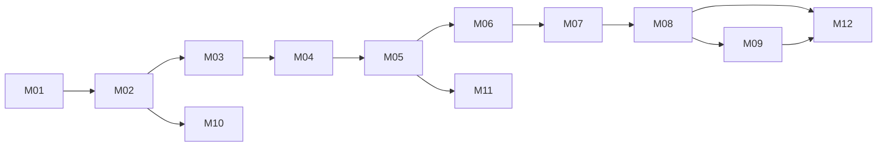

# PitchMind MVP — Dependency-ordered implementation backlog

Status: Proposed. Stories are not implemented by virtue of appearing here. Priority P0 is MVP-critical; P1 optional MVP expansion; P2 advanced.

## Dependency graph

| ID | Priority | Story / acceptance outcome | Depends on | Proof / exit gate |
|---|---|---|---|---|
| M01 | P0 | Repo scaffold, Clean Architecture, .NET + React + test projects | — | Local builds; Domain zero external refs |
| M02 | P0 | Docker local profile + Azure Pipelines PR validation | M01 | Tests in clean runner; local Docker health |
| M03 | P0 | Bicep Azure DEV baseline, identities, network, PostgreSQL, Event Hubs, ACA, ACR, Monitor | M02 | Bicep build/what-if + Azure DEV smoke |
| M04 | P0 | Canonical event contracts, synthetic fixture, ingestion, ordering, dedupe | M03 | 500 events/sec defined burst; duplicate invariants |
| M05 | P0 | PostgreSQL migrations, match state, replay, outbox | M04 | Identical versioned replay; transaction/retry tests |
| M06 | P0 | Deterministic press trigger→response→exploitation→outcome + evidence | M05 | Golden mechanism fixtures and counterexamples |
| M07 | P0 | API/BFF + live timeline and SignalR integration | M06 | Authz, latency and reconnection tests |
| M08 | P0 | React Intelligent Pitch, tactical overlay, evidence inspection, replay | M07 | Playwright golden journey + accessibility |
| M09 | P0 | Foundry explanation adapter, claim validation, bounded fallback | M06 | Unsupported claims rejected; outage fallback |
| M10 | P1 | Managed Redis cache + Service Bus + Functions AutoRecap | M03, M05 | Rebuildable cache, DLQ, idempotent jobs |
| M11 | P1 | Evidence exports and retention controls | M05 | Authorized export, provenance and expiry |
| M12 | P0 | Azure DEV integrated certification and release evidence | M08, M09 | Pipeline green; smoke, E2E, security and rollback |
| M13 | P1 | STAGE/PROD protected promotion and recovery drills | M12 | Approval, immutable digest and restore evidence |
| M14 | P2 | AI Search historical retrieval | M12 | Indexed provenance and authorization |
| M15 | P2 | Data Lake + Data Explorer historical tracking | M12 | Cost-capped ingestion and quality tests |
| M16 | P2 | Azure ML, APIM, partner/broadcast expansion | M14, M15 | Independent business case and security gate |

## Definition of Done
Code merged, reproducible tests, security and architecture checks, documentation updated, telemetry added, and relevant Azure deployment evidence linked. A Bicep skeleton is NOT a successful deployment.

## Suggested MVP critical path
M01→M02→M03→M04→M05→M06→M07→M08→M12, with M09 developed alongside UI after M06. M10/M11 do not block the first live-match demonstration unless explicitly promoted into MVP scope.
