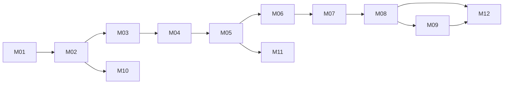

# PitchMind MVP — Dependency-ordered implementation backlog

Status: Proposed. Stories are not implemented by virtue of appearing here. Priority P0 is MVP-critical; P1 optional MVP expansion; P2 advanced.

## Hackathon MVP product epics and development stories

**Submission target:** October 27, 2026. **Status:** proposed planning specification; neither epic nor story creation implies an implemented or accepted feature.

The detailed, Product Owner-governed implementation backlog is maintained in **[HACKATHON-MVP-EPICS.md](HACKATHON-MVP-EPICS.md)**: **12 epics, 59 uniquely numbered development stories, and full traceability to M01–M16**. This document remains the milestone priority, dependency and exit-gate baseline; the epic document expands those milestones into football-first product development stories, engineering acceptance criteria, and release evidence.

**MVP user journey:** Open a clearly labeled synthetic match → understand score, time and match narrative → discover a context-aware tactical Key Moment → select **Why? / Show me** → inspect evidence and replay on a synchronized pitch → request a Microsoft Foundry explanation appropriate to the audience → retain deterministic insight if AI is unavailable.

| Epic | Product / engineering capability | Maps to | Priority |
|---|---|---|---|
| [EP-01](HACKATHON-MVP-EPICS.md#ep-01--engineering-foundation--developer-experience) | Engineering Foundation & Developer Experience | M01–M02 | P0 |
| [EP-02](HACKATHON-MVP-EPICS.md#ep-02--azure-dev-cloud-foundation--environment-isolation) | Azure DEV Cloud Foundation & Environment Isolation | M03 | P0 |
| [EP-03](HACKATHON-MVP-EPICS.md#ep-03--synthetic-football-match-data--reliable-ingestion) | Synthetic Football Match Data & Reliable Ingestion | M04 | P0 |
| [EP-04](HACKATHON-MVP-EPICS.md#ep-04--canonical-match-state-persistence-evidence--replay) | Canonical Match State, Persistence, Evidence & Replay | M05 | P0 |
| [EP-05](HACKATHON-MVP-EPICS.md#ep-05--football-tactical-intelligence--evidence-engine) | Football Tactical Intelligence & Evidence Engine | M06 | P0 |
| [EP-06](HACKATHON-MVP-EPICS.md#ep-06--match-api-live-timeline--secure-real-time-delivery) | Match API, Live Timeline & Secure Real-Time Delivery | M07 | P0 |
| [EP-07](HACKATHON-MVP-EPICS.md#ep-07--intelligent-football-website--explainable-match-experience) | Intelligent Football Website & Explainable Match Experience | M08 | P0 |
| [EP-08](HACKATHON-MVP-EPICS.md#ep-08--microsoft-foundry-grounded-ai-analyst--governed-agents) | Microsoft Foundry Grounded AI Analyst & Governed Agents | M09 | P0 |
| [EP-09](HACKATHON-MVP-EPICS.md#ep-09--operational-enhancements-cache-autorecap--evidence-export) | Operational Enhancements: Cache, AutoRecap & Evidence Export | M10–M11 | P1 |
| [EP-10](HACKATHON-MVP-EPICS.md#ep-10--mvp-certification-hackathon-demo--submission) | MVP Certification, Hackathon Demo & Submission | M12 | P0 |
| [EP-11](HACKATHON-MVP-EPICS.md#ep-11--protected-stageprod-promotions--recovery) | Protected STAGE/PROD Promotions & Recovery | M13 | P1 |
| [EP-12](HACKATHON-MVP-EPICS.md#ep-12--advanced-historical-analytical--enterprise-capabilities) | Advanced Historical, Analytical & Enterprise Capabilities | M14–M16 | P2 |

**Product release rule:** The P0 vertical slice is accepted only when synthetic data, deterministic match truth, one proven pressing mechanism, inspectable evidence, synchronized match UX, bounded AI explanations and Azure DEV deployment work end to end. P1/P2 items remain nonblocking unless explicitly reprioritized. A public sanitized GitHub repository, elevator pitch and publicly accessible working demo video **strictly under two minutes** are submission requirements.

---

## Dependency graph

| ID | Priority | Story / acceptance outcome | Depends on | Proof / exit gate |
|---|---|---|---|---|
| M01 | P0 | Repo scaffold, Clean Architecture, .NET + React + test projects | — | Local builds; Domain zero external refs |
| M02 | P0 | Docker local profile + Azure Pipelines PR validation | M01 | Tests in clean runner; local Docker health |
| M03 | P0 | Bicep Azure DEV baseline, identities, network, PostgreSQL, Event Hubs, ACA, ACR, Monitor | M02 | Bicep build/what-if + Azure DEV smoke |
| M04 | P0 | Canonical event contracts, synthetic fixture, ingestion, ordering, dedupe | M03 | 500 events/sec defined burst; duplicate invariants |
| M05 | P0 | PostgreSQL migrations, match state, replay, outbox | M04 | Identical versioned replay; transaction/retry tests |
| M06 | P0 | Deterministic press trigger→response→exploitation→outcome + evidence | M05 | Golden mechanism fixtures and counterexamples |
| M07 | P0 | API/BFF + live timeline and SignalR integration | M06 | Authz, latency and reconnection tests |
| M08 | P0 | React Intelligent Pitch, tactical overlay, evidence inspection, replay | M07 | Playwright golden journey + accessibility |
| M09 | P0 | Foundry explanation adapter, claim validation, bounded fallback | M06 | Unsupported claims rejected; outage fallback |
| M10 | P1 | Managed Redis cache + Service Bus + Functions AutoRecap | M03, M05 | Rebuildable cache, DLQ, idempotent jobs |
| M11 | P1 | Evidence exports and retention controls | M05 | Authorized export, provenance and expiry |
| M12 | P0 | Azure DEV integrated certification and release evidence | M08, M09 | Pipeline green; smoke, E2E, security and rollback |
| M13 | P1 | STAGE/PROD protected promotion and recovery drills | M12 | Approval, immutable digest and restore evidence |
| M14 | P2 | AI Search historical retrieval | M12 | Indexed provenance and authorization |
| M15 | P2 | Data Lake + Data Explorer historical tracking | M12 | Cost-capped ingestion and quality tests |
| M16 | P2 | Azure ML, APIM, partner/broadcast expansion | M14, M15 | Independent business case and security gate |

## Definition of Done
Code merged, reproducible tests, security and architecture checks, documentation updated, telemetry added, and relevant Azure deployment evidence linked. A Bicep skeleton is NOT a successful deployment.

## Suggested MVP critical path
M01→M02→M03→M04→M05→M06→M07→M08→M12, with M09 developed alongside UI after M06. M10/M11 do not block the first live-match demonstration unless explicitly promoted into MVP scope.
