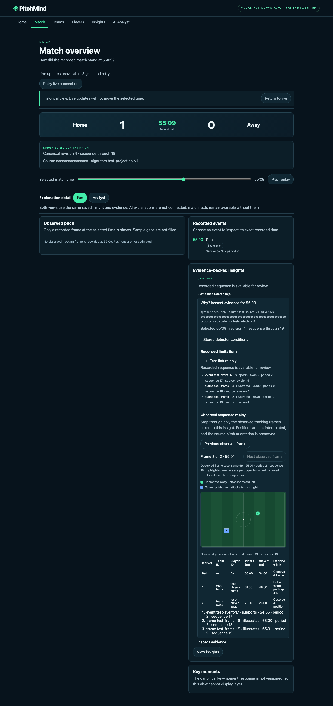
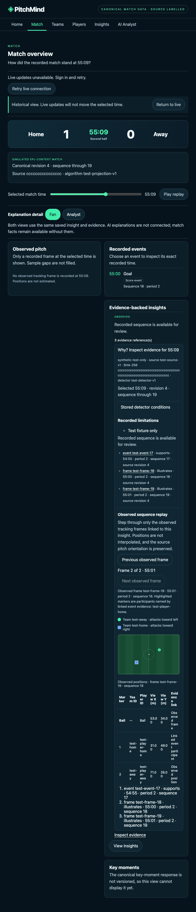
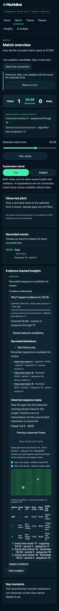
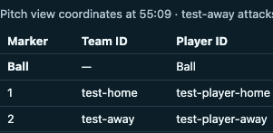
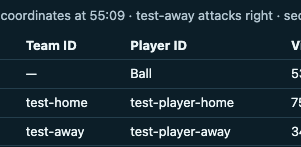

# EP07-S05 observed evidence replay UI — local verification

**Result: IMPLEMENTED LOCALLY; CHANGES FROM INDEPENDENT REVIEW FIXED; RE-REVIEW AND ACCEPTANCE PENDING.** Tested implementation commit: `8ae759f4694de9b735e1cc2006663e8d0a21ef97`, based on current `origin/main` (`1e6b68e8603237393a6851326d58b82e12263ae1`). It does not certify a football source, mark EP07-S05 verified, or accept the story.

## Scope

The evidence disclosure now renders an observed-frame stepper from the exact frames already returned by the canonical evidence API. It validates frame identity, selected-time/sequence bounds, source hash, canonical revision, rights-review state, coordinate metadata and pitch bounds before rendering. It preserves the source pitch orientation and exposes each team’s source attack direction in a text legend. Native previous/next buttons, an announced frame counter, a data table, and the linked sequence give keyboard and non-visual alternatives. It does not interpolate between frames or change the selected match time. Both observed-position tables use readable column widths in horizontally scrollable regions at phone widths, with described left/right arrow-key scrolling and no page-level horizontal overflow. The canonical UI hides every frame whose rights status is not exactly `approved_for_use`; both PostgreSQL tracking-reader paths also filter out unapproved or missing-status payloads before returning frames.

The canonical telemetry contract now requires `source.rightsReviewStatus` to equal `approved_for_use`. The JSON Schema, runtime validator, OpenAPI, API guide and generic contract tests use the same value. A completed review without explicit use approval is rejected, and the frontend hides frames that do not carry that approval. This does not grant the candidate feed approval: its independent rights/privacy and football reviews remain pending, so it is not eligible for canonical admission. Coordinates must declare supported units and origin; candidate-feed units and football realism remain unapproved. Browser fixtures are synthetic test-only values and are not the Manu–Liverpool candidate feed.

The canonical telemetry rights-status contract was tightened without changing route shapes, database, or service boundaries. API documentation and both OpenAPI/JSON Schema representations changed in the same increment. No material service boundary changed, so C4 diagrams did not change.

## Browser snapshots

Playwright captured the expanded evidence replay after stepping to observed frame 19. The viewport sizes are 1440×1000, 768×1024 and 375×812.

The canonical match coordinate table is independently captured at 375 pixels before and after keyboard scrolling.

## Checks actually run

- `frontend`: `npm test -- --run` — **97 passed, 0 failed** (8 files).
- `frontend`: `npm run test:e2e` — **8 passed, 0 failed**. The evidence replay scenario uses keyboard Enter on the disclosure and next-frame button, checks exact 55:00/55:01 frame identity and team direction labels, confirms the pitch and table are exposed, verifies selected match time remains 55:09, and checks no horizontal page overflow at 1440, 768 and 375 pixels. A mobile scenario checks the replay table’s own horizontal scroll region with the right-arrow key. The canonical match table also checks readable columns, arrow-key scrolling, and no page overflow at 375 pixels. Another scenario verifies that a pending-rights tracking response produces no pitch or position table while the canonical score remains visible. Fixtures are intercepted test-only API responses.
- `frontend`: `npm run lint` — passed.
- `frontend`: `npm run build` — passed (TypeScript and Vite production build). Vite reported only third-party Rollup annotation warnings from `@microsoft/signalr`.
- `dotnet test tests/PitchMind.Contracts.Tests/PitchMind.Contracts.Tests.csproj --configuration Release --no-restore --maxcpucount:1 --disable-build-servers -p:NuGetAudit=false` — **153 passed, 1 skipped, 0 failed**; skipped PostgreSQL readiness probe is opt-in.
- `dotnet test PitchMind.slnx --configuration Release --no-restore --nologo --maxcpucount:1 --disable-build-servers -p:NuGetAudit=false` — **496 passed, 29 skipped, 0 failed**. The skipped tests in this database-free invocation are opt-in PostgreSQL checks (28 Infrastructure and 1 API readiness).
- `./scripts/test-postgres.sh` — **64 Infrastructure tests and 154 Contracts tests passed, 0 skipped, 0 failed** against an isolated database on the existing local Docker Postgres service. This includes the regression that a pending-rights tracking row is not returned by the by-ID reader; the isolated database was dropped by the script.
- `node scripts/validate_operating_model.mjs` — passed: 12 epics, 59 stories, 28 Council roles, 5 design skills, 33 discoverable skills, 0 dependency cycles and 2 approval gates.
- `node scripts/test_design_skills.mjs` — passed.
- `node scripts/design-slop-scan.mjs frontend/src/CanonicalEvidenceReplay.tsx` — passed with 0 warnings.
- `git diff --check` — passed after code, story register, packet and evidence report changes.

The Playwright server and VSTest runner initially could not bind loopback under the default sandbox; the local-only commands then passed with approved local execution access. The temp clone also needed a temporary, untracked `PitchMind.Api` content-root symlink for `WebApplicationFactory`; it was removed after testing. No Azure resource or deployment operation occurred.

## PostgreSQL insight evidence rights gate — code commit `86acb95d50ed1b19262489dcf72a17253cfc33a0`

An independent exact-head review found that `PostgresMatchInsightReader` could return persisted insight summaries and raw linked event/frame payloads without verifying the linked row’s explicit source-use status. `ReadAtAsync`, `GetAtAsync`, and `ReadEvidenceAtAsync` now require `payload.source.rightsReviewStatus == approved_for_use` for every linked event/frame. Missing status, any other value, an unresolved reference, or a partially approved evidence set fails closed. This may hide older canonical insights whose payloads lack the field; no approval is inferred from match provenance or the owner’s synthetic-provenance statement.

The PostgreSQL regression covers approved and pending event/frame evidence across list, single-insight and raw-evidence reads, including later selected-time/revision bounds. The browser journey fixture now labels only its test event explicitly approved. `./scripts/test-postgres.sh` passed Infrastructure **64/64** and Contracts **154/154**, with no skips, against an isolated database that the script dropped. `dotnet test PitchMind.slnx -c Release -m:1 --disable-build-servers --no-restore` passed **496**, failed **0**, skipped **29** opt-in PostgreSQL checks; the isolated script above then ran its PostgreSQL checks with no skips. The API test project required a temporary `PitchMind.Api` symlink in this worktree; it was removed after the run. Council validation and `git diff --check` passed.

This does not add source approval metadata to production events, admit the Manu–Liverpool feed, or establish that existing rows meet the new gate. Independent static exact-code re-review of `86acb95d50ed1b19262489dcf72a17253cfc33a0` found no actionable findings; the reviewer did not run tests or modify files. Hosted CI, human screen-reader/contrast review, source/football review, and Product Owner acceptance remain pending. The PR remains a draft.

## Design and verification gaps

Automated checks do not establish contrast compliance, screen-reader behavior, football correctness, or suitability of the candidate source data. No axe scan, measured contrast check, manual screen-reader session, or human accessibility/design review was performed. The exact-head review of commit `8fe1e89c5b2a04880849d067847c7bc8a5ea4a06` found a PostgreSQL read-path rights gap and a keyboard-inaccessible replay table; this revision fixes both with a fail-closed UI/API read path and arrow-key scrolling. Independent re-review of the new head and hosted CI are pending. Product Owner acceptance is pending. EP07-S05 remains unverified and unaccepted.

## Review handoff

Request independent frontend/UX and accessibility review of the exact PR head. Reviewers should specifically assess the responsive pitch/table at 375 pixels, frame and team labeling, marker distinguishability, screen-reader reading order, contrast, and the explicit rights-approval gate. Product Owner acceptance remains a separate decision after those reviews and source/football evidence are available.
