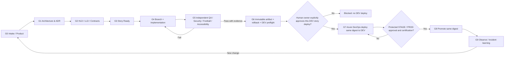
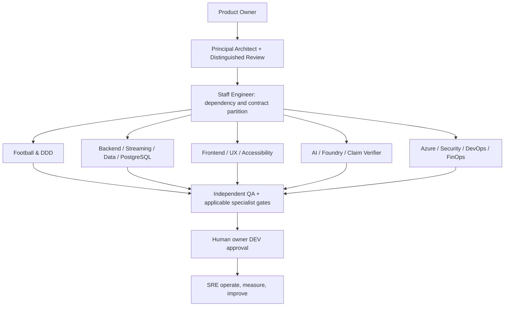

# PitchMind — Operating model diagrams

These are governance and **logical target** diagrams; they do not prove Azure components or CI gates were run. [Read the operating model](ENGINEERING-OPERATING-MODEL.md) for full authority and gate criteria.

## From story to operation

**Accountability:** Product Owner accepts product value; Principal Architect owns architecture decisions; a named story DRI implements; specialist gates provide independent safety and correctness checks; the **human repository owner** approves the individual DEV story deployment. Protected Azure DevOps Environment approvals additionally apply for STAGE/PROD. A PR/merge is never deployment consent.

## Delivery handoffs

Engage only the relevant specialist skills for a particular story, rather than requiring 28 simultaneous approvals.

## C4 realization: current demonstration versus target canonical cloud path

```mermaid
flowchart TB
  subgraph CURRENT["CURRENT: read-only synthetic vertical slice"]
    BROWSER["React/Vite"] --> API["ASP.NET API / SyntheticMatchService"]
    API --> FIXTURE["Immutable seeded fixture"]
    FIXTURE --> RULES["Selected-time / pressing candidate / deterministic fallback"]
  end
  subgraph TARGET["TARGET: cloud integration and certification not yet verified"]
    PROD["Synthetic telemetry producer"] --> EH["Event Hubs / matchId"]
    EH --> WORKER["Azure Container Apps event worker"]
    WORKER --> POSTGRES["PostgreSQL canonical events, projections, evidence, outbox"]
    POSTGRES --> BUS["Outbox dispatcher / Service Bus commands"]
    BUS --> AGENT["Bounded Foundry agent"]
    AGENT --> VERIFY["Independent evidence claim verifier"]
    POSTGRES --> BFF["Selected-time API/BFF"]
    VERIFY --> BFF
    BFF --> UI["Client / synchronized pitch and timeline"]
    BFF --> SIG["SignalR cursor / backfill"]
    SIG --> UI
  end
```

**Interpretation:** no arrow asserts a tested network dependency. The AI path may supply only validated derived language, **never canonical score/event mutations**. Redis, Azure Functions, AI Search, ADX and Front Door are optional services to activate only when a feature and cost justify them. C4 diagrams and IaC do not substitute for cloud smoke evidence.